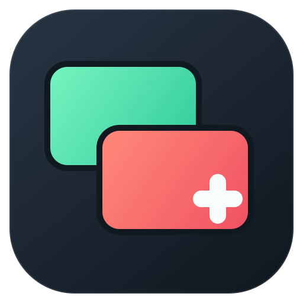
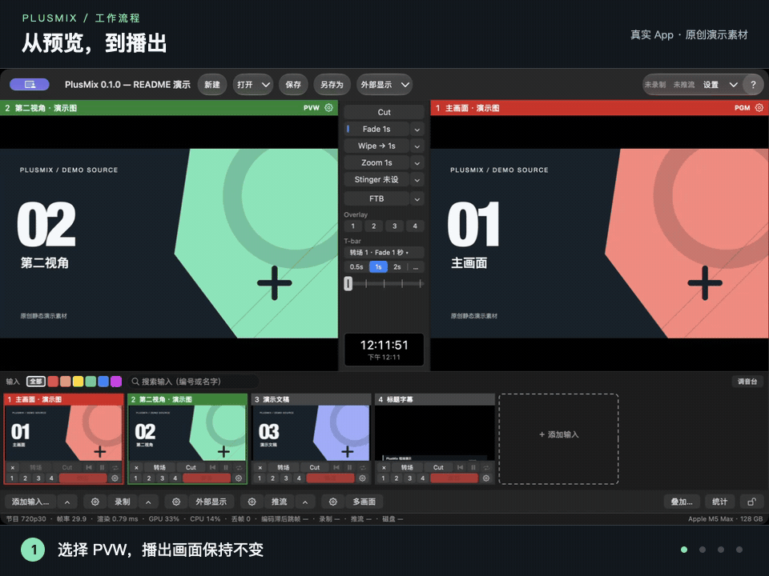
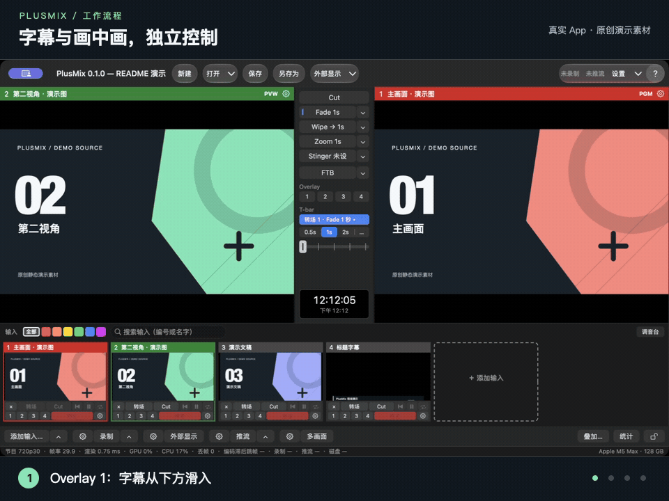

<p align="center">
  
</p>

# PlusMix

Apple Silicon 原生的多机位导播台：编号输入（摄像头 / 采集卡、DeckLink、屏幕、文件、图片、NDI、纯音频）、PGM / PVW 范式、Cut / Fade / Wipe / Zoom / Stinger 转场、
T-bar、FTB、四个叠加通道、四条音频总线，输出到录制（含 ISO 分路）、推流（RTMP / RTMPS / SRT）、NDI、第二块显示器、虚拟摄像头和多画面。
Swift 6（严格并发）+ Metal，macOS 15+，Apache-2.0。
代码名 Switcher：模块（`Switcher*`）、命令行工具（`switcher-headless` / `frameprobe`）、scheme、bundle id（`com.plusmix.switcher`）仍叫这个名字；界面、`PlusMix.app` 与发布产物用产品名 PlusMix。

**状态**：0.1.0 第一版功能已全部合入，之后又做了一轮界面改版（工具条、三段式底栏、一个设置窗、转场槽、播放控制与推流 / 录制状态窗……，0.1.x）。检查点 G2–G8 的自动化门槛通过（[测试报告索引](docs/testing/README.md)），
但还没有发布版：G8 判 0.1.1 还不发，只差人工检查清单与签名公证（8 小时长稳已复验通过、已知崩溃已修，见 [已知问题](docs/KNOWN_ISSUES.md)）。
现在能用来干活，但请先在自己的设备上按 [测试标准](docs/testing/测试标准.md) 验一遍。

## 看看它怎么工作

下面是当前 App 的**真实窗口录制**，使用原创演示素材，无需摄像头或网络。操作由本地 API 驱动，与界面按钮共用同一套命令；GIF 无音频。

**先预览，再播出。** 左侧绿色 PVW 选好下一路，右侧红色 PGM 保持当前节目；随后用 Cut 硬切、Fade 淡变或 Wipe 擦除切上播出。



**叠加分别控制。** 字幕从下方滑入，再加入画中画；两个通道可以独立收起，回到干净的节目画面。



[查看静态界面](docs/media/demo-poster.png) · [图标源文件、素材说明与重新生成](docs/media/README.md)

## 一分钟上手

要求：Apple Silicon Mac、macOS 15 以上、Xcode 26.x 或 27.x、Homebrew（`brew install xcodegen jq ffmpeg mediamtx`）。

克隆本仓库后在仓库根目录：

```bash
make gen build-app && open .build/DerivedData/Build/Products/Debug/PlusMix.app
```

1. 节目 › 打开… 选 `Samples/event/event.switcher.json`（四路合成源 + 多画面 + 四路 ISO，不需要任何设备；[示例说明](Samples/README.md)）。
2. 键盘 `2` 选 2 号到 PVW，`空格` Cut，`回车` Fade，`F` 渐黑；底栏"录制"录到 `~/Movies/PlusMix/`。
3. 输入 › 添加输入…（⌘I）接自己的摄像头。屏幕录制权限要在 系统设置 › 隐私与安全性 里手动给（[故障排查](docs/user/故障排查.md#1-权限)）。

不开界面、纯命令行跑同一个节目 30 秒并写每秒统计：

```bash
swift build -c release --package-path Tools/switcher-headless && Tools/switcher-headless/.build/release/switcher-headless run --show Samples/event/event.switcher.json --duration 30 --audio-device null --stats /tmp/stats.jsonl
```

## 文档

| 看什么 | 在哪 |
|---|---|
| 用户手册：概念、每种输入的接法、输出、快捷键、故障排查（中 / 英） | [docs/user/](docs/user/README.md) · [English](docs/user/en/README.md) |
| 示例节目：教会 / 教室 / 活动 | [Samples/](Samples/README.md) |
| 本地 API（HTTP + WebSocket）、示例、第三方面板兼容层 | [docs/api/](docs/api/README.md)、[命令参考](docs/api.md) |
| Stream Deck、Companion、外部 tally | [docs/integrations/](docs/integrations/README.md) |
| 测试标准（公开）、检查点报告索引、设备兼容性表 | [docs/testing/](docs/testing/README.md) |
| 设计方案、后续方案、内部测试标准 | [docs/spec/](docs/spec/) |
| 契约（所有包共用的类型与 JSON 字段） | [docs/CONTRACTS.md](docs/CONTRACTS.md) |

## 构建与测试

| 目标 | 做什么 |
|---|---|
| `make gen` | XcodeGen 由 `project.yml` 生成 `Switcher.xcodeproj`（不入库）。真实签名：`DEVELOPMENT_TEAM=你的TeamID make gen`（虚拟摄像头的系统扩展必须这样签） |
| `make build` | 六个包、两个命令行工具、App 全部编译 |
| `make test` | 包的 `swift test`（G8 时 861 个用例）、工具冒烟、App 的 `xcodebuild test`（244 个） |
| `make lint` | 禁词 / 版本号 / 包约束、依赖方向、目录归属、文档链接、随包手册与 `docs/user/` 一致 |
| `make manual` | 由 `docs/user/` 重生成随 App 打包的 HTML 手册（`App/Resources/Help/`） |
| `make gate4` | 10 分钟集成场景（V1–V7、A1–A4、E1–E3、E5、C1–C4）并出报告 |

改了 `docs/user/` 之后跑 `make manual`（= `python3 docs/tools/build-help.py`），重生成随 App 打包的 HTML 手册（`App/Resources/Help/`，帮助 › PlusMix 使用手册 打开的就是它）；忘了跑 `make lint` 会红。
单独跑一个包：`swift test --package-path Packages/SwitcherCore`。可选的第三方 SDK：NDI SDK for Apple（默认 `/Library/NDI SDK for Apple`，环境变量 `NDI_SDK_DIR`）、
DeckLink SDK（`DECKLINK_SDK_DIR` 或 `~/SDKs/DeckLink`）；没有时对应输入 / 输出编成空实现，其他功能不受影响。

权限：摄像头、麦克风首次访问弹窗；屏幕录制没有弹窗，要在 系统设置 › 隐私与安全性 › 屏幕与系统音频录制 里手动加；没设 Team ID 的 ad-hoc 签名每次重编都会重新问。
虚拟摄像头（系统扩展）和公证需要付费开发者账号。

## 目录

```
Packages/SwitcherCore      引擎：SwitcherContracts（契约）/ SwitcherEngine（时钟、帧槽、状态机）/ SwitcherRender（Metal）
Packages/SwitcherInputs    各输入；DeckLink、NDI 是可选 target      Packages/SwitcherAudio     混音（C 热路径）、重采样、效果、表
Packages/SwitcherOutputs   编码、录制、推流、NDI 发送、外部显示、虚拟摄像头桥、ISO
Packages/SwitcherControl   命令总线、HTTP / WS API、快捷键、MIDI、tally；VMixCompat 独立 target 默认关
Packages/SwitcherTestKit   合成源、帧号解码、Stats 采集、场景执行器
App/                       AppKit 主程序             CameraExtension/           CMIO 系统扩展（虚拟摄像头）
Tools/switcher-headless    无界面跑引擎              Tools/frameprobe           分析输出文件里的帧号 / 闪光 / click
Tools/streamdeck-plugin    Stream Deck 插件          Samples/                   示例节目与素材
Tests/Fixtures  Tests/References  scenarios/  baselines/  reports/   测试素材、参考图、场景、基线、报告
docs/user  docs/api  docs/testing  docs/integrations  docs/spec  docs/CONTRACTS.md  docs/OWNERSHIP.md  docs/contract-changes/
scripts/                   lint、依赖方向、目录归属检查，gate 脚本，网络损伤，MediaMTX 配置
```

依赖方向只允许 `SwitcherContracts ← SwitcherCore ← {Inputs, Audio, Outputs, Control} ← TestKit ← Tools / App`，`make lint` 会拦反向依赖。
热路径规则：渲染线程每帧零分配；音频回调内无锁、无分配、无日志、无系统调用，热路径用 C（[设计方案 §3](docs/spec/导播台设计方案.md)）。

## 贡献

- 许可证 **Apache-2.0**（[LICENSE](LICENSE)）；内嵌的第三方源码及其许可证在 [THIRD_PARTY/](THIRD_PARTY/)。不接受 GPL 代码。
- 贡献用 **DCO** 签字，不用 CLA：每个提交加 `Signed-off-by: 你的名字 <邮箱>`（`git commit -s`），表示你有权按 Apache-2.0 提交这段代码。
- 提交前 `make lint` 和相关包的 `swift test` 要绿；改公共契约（`SwitcherContracts` 的公开类型、JSON 字段名）先在 [docs/contract-changes/](docs/contract-changes/README.md) 写提案。
- 产品文案、代码、界面里不出现竞品的名字、图标、文案和默认快捷键表（`make lint` 会扫）；唯一例外是第三方 API 兼容层的模块名，它的法律说明见 [docs/api/vmix-compat.md](docs/api/vmix-compat.md)。
- 设备实测结果比代码更缺人手：按 [设备兼容性表](docs/testing/设备兼容性.md) 的模板提交。
- 报 bug 附上 `stats.jsonl` 和能复现的节目文件（[故障排查 §9](docs/user/故障排查.md#9-日志与诊断)）。

这个仓库由多个 AI 辅助会话按 [docs/plan/](docs/plan/导播台落地方案.md) 的分工推进，每个会话只动 [docs/OWNERSHIP.md](docs/OWNERSHIP.md) 里划给它的目录；仓库约定在 [CLAUDE.md](CLAUDE.md)。
