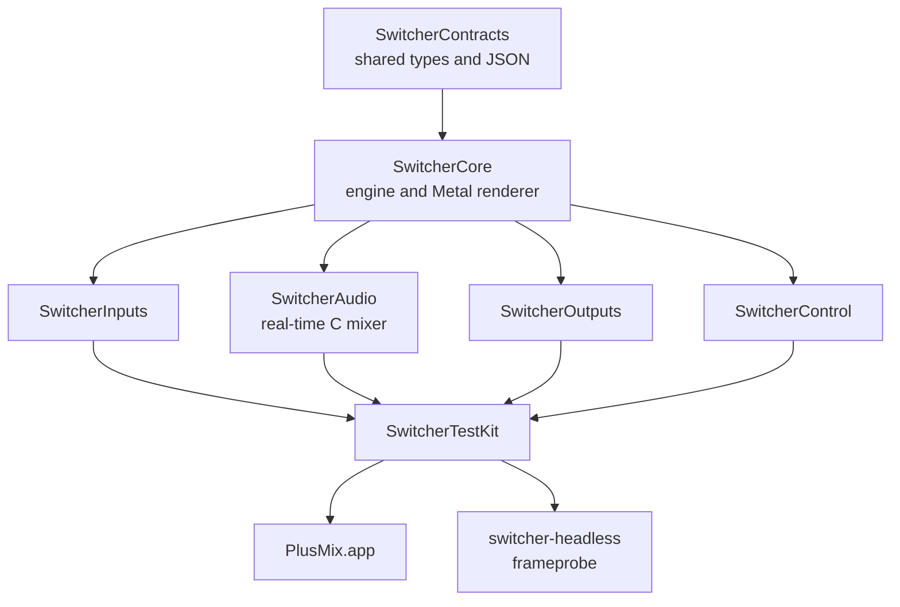

<p align="center">
  
</p>

<h1 align="center">PlusMix</h1>

<p align="center">
  <strong>A native multi-camera live production switcher for Apple Silicon Macs.</strong><br>
  Cameras, capture cards, screens, files and NDI® in. Recording, streaming, NDI®, displays and a virtual camera out.
</p>

<p align="center">
  <a href="LICENSE"></a>
  
  
  
  
  
</p>

<p align="center">
  <strong>English</strong> · <a href="README.zh-CN.md">简体中文</a>
</p>

<p align="center">
  
</p>

<p align="center">
  <a href="#see-it-in-action">Demo</a> ·
  <a href="#features">Features</a> ·
  <a href="#quick-start">Quick start</a> ·
  <a href="#project-status">Status</a> ·
  <a href="#documentation">Docs</a> ·
  <a href="#architecture">Architecture</a> ·
  <a href="#contributing">Contributing</a>
</p>

PlusMix is a production switcher in the Program / Preview tradition, written from scratch for macOS. It has numbered inputs, a transition column with a T-bar, four overlay channels, a four-bus audio mixer, and the outputs a small live show needs. Pictures are composited on the GPU with Metal, and sound runs through a real-time mixing engine written in C. The app is called PlusMix; inside the code it keeps its code name, **Switcher**.

## See it in action

**Preview first, then take it to air** (the clip above). Pick the next shot on the green Preview monitor while the red Program monitor stays on air, then take it with a Cut, a Fade or a Wipe.

**Overlays on their own channels.** A lower third slides in, a picture-in-picture fades in, and each channel leaves on its own, back to a clean program.


Both clips are real window recordings of the current build, made with original demo material. They are driven through the local API, which sends the same commands as the buttons; no camera or network is involved, and the GIFs have no sound. See also the [still screenshot](docs/media/demo-poster.png) and [how the icon and demos are made](docs/media/README.md) (Chinese).

## Features

### Inputs

- Up to 16 numbered inputs: cameras and capture devices (USB, HDMI or SDI to USB, Continuity Camera), Blackmagic DeckLink cards, screens, windows and apps, video files, still images, NDI® sources, audio-only devices and synthetic test patterns.
- Video files loop, pause, restart and play at 0.1–8× speed, and can restart by themselves when taken to Program.
- Per-input crop and position, a chroma keyer with an eyedropper on the live picture, audio delay compensation, and channel mapping for multichannel devices.

### Switching and transitions

- Program / Preview with Cut and four transition slots. Each slot holds a Fade, a Wipe (five directions), a Zoom or a Stinger with its own duration; ⌥1–⌥4 run a slot and Return runs the current one.
- A horizontal T-bar for manual transitions, and fade to black with an adjustable duration.
- Frame-accurate timing: a cut lands on the exact program tick, and the test harness checks transition curves frame by frame.

### Overlays and multiview

- Four overlay channels, full frame or picture-in-picture, with fade or slide-in animations, borders, nine anchor positions and an optional preview on PVW.
- A multiview with name labels and live audio meters, in its own window or on any display.

### Audio

- Faders, mute, pan, solo (PFL / AFL) and audio-follow-video on every input, and four buses: Master, Bus A, Bus B and a headphone bus.
- EQ, compressor and limiter on every bus; EQ and a dynamics stage on every input. The effect chain's latency is matched by delaying the picture the same amount, so recordings, streams and what you monitor all stay in sync.
- Loudness readouts (momentary, short-term, integrated, LRA and true peak), on top of a real-time audio path written in C: no locks, allocations, logging or system calls in the audio callback.

### Outputs

- Recording to H.264, HEVC or ProRes in crash-safe fragmented .mov files, with an optional MP4 remux after stopping, plus synchronized ISO recording of individual inputs.
- Streaming to several destinations at once over RTMP, RTMPS or SRT, with service presets (YouTube, Twitch, Facebook, Bilibili, Douyin, Kuaishou, WeChat Channels or custom), per-destination quality, automatic reconnect and stream authentication.
- NDI® output, full-screen external displays, and a virtual camera for video-call apps (the virtual camera needs a Developer ID–signed build).
- Disk protection with a minimum free space and a fallback folder.

### Control

- Editable keyboard shortcuts with an action picker, MIDI mapping, a Stream Deck plugin, and a local HTTP + WebSocket API with 42 commands.
- A read-only tally stream for tally lights, an optional compatibility layer for existing control panels such as Companion (off by default), and an interface lock.

### Built to be measured

- Every frame and audio block is stamped with host time on arrival, and encoder timestamps come from the program clock.
- One statistics structure feeds the UI, the API and the tests, and can be written to `stats.jsonl` once a second.
- Synthetic sources carry frame numbers, flashes and clicks. `frameprobe` reads them back out of recordings to measure drops, A/V sync and transition timing. A 10-minute integration run gates every checkpoint, and an 8-hour soak is part of the release gate.

## Quick start

You need an Apple Silicon Mac with macOS 15 or later, Xcode 26 or 27, and [Homebrew](https://brew.sh).

```bash
brew install xcodegen jq ffmpeg mediamtx
git clone https://github.com/PLus123456/plusmix.git
cd plusmix
make gen build-app && open .build/DerivedData/Build/Products/Debug/PlusMix.app
```

1. **Show › Open…** and pick `Samples/event/event.switcher.json`: four synthetic cameras, a multiview and four ISO recordings, no hardware needed ([sample shows](Samples/README.md), Chinese).
2. Press `2` to put input 2 on Preview, `Space` to cut, `Return` to run the current transition and `F` to fade to black.
3. Click **Record** in the bottom bar. Files go to `~/Movies/PlusMix/`.
4. **Input › Add Input…** (⌘I) connects your own camera. Screen recording permission has to be granted by hand in System Settings ([Troubleshooting › Permissions](docs/user/en/troubleshooting.md#1-permissions)).

To run the same show for 30 seconds without the interface and write per-second statistics:

```bash
swift build -c release --package-path Tools/switcher-headless
Tools/switcher-headless/.build/release/switcher-headless run --show Samples/event/event.switcher.json \
  --duration 30 --audio-device null --stats /tmp/stats.jsonl
```

The interface comes in English and Simplified Chinese and follows the system language.

## Project status

> [!NOTE]
> **Pre-release.** All 0.1.0 features are in, along with the 0.1.x interface redesign (toolbar, three-part bottom bar, a single Settings window, transition slots, playback controls, stream and recording status windows). 0.1.1 has not shipped yet: one high-severity defect is still open, the manual checklist and an 8-hour soak on the current code are pending, and there are no signed or notarized builds, so for now you build from source. Details are in the [known issues](docs/KNOWN_ISSUES.md) (Chinese).

| Latest checkpoint: G14, 2026-11-08 | Result |
|---|---|
| Package tests (`swift test`, six packages) | 1,097 cases: 1,070 pass, 25 skipped (hardware, SDK or signing), 2 environment-dependent |
| App tests (`xcodebuild test`, two runs) | 336 cases per run: 330 pass, 4 skipped, 2 display-dependent |
| 10-minute integration run | all automatic video, audio, encoder and control checks pass |
| Performance baseline | no regression against the previous checkpoint |

Full report: [reports/G14.md](reports/G14.md) (Chinese). How things are measured: [testing summary](docs/testing/en/README.md).

## Documentation

| Topic | Where |
|---|---|
| User manual: concepts, inputs, outputs, shortcuts, settings, troubleshooting | [English](docs/user/en/README.md) · [中文](docs/user/README.md) |
| Local API (HTTP + WebSocket) with examples | [docs/api/](docs/api/README.md) · [command reference](docs/api.md) (Chinese) |
| Stream Deck, Companion and tally | [docs/integrations/](docs/integrations/README.md) (Chinese) |
| Sample shows: church, classroom, event | [Samples/](Samples/README.md) (Chinese) |
| Testing: metrics, tools and checkpoint reports | [English summary](docs/testing/en/README.md) · [中文](docs/testing/README.md) |
| Design spec, follow-up plan and internal test standard | [docs/spec/](docs/spec/) (Chinese) |
| Contracts: the types and JSON fields shared by all packages | [docs/CONTRACTS.md](docs/CONTRACTS.md) (Chinese) |
| Release engineering: signing, notarization, updates | [docs/release/](docs/release/README.md) (Chinese) |

## Build and test

| Command | What it does |
|---|---|
| `make gen` | Generates `Switcher.xcodeproj` from `project.yml` with XcodeGen (the project file is not checked in). |
| `make build` | Builds the six packages, both command-line tools and the app. |
| `make test` | Runs `swift test` for every package, a smoke run of both tools, and the app's `xcodebuild test`. |
| `make lint` | Checks forbidden words, version numbers, package rules, dependency direction, directory ownership, doc links and the bundled manual. |
| `make manual` | Rebuilds the HTML manual bundled with the app from `docs/user/`. |
| `make gate4` | Runs the 10-minute integration scenario and writes a report. |

To test a single package: `swift test --package-path Packages/SwitcherCore`.

**Optional SDKs.** The NDI® SDK for Apple (`/Library/NDI SDK for Apple`, or set `NDI_SDK_DIR`) and the Blackmagic DeckLink SDK (`DECKLINK_SDK_DIR`, or `~/SDKs/DeckLink`). Without them, those inputs and outputs build as empty stubs and everything else works.

**Signing.** Builds are ad-hoc signed by default. With an Apple Development identity in your keychain, `DEVELOPMENT_TEAM=<Team ID> make gen build-app` signs for local development, and macOS then remembers camera, microphone and screen-recording permissions across rebuilds. Developer ID signing, notarization and the virtual camera's system extension need a paid Apple Developer account ([signing](docs/release/signing.md), Chinese).

**Permissions.** macOS asks for camera and microphone access on first use. Screen recording has no prompt: add the app under System Settings › Privacy & Security › Screen & System Audio Recording.

## Architecture



Arrows point from a module to the modules built on top of it, and `make lint` rejects any dependency in the other direction. Inside SwitcherCore, the engine and the renderer only see the contracts, never each other.

The real-time rules from the [design spec](docs/spec/导播台设计方案.md) (Chinese) are enforced in review and by tests: the render thread allocates nothing per frame; the audio callback takes no locks, allocates nothing, logs nothing and makes no system calls, and its hot path is written in C. Every frame and audio block is stamped with host time (`mach_absolute_time`) where it enters.

| Path | What lives there |
|---|---|
| `Packages/SwitcherCore` | The contracts, the engine (clock, frame slots, state machine) and the Metal renderer |
| `Packages/SwitcherInputs` | Every input kind; DeckLink and NDI® are optional targets |
| `Packages/SwitcherAudio` | The mixer (C hot path), resampling, effects and meters |
| `Packages/SwitcherOutputs` | Encoding, recording, ISO, streaming, NDI® output, external displays and the virtual camera bridge |
| `Packages/SwitcherControl` | Command bus, HTTP / WebSocket API, hotkeys, MIDI, tally and the compatibility layer |
| `Packages/SwitcherTestKit` | Synthetic sources, frame-number decoding, statistics and the scenario runner |
| `App/` · `CameraExtension/` | The AppKit app, and the CMIO system extension behind the virtual camera |
| `Tools/` | `switcher-headless`, `frameprobe` and the Stream Deck plugin |
| `Samples/` · `scenarios/` · `baselines/` · `reports/` | Sample shows, test scenarios, performance baselines and checkpoint reports |
| `docs/` | Manual, API, integrations, testing, spec, contracts and the development plan |

The code name **Switcher** stays on the modules (`Switcher*`), the command-line tools, the Xcode scheme and the bundle id (`com.plusmix.switcher`). The app, its windows and the release files are called PlusMix.

## How this project is built

PlusMix is developed by AI-assisted coding sessions working in parallel git worktrees. Each session follows one prompt in [docs/plan/prompts/](docs/plan/prompts/) and may only touch the directories assigned to it in [docs/OWNERSHIP.md](docs/OWNERSHIP.md). Checkpoint sessions (G2 to G14 so far) merge the finished branches, run the full test suite and write a report in [reports/](reports/). The plan, every prompt and every report live in this repository; the conventions are in [CLAUDE.md](CLAUDE.md) (Chinese).

## Contributing

- PlusMix is licensed under **Apache-2.0** ([LICENSE](LICENSE)). Bundled third-party code and its licenses are in [THIRD_PARTY/](THIRD_PARTY/); GPL code is not accepted.
- Sign off your commits under the **DCO** (`git commit -s`); there is no CLA.
- Before sending a change, `make lint` and `swift test` for the packages you touched should pass. Changes to the public contracts (public types in `SwitcherContracts`, JSON field names) start as a proposal in [docs/contract-changes/](docs/contract-changes/README.md).
- Product text, code and UI never use a competitor's name, icons, copy or default shortcut table, and `make lint` checks this. The only exception is the module name of the third-party API compatibility layer, explained in its [legal note](docs/api/vmix-compat.md).
- Results from real devices are the most wanted contribution: fill in the [device compatibility template](docs/testing/设备兼容性.md) (Chinese).
- For bug reports, attach `stats.jsonl` and a show file that reproduces the problem ([Troubleshooting › Logs and diagnostics](docs/user/en/troubleshooting.md#9-logs-and-diagnostics)).

## Acknowledgements

PlusMix builds on [HaishinKit](https://github.com/HaishinKit/HaishinKit.swift) (RTMP), [SwiftNIO](https://github.com/apple/swift-nio) and [Hummingbird](https://github.com/hummingbird-project/hummingbird) (the local API), [Sparkle](https://sparkle-project.org) (updates), [libsamplerate](https://github.com/libsndfile/libsamplerate) and [libebur128](https://github.com/jiixyj/libebur128) (audio), and the NDI® SDK.

## License

PlusMix is released under the [Apache License 2.0](LICENSE).

NDI® is a registered trademark of Vizrt NDI AB. The optional compatibility layer imitates a third-party control protocol only so that existing control panels keep working; protocol and product names belong to their owners, and PlusMix is not affiliated with them.
