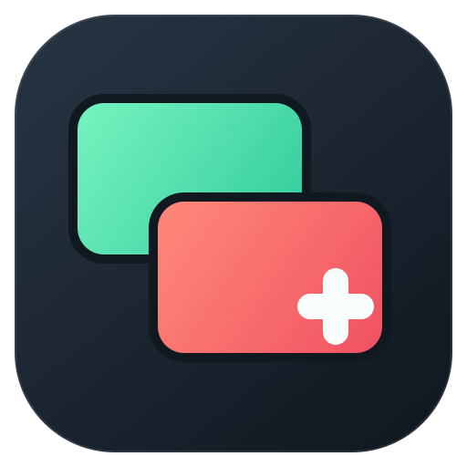
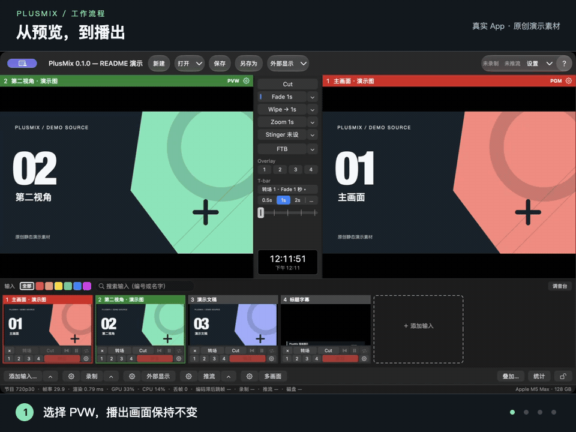
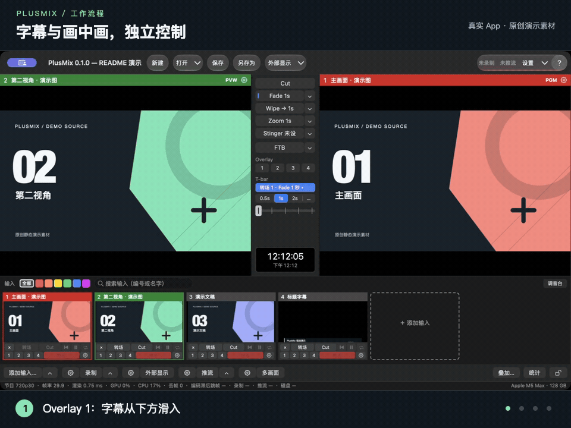
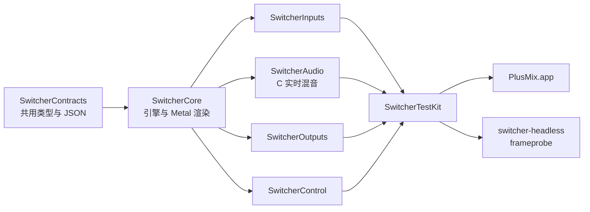

<p align="center">
  
</p>

<h1 align="center">PlusMix</h1>

<p align="center">
  <strong>Apple Silicon 原生的多机位导播台。</strong><br>
  摄像头、采集卡、屏幕、文件、NDI® 进来；录制、推流、NDI®、外接显示器、虚拟摄像头出去。
</p>

<p align="center">
  <a href="LICENSE"></a>
  
  
  
  
  
</p>

<p align="center">
  <a href="README.md">English</a> · <strong>简体中文</strong>
</p>

<p align="center">
  
</p>

<p align="center">
  <a href="#看看它怎么工作">演示</a> ·
  <a href="#功能">功能</a> ·
  <a href="#一分钟上手">上手</a> ·
  <a href="#项目状态">状态</a> ·
  <a href="#文档">文档</a> ·
  <a href="#架构">架构</a> ·
  <a href="#贡献">贡献</a>
</p>

PlusMix 是按 PGM / PVW 范式从零写的 macOS 导播台：编号输入、带 T-bar 的转场列、四个叠加通道、四条总线的调音台，以及一场小型直播要用的各种输出。画面用 Metal 在 GPU 上合成，声音走 C 写的实时混音引擎。App 叫 PlusMix，代码里沿用代码名 **Switcher**。

## 看看它怎么工作

**先预览，再播出**（页首那段）。左侧绿色 PVW 选好下一路，右侧红色 PGM 保持当前节目；随后用 Cut 硬切、Fade 淡变或 Wipe 擦除切上播出。

**叠加分别控制。** 字幕从下方滑入，再加入画中画；两个通道可以独立收起，回到干净的节目画面。



两段都是当前 App 的**真实窗口录制**，使用原创演示素材。操作由本地 API 驱动，与界面按钮共用同一套命令；不需要摄像头或网络，GIF 无音频。另见 [静态界面](docs/media/demo-poster.png) · [图标源文件、素材说明与重新生成](docs/media/README.md)。

## 功能

### 输入

- 最多 16 路编号输入：摄像头与采集卡（USB、HDMI / SDI 转 USB、连续互通相机）、Blackmagic DeckLink、屏幕 / 窗口 / 应用、视频文件、图片、NDI® 源、纯音频设备、合成测试源。
- 视频文件可循环、暂停、从头播，0.1–8 倍速播放，可设"切上 PGM 时从头播"。
- 每路裁切与位置、在实时画面上取色的抠像、音频延迟补偿、多声道设备的声道映射。

### 切换与转场

- PGM / PVW 范式：Cut 加四个转场槽，每个槽是 Fade、Wipe（五个方向）、Zoom 或 Stinger，时长各自设；⌥1–⌥4 执行对应的槽，回车执行当前槽。
- 横放的 T-bar 手推转场，渐黑（FTB）时长可调。
- 按帧对齐：Cut 落在节目时钟的准确拍点上，转场曲线由测试工装逐帧核对。

### 叠加与多画面

- 四个叠加通道：整幅或画中画，淡入或滑入动画，边框，九宫格锚点，可选在 PVW 上预览。
- 多画面带名字标签与实时电平表，可以开独立窗口，也可以送到任意一块显示器。

### 音频

- 每路有推子、静音、声像、独听（PFL / AFL）与音频跟随视频；四条总线：Master、Bus A、Bus B、耳机总线。
- 每条总线有 EQ / 压缩 / 限幅，每路输入有 EQ 与一个动态格。效果链的延迟用画面延后同样毫秒数的办法补齐：录制、推流与监听的音画都对得上。
- 响度读数（瞬时 / 短期 / 积分 / LRA / 真峰值）；实时音频路径用 C 写，音频回调里无锁、无分配、无日志、无系统调用。

### 输出

- 录制 H.264 / HEVC / ProRes，边录边存片段的 .mov（崩溃可恢复），停止后可转 MP4；可按路同步做 ISO 分路录制。
- 同时推多个目的地（RTMP / RTMPS / SRT），带服务预设（微信视频号、抖音、哔哩哔哩、快手、YouTube、Facebook、Twitch、自定义）、每个目的地单独的质量、自动重连与推流鉴权。
- NDI® 发送、全屏外接显示器、给视频会议软件用的虚拟摄像头（虚拟摄像头需要 Developer ID 签名的构建）。
- 磁盘保护：最低剩余空间与备用目录。

### 控制

- 可编辑的快捷键与选动作面板、MIDI 映射、Stream Deck 插件，以及有 42 条命令的本地 HTTP + WebSocket API。
- 只读 tally 流（给 tally 灯用）、给 Companion 等现成控制面板用的兼容层（默认关）、界面锁。

### 能量化验证

- 每一帧、每个音频块在入口打 host time 时间戳，编码时间戳用节目时钟的拍点。
- 界面、API、测试读同一份统计结构，可以每秒写一行 `stats.jsonl`。
- 合成源带帧号、闪光与 click，`frameprobe` 从录像里把它们读回来，量丢帧、音画同步与转场时间。每个检查点都跑 10 分钟集成场景，发布前还要过 8 小时长稳。

## 一分钟上手

要求：Apple Silicon Mac、macOS 15 以上、Xcode 26 或 27、[Homebrew](https://brew.sh)。

```bash
brew install xcodegen jq ffmpeg mediamtx
git clone https://github.com/PLus123456/plusmix.git
cd plusmix
make gen build-app && open .build/DerivedData/Build/Products/Debug/PlusMix.app
```

1. 节目 › 打开… 选 `Samples/event/event.switcher.json`：四路合成源 + 多画面 + 四路 ISO，不需要任何设备（[示例说明](Samples/README.md)）。
2. 键盘 `2` 选 2 号到 PVW，`空格` Cut，`回车` 执行当前转场，`F` 渐黑。
3. 点底栏"录制"，文件录到 `~/Movies/PlusMix/`。
4. 输入 › 添加输入…（⌘I）接自己的摄像头。屏幕录制权限要在 系统设置 › 隐私与安全性 里手动给（[故障排查](docs/user/故障排查.md#1-权限)）。

不开界面、纯命令行跑同一个节目 30 秒并写每秒统计：

```bash
swift build -c release --package-path Tools/switcher-headless
Tools/switcher-headless/.build/release/switcher-headless run --show Samples/event/event.switcher.json \
  --duration 30 --audio-device null --stats /tmp/stats.jsonl
```

界面有简体中文与英文两种，跟随系统语言。

## 项目状态

> [!NOTE]
> **预发布。** 0.1.0 的功能已全部合入，之后又做了一轮界面改版（工具条、三段式底栏、一个设置窗、转场槽、播放控制、推流 / 录制状态窗，0.1.x）。0.1.1 还没发：还有一条 S1 缺陷没修，人工检查清单与当前代码上的 8 小时长稳还没跑，也还没有签名公证的安装包，现在请从源码构建。详见 [已知问题](docs/KNOWN_ISSUES.md)。

| 最近一次检查点：G14，2026-11-08 | 结果 |
|---|---|
| 包测试（六个包的 `swift test`） | 1097 个用例：1070 过、25 跳过（硬件 / SDK / 签名）、2 个依赖环境 |
| App 测试（`xcodebuild test`，跑两遍） | 每遍 336 个：330 过、4 跳过、2 个依赖显示器 |
| 10 分钟集成场景 | 视频 / 音频 / 编码 / 控制各项自动判定全部通过 |
| 性能基线 | 与上一个检查点比没有退步 |

完整报告：[reports/G14.md](reports/G14.md)；测试标准与历次检查点报告：[docs/testing/](docs/testing/README.md)。

## 文档

| 看什么 | 在哪 |
|---|---|
| 用户手册：概念、每种输入的接法、输出、快捷键、设置、故障排查 | [中文](docs/user/README.md) · [English](docs/user/en/README.md) |
| 本地 API（HTTP + WebSocket）与示例 | [docs/api/](docs/api/README.md) · [命令参考](docs/api.md) |
| Stream Deck、Companion、外部 tally | [docs/integrations/](docs/integrations/README.md) |
| 示例节目：教会 / 教室 / 活动 | [Samples/](Samples/README.md) |
| 测试标准（公开版）、检查点报告索引、设备兼容性表 | [docs/testing/](docs/testing/README.md) · [English summary](docs/testing/en/README.md) |
| 设计方案、后续方案、内部测试标准 | [docs/spec/](docs/spec/) |
| 契约：所有包共用的类型与 JSON 字段 | [docs/CONTRACTS.md](docs/CONTRACTS.md) |
| 发布工程：签名、公证、更新 | [docs/release/](docs/release/README.md) |

## 构建与测试

| 目标 | 做什么 |
|---|---|
| `make gen` | XcodeGen 由 `project.yml` 生成 `Switcher.xcodeproj`（不入库） |
| `make build` | 六个包、两个命令行工具、App 全部编译 |
| `make test` | 每个包的 `swift test`、两个工具冒烟、App 的 `xcodebuild test` |
| `make lint` | 禁词、版本号、包约束、依赖方向、目录归属、文档链接、随包手册与 `docs/user/` 一致 |
| `make manual` | 由 `docs/user/` 重生成随 App 打包的 HTML 手册 |
| `make gate4` | 10 分钟集成场景，跑完出报告 |

单独测一个包：`swift test --package-path Packages/SwitcherCore`。

**可选 SDK。** NDI® SDK for Apple（默认 `/Library/NDI SDK for Apple`，或设 `NDI_SDK_DIR`）、Blackmagic DeckLink SDK（`DECKLINK_SDK_DIR`，或 `~/SDKs/DeckLink`）。没有时对应的输入 / 输出编成空实现，其他功能不受影响。

**签名。** 默认是 ad-hoc 签名。钥匙串里有 Apple Development 身份时，`DEVELOPMENT_TEAM=<Team ID> make gen build-app` 做本机开发签名，摄像头、麦克风、屏幕录制的授权跨重编译不再重问。Developer ID 签名、公证和虚拟摄像头的系统扩展需要付费开发者账号（[签名说明](docs/release/signing.md)）。

**权限。** 摄像头、麦克风首次访问会弹窗；屏幕录制没有弹窗，要在 系统设置 › 隐私与安全性 › 屏幕与系统音频录制 里手动加。

## 架构



箭头从一个模块指向建在它上面的模块，`make lint` 会拦反方向的依赖。SwitcherCore 里的引擎与渲染互不依赖，只见契约。

[设计方案](docs/spec/导播台设计方案.md) 里的热路径规则由评审和用例把关：渲染线程每帧零分配；音频回调内无锁、无分配、无日志、无系统调用，热路径用 C。所有帧和音频块在入口换算成 host time（`mach_absolute_time`）打戳。

| 目录 | 放什么 |
|---|---|
| `Packages/SwitcherCore` | 契约、引擎（时钟、帧槽、状态机）、Metal 渲染 |
| `Packages/SwitcherInputs` | 各种输入；DeckLink、NDI® 是可选 target |
| `Packages/SwitcherAudio` | 混音（C 热路径）、重采样、效果、表 |
| `Packages/SwitcherOutputs` | 编码、录制、ISO、推流、NDI® 发送、外部显示、虚拟摄像头桥 |
| `Packages/SwitcherControl` | 命令总线、HTTP / WebSocket API、快捷键、MIDI、tally、兼容层 |
| `Packages/SwitcherTestKit` | 合成源、帧号解码、统计采集、场景执行器 |
| `App/` · `CameraExtension/` | AppKit 主程序；虚拟摄像头背后的 CMIO 系统扩展 |
| `Tools/` | `switcher-headless`、`frameprobe`、Stream Deck 插件 |
| `Samples/` · `scenarios/` · `baselines/` · `reports/` | 示例节目、测试场景、性能基线、检查点报告 |
| `docs/` | 手册、API、对接、测试、规格、契约、开发计划 |

代码名 **Switcher** 留在模块（`Switcher*`）、命令行工具、Xcode scheme 与 bundle id（`com.plusmix.switcher`）上；App、窗口和发布产物用产品名 PlusMix。

## 这个项目怎么做出来的

PlusMix 由多个 AI 辅助的编码会话在各自的 git worktree 里并行推进。每个会话照 [docs/plan/prompts/](docs/plan/prompts/) 里的一份 prompt 干活，只动 [docs/OWNERSHIP.md](docs/OWNERSHIP.md) 里划给它的目录；检查点会话（目前到 G14）合并做完的分支、跑全量测试、在 [reports/](reports/) 写报告。计划、每一份 prompt 和每一份报告都在仓库里，仓库约定见 [CLAUDE.md](CLAUDE.md)。

## 贡献

- 许可证 **Apache-2.0**（[LICENSE](LICENSE)）；内嵌的第三方源码及其许可证在 [THIRD_PARTY/](THIRD_PARTY/)。不接受 GPL 代码。
- 贡献用 **DCO** 签字，不用 CLA：每个提交加 `Signed-off-by: 你的名字 <邮箱>`（`git commit -s`）。
- 提交前 `make lint` 和改到的包的 `swift test` 要绿；改公共契约（`SwitcherContracts` 的公开类型、JSON 字段名）先在 [docs/contract-changes/](docs/contract-changes/README.md) 写提案。
- 产品文案、代码、界面里不出现竞品的名字、图标、文案和默认快捷键表（`make lint` 会扫）；唯一例外是第三方 API 兼容层的模块名，它的法律说明见 [docs/api/vmix-compat.md](docs/api/vmix-compat.md)。
- 设备实测结果比代码更缺人手：按 [设备兼容性表](docs/testing/设备兼容性.md) 的模板提交。
- 报 bug 附上 `stats.jsonl` 和能复现的节目文件（[故障排查 §9](docs/user/故障排查.md#9-日志与诊断)）。

## 致谢

PlusMix 用到了 [HaishinKit](https://github.com/HaishinKit/HaishinKit.swift)（RTMP）、[SwiftNIO](https://github.com/apple/swift-nio) 与 [Hummingbird](https://github.com/hummingbird-project/hummingbird)（本地 API）、[Sparkle](https://sparkle-project.org)（更新）、[libsamplerate](https://github.com/libsndfile/libsamplerate) 与 [libebur128](https://github.com/jiixyj/libebur128)（音频），以及 NDI® SDK。

## 许可证

PlusMix 以 [Apache License 2.0](LICENSE) 发布。

NDI® 是 Vizrt NDI AB 的注册商标。可选的兼容层只模仿第三方导播软件的控制协议，好让现成的控制面板能用；协议与名称归各自所有者，PlusMix 与它们没有关联。
