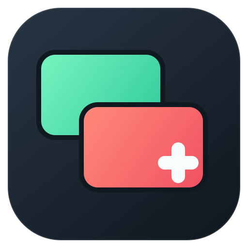

# README 视觉素材

这套素材与代码一起维护，不依赖外部图片地址。图标与演示输入均为本项目原创，按仓库的 Apache-2.0 许可证提供。

## 图标



两块交叠的画面分别用**预览绿**与**播出红**表示 PVW / PGM，两者使用同样的深色描边、线宽和圆角。白色加号收进红色画面的右下角，与画面融为一体，交叠处保留完整轮廓。深色圆角底与应用界面呼应，避免小尺寸依赖文字。

2026-11-08 根据用户反馈用 image2 调整外沿与加号位置，再按生成方案整理成可编辑 SVG：[生成原图](design/plusmix-icon-image2.png) · [完整提示词](design/icon-image2-prompt.txt)。正式 README 与 AppIcon 继续统一从 SVG 导出。

- [plusmix-icon.svg](plusmix-icon.svg)：唯一的可编辑源，512×512 viewBox；外侧透明，无外部字体或图片依赖。
- [plusmix-icon.png](plusmix-icon.png)：README 使用的 512×512 透明 PNG。
- [AppIcon.appiconset](../../App/Resources/Assets.xcassets/AppIcon.appiconset/Contents.json)：macOS 的 16、32、128、256、512 pt，分别有 1× / 2×，共十张 PNG，最大 1024×1024。`project.yml` 的 `ASSETCATALOG_COMPILER_APPICON_NAME` 指向 `AppIcon`。

在仓库根目录重新导出（macOS，自带 Swift / AppKit，无需 Python 第三方包）：

```bash
python3 docs/media/tools/make-icons.py
make gen build-app
```

## 两段真实窗口录制

| 文件 | 演示内容 | 格式 |
|---|---|---|
| [demo-switching.gif](demo-switching.gif) | 先改变 PVW，PGM 不变；再依次执行 Cut、1 秒 Fade、1 秒左→右 Wipe | 960×720，12 秒，12 fps，无音频 |
| [demo-overlays.gif](demo-overlays.gif) | Overlay 1 字幕滑入；Overlay 2 画中画淡入；依次独立收起 | 960×720，12 秒，12 fps，无音频 |
| [demo-poster.png](demo-poster.png) | 不播放动画时使用的真实主窗口静态图 | 1280×760 |

录制基于 2026-11-08 的源码 `1886bde` 加本次 AppIcon 配置，macOS 27.0.1，App 显示版本 0.1.0。画面是**实际 AppKit / Metal 窗口**，并非界面稿；四路输入是生成器画出的三张编号图片和一张透明字幕图，不代表真实摄像头或现场。调用本地 API 与按钮使用相同的命令总线。解说条在录屏外围后期添加，App 内容只缩小，不替换、不重绘。

此演示只展示切换和叠加，没有录制、推流、采集卡、NDI 或音频实测的含义。GIF 循环播放；需要静态版本请看 [主窗口 PNG](demo-poster.png)。

## 重新录制

需要 Apple Silicon Mac、项目构建依赖与 FFmpeg。终端需要系统的“屏幕与系统音频录制”权限；**录制期间保持演示窗口在前台**。应用在窗口被遮挡时可能暂停 Metal 监视器呈现，录制脚本检测到失去前台会报错，不能用只看 API 状态的方式判定画面正确。

```bash
# 1. 从当前源码构建，包括 AppIcon
make gen build-app

# 2. 生成原创演示输入与节目文件（全部在 .build/readme-media/demo/）
python3 docs/media/tools/make-demo.py

# 3. 启动隔离的演示实例，录制它自己的窗口，并核对命令回执与状态
python3 docs/media/tools/capture-demo.py

# 4. 在窗口外围添加中文步骤说明、缩小并压成 README 用的循环 GIF
python3 docs/media/tools/encode-demo.py

# 5. 文档路径检查；还需目视查看两段 GIF 的中间帧与结束帧
scripts/check-links.sh README.md docs/media
```

[capture-demo.py](tools/capture-demo.py) 使用项目已有的测试宿主模式：独立偏好设置、静音设备、随机本机 API 端口，不恢复用户的节目。只控制和终止它自己启动的 PID；演示节目没有输出目的地，不会推流或启动节目内录制。录屏使用 [record-window.swift](tools/record-window.swift) 的 ScreenCaptureKit 单窗口过滤，不录桌面或其他应用。

原始 MOV、临时 SVG / PNG、演示节目、运行日志、命令与状态证据都在 `.build/readme-media/`，不入库。每次重录会覆盖该目录下同名演示产物；时钟、统计数字和系统窗口装饰随运行环境变化，所以 GIF 不承诺逐字节相同。发布素材前检查各状态的真实画面；文件大小以单段不超过 2 MiB 为目标。

可维护的入口：[图标导出](tools/make-icons.py)、[SVG 光栅化](tools/render-svg.swift)、[演示素材生成](tools/make-demo.py)、[实机录制](tools/capture-demo.py)、[GIF 编码](tools/encode-demo.py)。
