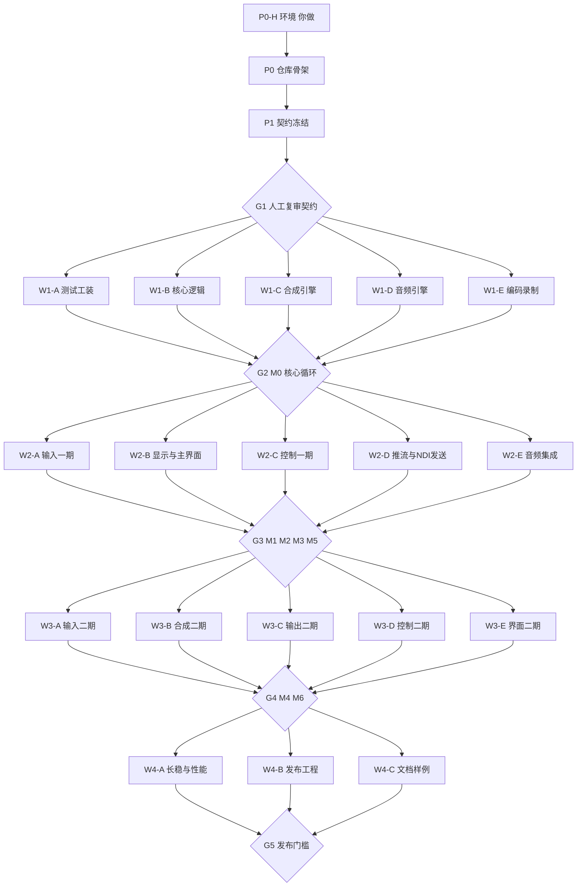

# 导播台落地方案（执行版）v0.1

配套 docs/spec 下的《导播台设计方案》《导播台测试标准》《导播台后续方案》和 UI 稿。本文只回答四个问题：拆成几块、哪些并行哪些串行、检查点在哪、怎么检查。第 8 节是 2026-09-29 界面对照调研之后加的第五波（界面改版），第 9 节是每个会话可以直接粘贴的 prompt。

---

## 0. 一屏结论

- 拆成 **5 个阶段、24 个 Claude 会话、5 个检查点**，外加一份你自己做的环境清单。
- 串行骨架：环境（你）→ P0 仓库骨架 → P1 契约冻结 → **G1 人工复审** → 【W1 五路并行】→ **G2 = M0** → 【W2 五路并行】→ **G3 = M1 + M2 + M3 + M5** → 【W3 五路并行】→ **G4 = M4 + M6** → 【W4 三路并行】→ **G5 = M7 发布门槛**。
- 为什么这样拆：设计方案 §12 决策 9 说先 headless 跑通核心循环再做 UI；测试标准 §9 说先做工装；契约先冻结，五路才能并行不打架。每个会话只拥有一个目录，跨目录改动机械拦截。
- 检查点的本质：**功能会话不合并，检查点会话只合并、只跑测试、只写报告、不写功能。** 不过就把失败项连同报告退回原会话。
- 现在最大的阻塞：**这台机器没装 Xcode**，什么都编不了。第 1 节有清单。

---

## 1. 现状盘点

### 1.1 读了什么

| 文件 | 内容 | 用在哪 |
|---|---|---|
| 导播台设计方案.md | 架构、线程模型、数据模型、选型、里程碑 M0–M7 | 拆分的骨架，每个 prompt 的"先读" |
| 导播台测试标准.md | V/A/E/L/S/C 六类指标、工装、测法、阈值、报告模板 | 每个会话的验收 ID，检查点的通过标准 |
| 导播台后续方案.md | 第二版功能 | 本期只要求架构留位置（Frame 像素格式含 UYVY、Renderer 留转场接口、总线枚举可扩） |
| Vmix macOS风格界面设计.zip | Claude Design 画布（React 组件）+ 三张 vMix 截图（主界面、Input Select、Recording Setup） | W2-B / W3-E 的布局参考，只借布局不借品牌 |

### 1.2 这台机器

Apple M5 Max / 128 GB / macOS 26.4。**缺：Xcode、Command Line Tools、Homebrew、ffmpeg、MediaMTX、NDI SDK、DeckLink SDK。硬件只有内置摄像头。** 没有 Xcode 时连 python3 都是空壳。这台机器远强于规格里的目标机（M1 Air 8 GB），性能阈值在这里过了不代表在 Air 上过，发布前要借一台 Air 跑 L5。

### 1.3 规格与 UI 稿的冲突和缺口（已在 prompt 里按默认值处理，第 7 节等你拍板）

1. **品牌**：UI 稿标题写着 "vMix Pro" / "vMix for Mac"，设计方案 §0 明确产品名不能带 vMix。→ 只借布局，文案全换。
2. **转场集合**：稿子是 Cut / Fade / Merge / Wipe / Fly / Quick Play，规格是 Cut / Fade / Wipe / Zoom / Stinger。→ 按规格。
3. **Tally 颜色**：稿子用 vMix 的绿 = PGM、橙 = PVW。→ 改用广播惯例红 = PGM、绿 = PVW。
4. **测试图案帧号位数**：测试标准写 16 块 12 位，12 位 68 秒就回绕，8 小时长稳会歧义。→ 32 块 28 位 + 4 位校验（P1 里唯一允许偏离测试标准的地方）。
5. **输入类型与录制格式列表**：稿子里是 vMix Windows 版的（DVD、PowerPoint、AVI、WMV）。→ 按规格 §6 和 §8。
6. **HaishinKit 接哪一层**：规格自己说"做到这步再验证"。→ W2-D 第一步就是 spike，三选一写结论。
7. **vMix 兼容层法律灰区** → 独立 target、默认关、文档顶部带提示。
8. **虚拟摄像头与公证**需要付费 Apple Developer 账号，W3 之前要有。
9. **硬件缺口**导致一批测试只能标 BLOCKED，见第 6 节。

---

## 2. 拆分总览

体量：S 半天内、M 一到两天、L 三天以上（指 Claude 会话的工作量，不是日历）。"只准动"就是 docs/OWNERSHIP.md 的内容，check-ownership 脚本按它拦截。

| 编号 | 会话 | 只准动 | 依赖 | 并行组 | 验收 ID | 体量 |
|---|---|---|---|---|---|---|
| P0-H | 环境清单（你做） | — | — | 串行 | 第 4 节 G0 | — |
| P0 | 仓库初始化 | 根、docs/、scripts/、各 Package.swift、project.yml、Makefile | P0-H | 串行 | make gen build test lint | S |
| P1 | 契约冻结 | SwitcherContracts、docs/CONTRACTS.md | P0 | 串行 | 契约单元测试 + G1 复审 | M |
| W1-A | 测试工装 | SwitcherTestKit、Tools/frameprobe | P1 | W1 | 图案往返、click 检测、合成源自测 | M |
| W1-B | 核心逻辑 | SwitcherCore/SwitcherEngine | P1 | W1 | V2 V3 V4 V5 C4（进程内） | M |
| W1-C | 合成引擎 | SwitcherCore/SwitcherRender、References | P1 | W1 | V1 V8 V9、零分配、显示解耦 | L |
| W1-D | 音频引擎 | SwitcherAudio | P1 | W1 | A1 A6 A7、重采样对齐 | L |
| W1-E | 编码录制 | SwitcherOutputs | P1 | W1 | E1 E2 E3 E5 E6 | M |
| G2 | M0 集成 | Tools/headless、scripts、scenarios、reports、baselines | W1 全部 | 串行 | V1–V5（10 分钟 + 60 分钟） | M |
| W2-A | 输入一期 | SwitcherInputs（除 DeckLink / NDI） | G2 | W2 | L1 S5 S6 | M |
| W2-B | 显示与主界面 | App、MetalDisplayView | G2 | W2 | UI 冒烟、显示解耦、状态行一致 | L |
| W2-C | 控制一期 | SwitcherControl（除 VMixCompat） | G2（可在 W1-B 合并后提前） | W2 | C1 C2 C3 C4 | M |
| W2-D | 推流与 NDI 发送 | SwitcherOutputs/Streaming、NDISend、netem 脚本 | G2 | W2 | E7 E8 E9 + E2 E3 复跑 | L |
| W2-E | 音频集成 | SwitcherEngine/Audio*、SwitcherAudio/Integration | G2 | W2 | A1 A2 A3 A4 A5 AFV | M |
| G3 | M1 M2 M3 M5 集成 | 同 G2 + App 胶水 | W2 全部 | 串行 | V6 V7 A1–A7 E1–E9 C1–C4 S5 | M |
| W3-A | 输入二期 | SwitcherInputs/DeckLink、NDI | G3 | W3 | NDI 回环 L1、DeckLink 单元 | M |
| W3-B | 合成二期 | SwitcherRender、References | G3（可在 G2 后提前） | W3 | V6 V7 V8 扩展、V1 回归 | L |
| W3-C | 输出二期 | Outputs/External、VirtualCamera、ISO、CameraExtension | G3 | W3 | A4 S7、虚拟摄像头 L1 | L |
| W3-D | 控制二期 | Control/VMixCompat、Tally、streamdeck-plugin | G3（可在 W2-C 合并后提前） | W3 | C5 | M |
| W3-E | 界面二期 | App | G3 | W3 | UI 表驱动、Show 往返 | L |
| G4 | M4 M6 集成 | 同 G3 | W3 全部 | 串行 | V1–V9 A1–A4 E1–E3 C1–C5 | M |
| W4-A | 长稳与性能 | scripts/soak、perf、baselines | G4 | W4 | S1 S2 S3 A3（8 小时） | M（含 8 小时挂机） |
| W4-B | 发布工程 | scripts/release、.github、project.yml | G4 | W4 | 干净账户安装、Sparkle 更新 | M |
| W4-C | 文档样例 | docs（除 spec / plan）、Samples、README | G4 | W4 | 命令可执行、样例可打开 | M |
| G5 | 发布门槛 | reports、KNOWN_ISSUES、版本号 | W4 全部 | 串行 | 测试标准 §6 五条 | S |

### 2.1 可以提前开的会话（激进排法）

波次是安全排法。有余力时这三处可以提前，不会打架：
- W2-C 控制层只依赖契约和状态机，W1-B 一合并就能开。
- W3-B 合成二期只依赖 W1-C，G2 一过就能开，和 W2 并行。
- W3-D 只依赖 W2-C，W2-C 合并即可开。

真设备（内置摄像头、扬声器）同一时刻只能给一个会话用：W2-A 和 W2-E 的真设备测试要错开跑。

---

## 3. 依赖图



---

## 4. 检查点：在哪、怎么检查

检查点会话的规矩：只合并、只跑、只写报告；单个包超过 50 行的改动不许在检查点做，写成 reports/issues/ 退回原会话。每个检查点固定产出 reports/GN.md（测试标准 §7 模板）和 baselines/gN-<机器>.json。你每个检查点的人工时间控制在 15–30 分钟。

### G0 环境（你自己检查）

```bash
xcodebuild -version && swift --version && ffprobe -version | head -1 && mediamtx --version && xcodegen --version && ls "/Library/NDI SDK for Apple" && xctrace list templates | grep -i metal
```
全部有输出才算过。NDI 那行到 W2 前补上即可。

### G1 契约复审（人工，P1 之后，进 W1 的闸门）

- 自动：SwitcherContractsTests 全绿；make lint 绿。
- 人工（15 分钟）：读 docs/CONTRACTS.md，逐条对设计方案 §1.1 的词和 §4 的结构；确认 Stats 字段名与测试标准 §7 逐字一致；确认 Command 覆盖 §9.1 的每一条；确认测试图案的 32 块决定写明了理由。
- 不过怎么办：退回 P1 改，不开 W1。契约在 W1 期间的任何改动都要走 docs/contract-changes/ 提案，由你批。

### G2 = M0 核心循环

- 入口：w1-* 五个分支的报告都在，各自测试全绿。
- 自动：`make gate2`（10 分钟）+ `make gate2-1h`（你触发）。通过：V1（本机参考线 avg ≤ 2 ms）、V2 = 0、V3 p99 ≤ 4 ms、V4 设计外 = 0、V5 ≤ 2 帧。
- 人工：QuickTime 打开 out.mov，看帧号块在走、色块随 Cut 变、闪光每秒一次；tail stats.jsonl 每秒一行字段齐；--preview 窗口与文件一致；活动监视器 10 分钟内存平。
- 不过：失败指标对应的包退回（V1 / 零分配 → W1-C；V2 / V3 / V5 → W1-B；V4 → W1-B 或 W1-A；文件问题 → W1-E）。

### G3 = M1 切换 + M2 音频 + M3 输出 + M5 控制

- 自动：`make gate3`：V1–V7、A1–A4、E1–E3、C1–C4；E7–E9 需要你跑 sudo 的 netem 脚本。硬性项：V6 无混合帧、A1 = 0、A7 = 0、E7 其他路 0 丢帧、C3 = 0、C4 = 0。
- 人工：docs/checklists/G3.md（开 App、键盘切换、T-bar、录 2 分钟拍手对音画、推本地 MediaMTX 并断网恢复、curl 状态与画面一致、USB 摄像头拔插）。
- 不过：按指标退回 W2-A / B / C / D / E。

### G4 = M4 输入 + M6 叠加与其它输出

- 自动：`make gate4`：V1–V9、A1–A4、E1–E3、C1–C5、NDI 回环 L1、三种 SDK 编译矩阵。
- 人工：docs/checklists/G4.md（每种输入类型、四路叠加、抠像、三种新转场、多画面到外接屏、虚拟摄像头、Companion 六项、ISO 对齐）。
- 产出里必须有 BLOCKED 清单及解锁条件。

### G5 = 发布门槛（测试标准 §6）

L0–L2 全过；L3 现有设备上无 S0 / S1；L4 8 小时通过（硬性）；L5 无退步；已知问题列表更新；公证包 spctl 通过。任何硬性项不过就不发。

---

## 5. 会话怎么跑

1. **一个会话 = 一个 prompt 文件**。新开 Claude Code 会话，粘贴 prompts/00-通用前言.md 全文，再粘贴该会话的文件全文，开头加一句"请在独立的 git worktree 里工作"。
2. **并行**：同一波次的会话各开一个窗口同时跑。它们只动各自目录，check-ownership 会拦越界。
3. **不 push、不 merge**：功能会话只在自己分支提交。检查点会话按 prompt 里的顺序合并。
4. **报告**：每个会话结束必有 reports/<分支>.md。你只看报告里的三块：测试表、BLOCKED 项、契约疑问。
5. **契约变更**：任何会话提出 docs/contract-changes/*.md，你批了之后由 P1 的会话（或新开一个契约会话）改，其他会话 rebase。
6. **模型与推理档位**：P1、W1-B、W1-C、W1-D 用最高档位（正确性关键）；界面和文档会话可以低一档。
7. **真设备互斥**：W2-A 和 W2-E 用摄像头 / 声卡的测试错开。

---

## 6. 硬件与 SDK 阻塞矩阵

| 缺什么 | 阻塞的测试 | 哪个会话 | 解锁方式 |
|---|---|---|---|
| Xcode + CLT | 一切 | P0 起 | App Store 装 Xcode 26，xcode-select |
| Homebrew + ffmpeg / mediamtx / xcodegen | E2 E3 E4 E5 E7–E9、P0 工程生成 | P0、W1-E、W2-D | brew install |
| NDI SDK | NDI 发送、NDI 接收、NDI 回环 L1 | W2-D、W3-A | ndi.video 注册下载 |
| DeckLink SDK | DeckLink target 编译 | W3-A | Blackmagic 官网下载到 ~/SDKs/DeckLink |
| DeckLink 硬件 | DeckLink 的 L1 L2 S5 | W3-A | Mini Recorder 或 UltraStudio |
| UVC 采集卡 + USB 摄像头 | S5 热插拔 20 次、UVC 的 L1 L2 | W2-A | Cam Link 4K 一类 + 任意 USB 摄像头 |
| USB 音频接口 + 回环线 | A5 监听延迟 | W2-E | 接口 + 3.5 mm 线 |
| 外接显示器 | 外部显示、L2 秒表法、120/60 Hz 解耦 | W2-B、W3-C | 任意 HDMI 显示器 |
| HDMI 采集卡（回环） | L2 回环法、显示路径验证 | W3-C | 与 UVC 采集卡可以是同一块 |
| Apple Developer Program | 虚拟摄像头激活、公证、Sparkle 签名 | W3-C、W4-B | 付费账号 + Team ID |
| Companion | C5 | W3-D | 免费安装 |
| M1 Air 8 GB | S4 热降频、L5 真实基线 | W4-A | 借一台 |

---

## 7. 待你拍板的决策（prompt 里已按默认值写）

| # | 决策 | 默认值 | 改的话影响 |
|---|---|---|---|
| 1 | 产品名 | 代号 Switcher，UI 不出现 vMix | P0 lint 规则、W2-B 文案 |
| 2 | 转场集合 | Cut / Fade / Wipe / Zoom / Stinger，不做 Merge / Fly / Quick Play | P1 枚举、W2-B 按钮 |
| 3 | Tally 颜色 | PGM 红 / PVW 绿 | W2-B |
| 4 | 帧号块数 | 32 块 28 位 | P1、W1-A |
| 5 | 仓库根 | 直接在 /Users/plus/plusmix git init，规格移到 docs/spec/ | P0 |
| 6 | HTTP / WS 库 | Hummingbird 2 | W2-C |
| 7 | 工程生成 | XcodeGen | P0 |
| 8 | 部署目标 | macOS 15（NSView.displayLink 需要 14+，测试矩阵要当前和上一个大版本） | P0 |
| 9 | 推流层 | HaishinKit 能接编码帧就用；否则 libavformat 动态链接 | W2-D |
| 10 | vMix 兼容层 | 做，独立 target，默认关，发布前问律师 | W3-D |
| 11 | Stream Deck | 官方插件和 Companion 模块二选一做完整 | W3-D |

---

## 8. 界面对照调研之后：第五波 · 界面改版（2026-09-29 加）

0.1.0 候选（G5，2026-09-28）之后，用户在另一台机器上把竞品 28 版逐项截了 157 张图；会话 UIA（分支 `claude/vmix-28-guide-menu-ui-c83cd1`）拿它和 PlusMix 逐项对照，只写文档不改代码，产出在 docs/ui-study/（入口 README.md：130 条改动、63 条缺陷、68 条待拍板、14 张问题单 reports/issues/UIA-*.md）。本节把结论记在案，并拆成 prompt 85–104；网页版（scripts/gen-prompt-page.py 从 docs/plan/prompts/ 生成）是同一内容。

### 8.1 结论一屏

- **菜单逻辑**：参考软件的规则很一致——每个东西就近有齿轮，按钮主体直接干活，右侧小箭头弹快捷菜单，底栏菜单一律朝上开。我们功能大多都有，但入口几乎全在 mac 菜单栏：主窗口缺工具条、缺齿轮、缺小箭头；转场是"一个按钮 = 一种效果"而不是"四个可配置槽"；底栏菜单往窗口外弹。根源之一是 W2-B 写了"留给 W3-E"的一批入口没进 W3-E 的 prompt（docs/ui-study/01 §2）——以后检查点写续做 prompt 时对一遍上一轮报告里的"留给 xx"清单。
- **目视**：用户点名的两处都找到根因并做过原型实测——转场列没对齐是 `NSStackView.alignment = .width`（不支持的值，读回 0）；"超出边框"的是底栏"外部输出"菜单（伸出 25 pt，子菜单 228 pt）和"叠加…"弹出层（最多伸出 318 pt、内容被裁）。另记 32 条（03）。
- **缺陷 63 条**（02 §1）：最重的是音频效果链"界面能调、声音不变"（S1，引擎不读 effects）；一步操作就停掉直播且不确认 5 条（X01–X05）；起不来的推流路让"推流"按钮变成全停；快捷键编辑器把"其他命令"静默存成 Cut；Bus A / B 没有出口、2 声道设备上耳机没声；RTMP 地址里的 user:pass 被丢；转场中改 PVW / PGM 不拦。
- **怎么信**：9 个分区 agent 逐图读 + 读对应代码，1 个目视 agent 真跑 App 截图量尺寸，5 个核对 agent 逐条挑错（401 条：326 属实、67 改措辞、7 与图不符且都是截图细节，代码结论 0 条不符）。

### 8.2 现状缺陷（与发布有关的部分；全表见 docs/ui-study/02-功能缺口.md §1，已同步进 docs/KNOWN_ISSUES.md）

| 级别 | 编号 | 现象 | 问题单 | 修在 |
|---|---|---|---|---|
| S0 | X01–X05 | 底栏录制 / 推流一按全停不确认；起不来的推流路让主体按钮变成全停；新建 / 打开 / 换节目格式直接停录制推流、丢未保存改动；删除正在推的目的地不确认（Q68 默认 (a)：按 S0，0.1.0 前修） | UIA-w3-app-stream-button-state-and-retry、UIA-w3-app-show-switch-and-quit-safety | 87 W5-B |
| S1 | X06 X07 | 总线与每路音频效果链界面能调、引擎不读；手册 / API 文档按已生效写 | UIA-w2-audio-effect-chains-not-applied | 87 标"尚未生效" → 88 W5-C 接总线 → 102 W1-D3 每路 |
| S1 | X08 X09 | Bus A / B 没有任何出口；2 声道设备上耳机总线没声 | 02 §1 | 97 W5-K |
| S1 | X10 | 快捷键编辑器把"其他命令"静默存成 Cut | UIA-w3-app-hotkey-editor-other-command-becomes-cut | 87 → 96 W5-J |
| S1 | X11–X13 | 底栏状态文字不可信；效果 sheet 开着时快捷键失灵；删除输入不确认、删 PGM 即黑场 | 同上 / UIA-w3-app-misc-logic-bugs | 87、97 |
| S2 | X14 X15 | 录制"容器 .mp4"选了没用；录制 / 推流的 source 被忽略 | UIA-w1-outputs-record-container-and-source | 87、99 P5、95 W5-I |
| S2 | X19 | 转场进行中 setPreview / setProgram 不拦 | UIA-w1-core-preview-program-change-mid-transition | 90 W5-E（Q66 默认 (a) 拒收） |
| S2 | X20 X21 | 外部显示菜单勾不看开关、再点删配置、同屏叠窗；"叠加…"是 transient 浮层 | UIA-w3-app-bottom-bar-popups-overflow-window | 86、92、97 |
| S2 | X25 | RTMP 地址里的 user:pass@ 被丢 | UIA-w2-stream-rtmp-userinfo-dropped | 89 W5-D |
| S2 | X30 X32–X34 X53 | 手册与实现对不上（退出口径、tally 流、兼容层地址、caffeinate、磁盘下限） | UIA-w4-docs-manual-vs-implementation | 85 已按实情改手册；实现归 87 / 98 / 103 |
| S3 合规 | X59 X62 | 关于面板没有 NDI® 声明与开源许可入口；偏好设置里出现竞品模块名 | UIA-w3-app-ui-copy-compliance | 86 W5-A；lint 规则归 91 G6 |

### 8.3 第五波拆分

三批：**止血**（不改契约、S 为主，0.1.0 候选能收）→ G6 → **主窗口骨架与面板改版**（不改契约，0.1.x）→ P5 契约落地 → **契约批了才能做的** → G7。体量口径同 §2；"只准动"已落进 docs/OWNERSHIP.md。

| 编号 | 会话 | 只准动 | 依赖 | 批次 | 验收 / 用例 | 体量 |
|---|---|---|---|---|---|---|
| 85 | UIA 界面对照调研（已完成，补记） | docs/ui-study、docs/plan、手册与已知问题的实情修正 | G5 | 记录 | check-links、lint | — |
| 86 | W5-A 目视与弹出：转场列排版、底栏弹出朝上、分栏与位置、文案合规、关于面板 | App/ | — | 止血 | testUI_transitionColumnEdgesAligned、testUI_bottomBarPopupsStayInsideWindow | M |
| 87 | W5-B 直播安全与界面说谎：X01–X05、效果链标"尚未生效"、"其他命令"、文件格式、标题 | App/ | 86 之后开 | 止血 | testUI_stopRecordAsksConfirmation、testUI_streamRetryDoesNotStopHealthyRoutes | M |
| 88 | W5-C 音频总线效果链接线 | SwitcherAudio/Integration、BusEffectChain、App/Sources/Engine 两文件 | 探针、Q09 (b) | 止血 | testA_busEffects_*、A7 = 0 | M |
| 89 | W5-D 推流地址鉴权 | SwitcherOutputs/Streaming、ShowRedaction | 探针 | 止血 | testE_streamDestination_keepsUserinfoInConnectURL | S |
| 90 | W5-E 转场进行中拒收 setPreview / setProgram | SwitcherEngine/State、ReducerTests | Q66 (a)；提案 023 一节 | 止血 | testV6_setPreviewRejectedDuringTransition | S |
| 91 | G6 检查点：止血合入、全量、KNOWN_ISSUES、0.1.0 重判、lint 加 .strings 禁词 | 同 G5 + scripts | 86–90 | 闸门 | make test、gate4、docs/checklists/G6.md | M |
| 92 | W5-F 底栏三段式、五个输出按钮、状态行独立 | App/ | G6；Q03 | 骨架 | testUI_streamMenuListsDestinationsWithState | M |
| 93 | W5-G 工具条、监视器齿轮、菜单栏重排 | App/ | 92 | 骨架 | testUI_switchMenuShowsHotkeysFromTable | M |
| 94 | W5-H 输入条与格子 | App/ | 92；Q06 / Q26 | 骨架 | testUI_inputCellButtonsRespectTransitionGuard | M |
| 95 | W5-I 输出设置页 | App/ | G6；Q30 / Q31 | 骨架 | testPanels_isoTableFollowsRecordFormat | M |
| 96 | W5-J 设置体系合窗 + 选动作面板 + 控制层动作补齐 | App/、SwitcherControl Hotkeys / MIDI / CommandCatalog | G6；Q04 / Q29 / Q51–Q53 | 骨架 | testPanels_settingsWindowOpensRequestedPage | L |
| 97 | W5-K 面板改版：添加输入、输入设置、叠加窗、音频设置窗与设备声道 | App/ | 88；Q40 / Q55 / Q58 | 骨架 | testPanels_overlayWindowStaysOpenWhileSwitching | L |
| 98 | W5-L 其他：防睡眠、tally 流、远程控制页、提醒、统计窗、界面锁 | App/、project.yml | G6；Q46 / Q47 / Q50 | 骨架 | testTally_appServesReadOnlyStream | M |
| 99 | P5 契约落地四：提案 020–023 | SwitcherContracts、CONTRACTS.md、reducer、CommandBus、填数方 | 用户批 | 串行 | 契约用例、api.md、整仓 make test | M |
| 100 | W5-M 转场槽落地（含 T-bar 横放、兼容层、Stream Deck） | App/、SwitcherControl、Tools/streamdeck-plugin | 99 | 契约后 | testUI_transitionSlotMenuConfiguresWithoutExecuting | L |
| 101 | W5-N 文件播放控制、推流状态面板、时长 | App/、SwitcherInputs/File | 99 | 契约后 | testUI_fileCellPlayPauseRestart | M |
| 102 | W1-D3 每路音频效果格（C 热路径） | SwitcherAudio/ | 88、99 | 契约后 | A7 = 0、check-rt-symbols | L |
| 103 | W4-C2 手册与实现再对齐、随包 HTML 手册 | docs（除 spec / plan）、Samples、App/Resources/Help | G6 之后 | 文档 | check-links | M |
| 104 | G7 检查点：骨架与契约后合入、L3 目视清单重看、0.1.x 放行 | 同 G6 | 92–103 | 闸门 | make test、gate4、perf-baseline、docs/checklists/G7.md | M |

### 8.4 顺序与规矩

- 止血五路（86–90）互不依赖，可并行；86 与 87 都只动 App/、都改 Localizable.strings，建议 87 从 86 合入后的 main 开，或并行后由 G6 解 strings 冲突。
- 骨架七路（92–98）全在 App/：**串行开**（每个从上一个合入后的 main 开）最省事；要并行就按 92 → 93 / 94 → 95 / 96 / 97 / 98 的依赖排，G7 按同一顺序合并。
- 契约后三路（100–102）等 P5（99）合入 main 后再开；P5 等用户批提案 020–023。文档（103）随每批合入 rebase 一次。
- 每个会话照旧：只动自己目录、先写红测试、报告五段、不 push 不 merge；App 用例写在 App/Tests/，函数名带上表里的 ID。
- 竞品截图在用户本机 `vmix-28-guide/`（已加进 .gitignore，不入库）；prompt 里"图 NNN"指它；给 App 的文案一律是我们自己的说法（铁律 6）。

### 8.5 待你拍板（prompt 已按下面的默认值写；改了哪条就改对应 prompt）

| # | 决策（docs/ui-study/04） | 默认值 | 影响 |
|---|---|---|---|
| Q01 | 转场按钮模型 | A：四个可配置槽进契约（提案 020）；0.1.0 先做 B 的最小一步——T-bar 上方那行变弹出菜单，只选类型不执行 | 86、99、100 |
| Q02 | 效果链做到哪一步 | (a) 先标"尚未生效"，0.1.0 前接总线三格，每路进 0.1.x | 87、88、102 |
| Q03 | 底栏三段式细则 | 去掉单独 ISO 按钮；单路起停放 ▴；外部显示主体 = 全部开 / 关；推流主体全起全停 + 停止前确认 | 92、93 |
| Q04 | 设置窗合不合 | (a) 合成一个带侧栏的"设置"窗，先理入口再合窗；即时生效 | 96 |
| Q05 | T-bar 方向 | (a) 横放，随转场槽一起重排 | 100 |
| Q06 | 格子上的删除 | (a) 格子上放 ×，在 PGM / PVW / 叠加 / Stinger / ISO 录制中时确认 | 87、94 |
| Q07–Q14 | 契约相关小项 | Q07 跟当前槽；Q08 FTB 时长命令并进 020；Q09 AUNBandEQ（先探针）；Q10 effects 只放音频；Q11 文件播放命令进 v1（021）；Q12 container 废弃；Q13 三个统计字段进 Stats（022）；Q14 InputConfig 可选 color（023） | 88、99、101 |
| Q26–Q33 | 只影响界面的 | 格子两行常显；监视器齿轮直开设置；工具条 .unified、正中外部显示▾；默认键 ⌥1–⌥4 / ⌃1–⌃4、录制推流不给键；录制码率跟节目格式、推流封顶 1080p / 6 Mb/s；服务预设短表；输入上限 64；帮助 = 随包 HTML | 92–98、103 |
| Q66 | 转场中改 PVW / PGM | (a) 拒收 | 90 |
| Q67 | 退出时写不写回原文件 | (a) 统一成"问" | 87 |
| Q68 | X01–X05 定级 | (a) 按 S0：0.1.0 放行前修 | 87、91 |
| Q36–Q65 | 其余 30 条 | 全按 04 第 5 节的"倾向"做，只需知会 | 各 prompt |

### 8.6 第五波止血合入（G6，2026-10-02；细节 reports/G6.md）

- 五路按 86 → 87 → 88 → 89 → 90 合入 `g6`，每合一路 `make test lint`。冲突只有两处：86 / 87 的两份 Localizable.strings（86 改值、87 加键，两边都留）与 87 / 88 同名新建的 `AudioEffectsSupport.swift`（取 87 的、把总线常量翻 true）；胶水 App/ 6 行（87 自己写明"88 接上时翻"的三行断言），各包 0 行；契约没动（提案 023 第一节已批、文字归 P5；024 待用户定）。
- 结果：UIA 查出的 S0 五条（X01–X05）全部修了并有用例钉住；S1 里 X06 总线半、X10、X11、X13 修了；S2 X14（界面半）/ X19 / X20 / X25 / X30 修了；S3 合规 X59 / X62 修了，lint 对 *.lproj/*.strings 不再放行模块名 token。docs/KNOWN_ISSUES.md 已按此更新（"2026-10-02 第五波止血已修"表）。
- **0.1.0 仍不发**：新发现 S1（`MIDIHost.sync` 偶发崩溃，W2-C 系）；8 小时长稳没在修复后的树上重跑；签名账号没有；X07 / X08 / X09 这三条 S1 归 102 / 97（按 Q68 (a) 同样要在放行前修）。阻塞项与归属见 reports/G6.md §7。
- 骨架批次（92–98）现在可以从 G6 合入后的 main 开（92 → 93 / 94 → 95 / 96 / 97 / 98，建议串行）；给 92 / 95 / 97 / 99 / 100 / 101 / 103 各追加了一行"G6 追加"（止血报告里退回的活）。P5（99）等用户批 020–022 与 024，023 第一节已批。
- 测试工装：`scripts/gate4.sh --checkpoint` 让后面的检查点跑 L2 不再改写 reports/G4.md 与 g4 基线；check-ownership 的冲突文件识别修了一处 pipefail 竞态；同机多会话并行时 StreamingTests 端口 / 输出目录会互相踢掉（reports/issues/G6-w2-stream-streamingtests-shared-ports-and-output-dir.md）。

---

## 9. Prompt 集

下面按会话顺序给全。每个 prompt 使用时都要在前面贴上 00 通用前言。单独文件在 prompts/ 目录。


---

## 00 通用前言（贴在每个会话 prompt 的最前面）

你在 /Users/plus/plusmix 仓库工作。这是一个 Apple Silicon 原生的多机位导播台，代号 Switcher，Swift 6 + Metal，Apache-2.0。

先读（只读需要的节，别全读）：
- docs/spec/导播台设计方案.md：架构（§2）、线程与时钟（§3）、数据模型（§4）、工程结构（§11）、决策记录（§12）
- docs/spec/导播台测试标准.md：指标定义（§1）、工装（§2）、测法（§3）、阈值（§4）、stats.jsonl 字段（§7）
- docs/CONTRACTS.md 和 Packages/SwitcherCore/Sources/SwitcherContracts/：所有包共用的类型（P1 之后存在）
- CLAUDE.md：仓库约定
- 本会话下面列出的"只准动"目录

铁律：
1. 只动本会话指定的目录，其他包只读。要改契约（SwitcherContracts 里任何公开类型、JSON 字段名、测试图案布局）不许直接改：在 docs/contract-changes/ 写提案（改什么、为什么、影响谁），然后停下来问我。
2. 先写测试，再写实现。本会话要通过的测试 ID 列在下面，测试函数名带 ID（例如 testV6_cutLandsOnExactTick）。测不了的写 XCTSkip 并注明原因（BLOCKED-硬件 / BLOCKED-SDK / BLOCKED-签名）。
3. 热路径规则（设计方案 §3.2、§3.5）：渲染线程每帧零分配；音频回调内无锁、无分配、无日志、无系统调用、无 Swift ARC 抖动，热路径用 C。违反的代码不许合并。
4. 统计只有一份：所有数字进 Stats（测试标准 §7 的 stats.jsonl 字段），UI、API、测试三方读同一个结构，不许各自另算。
5. 所有帧和音频块在入口换算成 host time（mach_absolute_time）打戳；编码 PTS 用拍点时刻，不用渲染完成时刻。
6. 不出现 vMix / OBS 的名字、图标、文案、默认快捷键表；不复制 GPL 代码（OBS、Nageru 只能读思路自己重写）。用词按设计方案 §1.1。
7. 在独立的 git worktree 和分支上工作（分支名在下面），小步提交，提交信息写"为什么"。不 push、不 merge，合并由检查点会话做。
8. 结束前在 reports/<分支名>.md 写报告，固定格式：做了什么；每个测试 ID 的数值 / 阈值 / 通过否；没做的和原因；对契约的疑问；下一个会话需要知道的坑。
9. 做不到就直接说做不到。不许为了让测试过而放宽阈值、跳过断言、改测试图案。阈值只有我能改。
10. 不确定的 API 行为（尤其 macOS 26 上的 AVFoundation / ScreenCaptureKit / VideoToolbox / CMIO），先写 20 行探针程序验证，结论写进报告，再写正式代码。

---

## 01 P0-H 环境准备（你自己做，Claude 做不了：要 Apple ID、sudo、注册下载）

现状（已在这台机器上查过）：Apple M5 Max / 128 GB / macOS 26.4。没有 Xcode、没有 Command Line Tools、没有 Homebrew、没有 ffmpeg、没有 MediaMTX、没有 NDI SDK、没有 DeckLink SDK；只有内置摄像头。没有 Xcode 什么都编不了，连 python3 都是空壳。

P0 之前必须做：
1. App Store 装 Xcode 26.x，打开一次装附加组件，然后在终端执行：
   sudo xcode-select -s /Applications/Xcode.app/Contents/Developer
   sudo xcodebuild -license accept
   xcodebuild -runFirstLaunch
   验证：xcodebuild -version && swift --version（Swift 应为 6.x）
2. 装 Homebrew（brew.sh 官网那一行命令），然后：
   brew install ffmpeg mediamtx xcodegen gh jq
   验证：ffprobe -version；ffmpeg -filters | grep vmaf（E4 要 libvmaf，没有就先跳过 E4）；mediamtx --version；xcodegen --version
3. git config --global user.name "..." 和 user.email "..."

W2 之前：
4. NDI SDK for Apple：去 ndi.video 注册下载，装到默认路径 /Library/NDI SDK for Apple/
5. 装 Bitfocus Companion（C5 用）

W3 之前：
6. Blackmagic Desktop Video SDK（含 DeckLinkAPI 头文件和 .idl）：解压到 ~/SDKs/DeckLink/。没硬件也要装，编译要用
7. Apple Developer Program（付费）：虚拟摄像头系统扩展签名和公证都要。把 Team ID 记下来
8. 硬件，按解锁的测试排序（对应落地方案第 6 节）：UVC 采集卡 → USB 摄像头 → USB 音频接口 + 3.5 mm 回环线 → 外接显示器 → HDMI 采集卡（回环）→ DeckLink Mini Recorder → 一台 M1 Air 8 GB（基线机，性能阈值是按它定的）

---

## 02 P0 仓库初始化
分支：main（这是唯一直接在 main 上做的会话）。只准动：仓库根、docs/、scripts/、各包的 Package.swift 骨架、project.yml、Makefile。

目标：把 /Users/plus/plusmix 变成能 `make test` 的空骨架，目录严格按设计方案 §11。

做：
1. git init。把根目录的三份规格 .md 和 "Vmix macOS风格界面设计.zip" 移到 docs/spec/，zip 解压到 docs/spec/ui-mock/（原 zip 保留）。把根目录的 导播台落地方案.md 和 prompts/ 移到 docs/plan/。LICENSE = Apache-2.0；.gitignore 覆盖 Xcode、SwiftPM、DerivedData、reports/*.jsonl、*.mov（Tests/Fixtures 下的小样例除外）。
2. 目录：Packages/{SwitcherCore,SwitcherInputs,SwitcherAudio,SwitcherOutputs,SwitcherControl,SwitcherTestKit}，各自独立 Package.swift（swift-tools-version 6.0，swiftLanguageModes [.v6]，平台 macOS 15）；SwitcherCore 里预建 SwitcherContracts、SwitcherEngine、SwitcherRender 三个 target；App/（AppKit）；CameraExtension/（空目录 + README，W3-C 填）；Tools/switcher-headless 和 Tools/frameprobe（SwiftPM 可执行，先只打印版本）。
3. 包依赖方向只允许：SwitcherContracts ← SwitcherCore ← {Inputs, Audio, Outputs, Control} ← TestKit ← Tools / App。写 scripts/check-deps.sh 解析各 Package.swift 的 dependencies，出现反向依赖直接失败。
4. App 用 XcodeGen：project.yml 生成 Switcher.xcodeproj，App target 依赖本地包；Info.plist 带 NSCameraUsageDescription、NSMicrophoneUsageDescription（屏幕录制没有 usage key，README 里说明要在系统设置授权）；bundle id 先用占位 com.example.switcher，Team ID 用环境变量。CameraExtension target 先不建。
5. 每个包一个能跑的占位测试。Makefile 目标：gen（xcodegen）、build、test（所有包 swift test + App 的 xcodebuild test）、lint。lint 包含：scripts/lint-rules.sh（产品文案、类型名、UI 字符串里不许出现 vMix / OBS）、scripts/check-deps.sh、scripts/check-ownership.sh <分支>（检查该分支相对 main 只改了 docs/OWNERSHIP.md 里允许的目录）。
6. CLAUDE.md：写清仓库约定（docs/plan/prompts/00-通用前言.md 里的铁律、目录归属、make 目标、报告格式、契约变更流程）。docs/OWNERSHIP.md：会话 → 允许目录 的表，照落地方案第 2 节抄。
7. reports/、reports/issues/、baselines/、scenarios/、docs/contract-changes/ 目录各放一个 README 说明用途。
8. 提交，提交信息说明骨架来源于设计方案 §11。

完成定义：`make gen build test lint` 全绿；README 写清怎么开始下一个会话。
不做：任何业务代码。

---

## 03 P1 契约冻结
分支：p1-contracts。只准动：Packages/SwitcherCore/Sources/SwitcherContracts/、Packages/SwitcherCore/Tests/SwitcherContractsTests/、docs/CONTRACTS.md。

这是整个项目最重要的一个会话：它之后五个会话并行开工，全部编译在这些类型上。改一次契约等于五个会话返工，所以要慢、要全、要有测试。

先读：设计方案 §1.1、§3、§4、§5 的合成步骤、§9.1 命令列表；测试标准 §2.1–2.4、§7。

交付（全部在 SwitcherContracts target，公开 API 全部带文档注释）：
1. 时间：HostTime（mach 绝对时间 UInt64，与秒 / 纳秒的换算用 mach_timebase_info）；Rational（整数分子分母）；FrameRate（30、59.94 = 60000/1001、60）；TickClockSpec{t0, frameDuration: Rational}；Tick(Int64)；time(of: Tick) -> HostTime 必须是整数运算，不许浮点累加。
2. 视频：PixelFormat{nv12, bgra, uyvy}；ColorInfo{primaries, transfer, range}；Frame{pixelBuffer: CVPixelBuffer, pts, duration, color, inputNumber, sequence, ingressTime}（@unchecked Sendable，注释写清为什么安全）。
3. FrameSlot 协议（push、latest(atOrBefore:)、统计 pushed / consumed / dropped / reused）和 AudioRing 协议（float32 非交错、48 kHz、每块带 host time；write / read / available）。只定协议和 C 头文件里的结构布局，实现由 W1-B、W1-D 做。
4. 输入：InputKind{camera, decklink, screen, file, image, ndi, audio, synthetic}；InputState{live, noSignal, error(String)}；InputSettings（延迟补偿 0–500 ms、裁切 / 变换、音频路由、增益、效果链占位、抠像参数占位）；Input 协议（number、name、kind、state、videoSlot、audioRing、start、stop）。
5. 状态：MixerState（不可变、Codable、Sendable）：program、preview、transition{type: cut / fade / wipe / zoom / stinger, durationTicks, progress, source: auto / tbar}、ftb、overlays[4]{input, on, rect, animProgress}、audio{buses[4], perInput 路由 / 增益 / 静音 / 独听 / 声像 / 延迟, afv}、outputs[]。Command 枚举覆盖 §9.1 全部：cut、fade(duration)、setPreview、setProgram、tbar(progress)、ftb、overlay(n, on, input)、audioGain、mute、startRecord、stopRecord、startStream(dest)、stopStream、setInputSetting、addInput、removeInput、loadShow；每条命令带 sequence: UInt64 和 issuedAt: HostTime。定义 reduce(_ state: MixerState, _ command: Command, at tick: Tick) -> MixerState 的签名（纯函数，实现放 W1-B）。
6. Stats：严格等于测试标准 §7 那一行字段：ts、tick、render_ms、missed_render、jitter_ms、per_input{fps, dup, drop}、encoder[{skipped, bitrate}]、audio{dropouts, underruns}、rss_mb、cpu_pct、gpu_pct。Codable，一行一个 JSON。字段名就用这些下划线名，不改驼峰。
7. Show 文件：schemaVersion = 1，含 inputs、mixer、audio、outputs、layout；Codable + migrate(from:) 占位。
8. Scenario 脚本：{durationTicks, events: [{tick, command}]}，Codable。
9. TestPattern（CPU 参考实现，BGRA 和 NV12 亮度平面都要能写能读）：以 1920×1080 定义，其他尺寸按比例缩放块尺寸。布局：
   - 行 1（y = 16）：帧号 32 个 32×32 块，28 位数据 + 4 位校验。测试标准写的是 16 块 12 位，12 位 68 秒就回绕，8 小时长稳会歧义，所以扩到 32 块。这是本会话唯一允许偏离测试标准的地方，写进 CONTRACTS.md。
   - 行 2（y = 64）：生成时 host time 的毫秒，32 块同样编码。
   - 输入 ID：x = 16, y = 112 一个 64×64 纯色块，16 色调色板，颜色在 4:2:0 + 压缩后仍可分辨（写测试证明：任意两色 YCbCr 距离 ≥ 阈值）。
   - 闪光：右上角 64×64，tick % fps == 0 的帧全白，其余全黑。
   - 其余画面：可配置纯灰（V7 用 64 / 192）或渐变。
   - 解码规则：每块取中心 16×16 均值，> 128 为 1；校验失败返回 nil。
10. TestSignal（音频，CPU）：1 kHz 正弦 -20 dBFS，在闪光帧时刻叠加 1 ms 满幅 click；可加采样率漂移 ppm。
11. docs/CONTRACTS.md：每个类型一段"是什么、谁写、谁读、线程归属"；§1.1 术语 → 标识符对照表；线程规则检查表（复审时逐条对）；Renderer 与 FrameConsumer 协议草案（引擎每拍调 Renderer，完成回调里调 FrameConsumer 列表）。

测试（SwitcherContractsTests）：
- 拍点时间：59.94 fps，第 216000 拍（1 小时）的 time(of:) 与有理数精确值一致，误差 0；同时算一遍浮点累加证明它有误差。
- TestPattern 编解码恒等 10 万随机帧号；经高斯模糊 σ = 1.5 + 4:2:0 降采样 + ±10 电平噪声后解码正确率 100%；校验位能捕获单块翻转。
- 调色板两两 YCbCr 距离 ≥ 阈值。
- Stats / Show / Scenario / MixerState 的 Codable 往返恒等；Stats 的 JSON 键名快照测试（键名写死在测试里，改了就红）。
- Command 每个 case 至少一个构造样例并往返 JSON。

完成定义：以上测试全绿；CONTRACTS.md 我 15 分钟能读完；make lint 绿。结束后我做 G1 复审，复审没过不进 W1。

---

## 10 W1-A 测试工装（SwitcherTestKit + frameprobe）
分支：w1-testkit。只准动：Packages/SwitcherTestKit/、Tools/frameprobe/。依赖：SwitcherContracts（只读）。
先读：测试标准 §2.1–2.4、§3 里 V4–V7 和 A2–A4 的测法、§7。

目标：测试标准 §9 第 1 条。没有这些，后面全是手测。

交付：
1. SyntheticVideoInput（实现 Input 协议，kind = .synthetic）：自带线程和自己的时钟（30 / 59.94 / 60，有理数），每帧从 CVPixelBufferPool（IOSurface 背后、NV12）取缓冲，用 TestPattern 写帧号、时间戳、输入 ID、闪光，入口打 host time，push 到自己的 FrameSlot。可配置：人为抖动（±ms 均匀分布）、人为丢帧（每 N 帧丢 1）、时钟漂移（±100 ppm）、底色灰度、分辨率。每帧零分配（pool 预热）。
2. SyntheticAudioInput：TestSignal 写进 AudioRing，块大小 256，采样率漂移可配，click 与视频闪光同一 host time（两者共用一个 t0）。
3. StatsWriter（1 Hz 追加 stats.jsonl；写线程不阻塞任何实时线程：用 SPSC 队列交给写线程）和 StatsSummary（读 jsonl 出 avg / p99 / max，按测试标准 §4 阈值表判定，输出 §7 报告表格的 markdown）。
4. ScenarioRunner：读 Scenario，按 tick 通过闭包 (Tick, Command) -> Void 发命令；"当前 tick"由引擎回调驱动，不自带时钟。
5. frameprobe 命令行（Tools/frameprobe）：输入 .mov / .mp4（AVAssetReader 解成 BGRA）或原始 NV12 帧目录；逐帧解码 TestPattern；音轨找 click（1 ms 窗口能量 > 阈值，输出样本级时间）。子命令：
   - frames：每帧 {index, frameNumber, inputID, genTimeMs, flash}
   - stats：每输入的重复 / 丢弃序列与比例（V4，传入每路 fps 以区分设计内 / 设计外）、总帧数 vs 时长 × 帧率（V5）
   - switches：输入 ID 变化的帧、Cut 前后有无混合帧（判据：帧灰度不等于任一输入的标称灰度）（V6）
   - fade：Fade 期间逐帧混合比例（A = 64、B = 192 时比例 = (gray − 64) / 128），与线性曲线的最大偏差帧数（V7）
   - av：每个闪光帧 ↔ 最近 click 的时间差序列，均值 / 标准差 / 最大绝对值 / 线性拟合斜率（A2、A3）；多文件模式比较同一事件（A4）
   - 输出 JSON；--markdown 出人读表。
6. 一个 20 秒样例：用 VideoToolbox 直接把 SyntheticVideoInput 的帧编成 H.264 2 Mbps 写 .mov（只为测试，不依赖 W1-E），放 Tests/Fixtures/（≤ 5 MB），作为 frameprobe 的回归素材。

测试：
- 图案经 1080p H.264 2 Mbps 往返 1200 帧解码率 100%；720p 4 Mbps 也过。
- click 检测：合成音轨 100 个 click 全部找到，时间误差 ≤ 0.05 ms；加 −40 dB 白噪声仍 100%。
- 合成源自测：60 fps 跑 10 秒，帧号连续、时间戳单调、slot 统计 pushed = 600 ± 1；开 5% 人为丢帧后 frameprobe stats 报出的丢弃 = 设定值 ± 0.5%。
- StatsSummary：喂一份手写 jsonl，p99 算法写明（最近秩法）并与手算一致。
- frameprobe 对 Fixtures 样例的输出做快照测试。

报告里写：解码鲁棒性的极限（多低码率开始失败），给以后压码率的人参考。

---

## 11 W1-B 核心逻辑（节目时钟、帧槽、状态机、引擎骨架）
分支：w1-core。只准动：Packages/SwitcherCore/Sources/SwitcherEngine/、对应 Tests/。
先读：设计方案 §3.1、§3.2 挑帧规则、§3.4、§4、§9.1、§12 决策 1 / 3 / 10；测试标准 §1 V2 / V3 / V5、§9 第 2–4 条。

交付：
1. ProgramClock：按 TickClockSpec 生成理想拍点；等待用 mach_wait_until；线程 QoS user-interactive（pthread 实时属性可选，写清为什么用或不用）；每拍对照理想拍点校正不累积误差；跳拍逻辑：下一拍到期上一帧未提交则跳过并 missed_render += 1；每拍记录实际唤醒时刻与理想拍点之差（V3 jitter）。
2. FrameSlot 实现：SPSC，容量 3，写线程 push 时满则丢最旧（dropped += 1）；读线程 latest(atOrBefore:) 取 pts ≤ 拍点的最新帧，同一帧第二次被取 reused += 1；无锁（swift-atomics 或 C），零分配。
3. StateMachine：一个 actor 持有 MixerState；reduce 纯函数实现全部 Command；Cut 是原子换号；fade / wipe / zoom / stinger 的 progress 按 durationTicks 每拍推进，结束时 program 与 preview 对调；AFV 事件随转场发出；tbar(progress) 手动模式，推到 1.0 提交；FTB 开关；overlay(n, on, input) 与进出动画进度；命令按 sequence 严格顺序应用，乱序到达的排队等待（C4 的基础）；每次 reduce 后把新快照用原子指针交换发布，渲染线程 / 音频线程读的是指针，不进 actor。
4. Engine 骨架：clock → 读快照 → 从每路 FrameSlot 挑帧 → 调 Renderer 协议（W1-C 实现）→ 完成回调里调 FrameConsumer 协议列表（W1-E 实现）→ 更新 Stats。本会话用 Fake 实现测。派发规则：每个消费者自己的队列，慢了自己丢，不许拖渲染线程。
5. Show 读写 + schemaVersion 迁移框架。

测试（函数名带 ID）：
- 时钟：59.94 fps 拍点数学 1 小时无漂（纯算术）；实跑 30 秒 V3 抖动 p99 ≤ 1 ms（这台机器上；"必须"档是 4 ms）；让 Fake 渲染器耗时 30 ms，missed_render 精确等于理论跳拍数。
- 帧槽：用假时间戳序列模拟 30 / 59.94 / 60 输入进 60 fps 拍点：30 → 重复率恰好 50%、丢弃 0；59.94 → 每 1000 拍重复 1 次；60 带 +100 ppm → 每 10000 拍丢 1 次；全部与理论值精确相等（V4 设计内口径）。
- 状态机：每条命令的前后状态表驱动；Cut 在第 n 拍生效且无中间态；Fade 30 拍逐拍 progress = k/30；tbar 25 / 50 / 75% 映射；乱序命令（seq 3 先到）等 seq 2 到了再按序应用；1000 条命令并发投递 0 丢失 0 乱序。
- 引擎：Fake 渲染器 + Fake 消费者跑 10 秒，V5 帧计数 = 600 ± 0；一个慢消费者不影响其他消费者收到的帧数。

禁止：在渲染路径用 actor、async、DispatchQueue.sync、任何分配。
报告里写：实时线程属性用了什么、为什么；原子指针发布快照的内存序论证。

---

## 12 W1-C 合成引擎（Metal）
分支：w1-compositor。只准动：Packages/SwitcherCore/Sources/SwitcherRender/、对应 Tests/、Tests/References/。
先读：设计方案 §2.1、§3.2、§3.3、§5、§12 决策 2 / 6；测试标准 §1 V1 / V8 / V9、§3 V8 / V9。

交付：
1. Renderer（实现 CONTRACTS.md 里的 Renderer 协议草案；与 W1-B 有分歧写进报告）：三重缓冲 + 信号量限制 CPU 领先 GPU ≤ 2 帧；纹理池、命令缓冲区池，每帧零分配（用 Instruments Allocations 证明：稳态 10 秒内 0 次分配，数据写进报告）。
2. 输入纹理：NV12 / BGRA / UYVY 三种（DeckLink 给 UYVY，现在就做，W3 不再改着色器）通过 CVMetalTextureCache 零拷贝；片段着色器做 YCbCr → RGB（BT.709，limited / full 都支持）。
3. 合成 pass 严格按 §5 顺序：PGM 底（裁切 / 缩放 / 变换）→ 转场混合（本期 Cut、Fade；Wipe / Zoom / Stinger 留接口，W3-B 填）→ Overlay 1 → 4（alpha 合成，本期只做静态位置）→ FTB → PVW → 多画面（基础网格 + tally 边框 + 名字，文字用预渲染 atlas）。
4. 输出：RGB → NV12（BT.709 limited）compute kernel 写进 IOSurface 背后的 CVPixelBuffer（pool），交引擎派发。
5. 计时：每拍 GPU 完成时间（MTLCommandBuffer 的 GPUStartTime / GPUEndTime）→ Stats.render_ms；每个 pass 打 os_signpost。
6. 离线渲染 API：renderOffline(state:, inputs: [Int: CGImage], size:) -> CGImage，走同一套 pass；scripts/gen-references.sh 生成参考图进 Tests/References/，带 README（怎么生成、改了要在 PR 里说明）。
7. MetalDisplayView：NSView + CAMetalLayer，用 NSView.displayLink(target:selector:)（不用 CVDisplayLink）按所在显示器刷新率把"最新完成的纹理"blit 上屏；可设最大刷新率（缩略图 15–30 fps）；渲染线程永远不等 drawable。附一个调试用 PreviewWindow，之后 headless 的 --preview 用。

测试：
- V8：固定状态（PGM = 输入 1，Overlay 1 和 3 开，画中画在右下 1/4，FTB 关）+ 固定输入图 → PNG 对参考图 PSNR ≥ 40 dB 或 SSIM ≥ 0.98（首次生成参考图后人工看一眼，写进报告）。再加 Fade 50%、FTB 100%、纯 PVW 三张。
- V9：灰阶（0–255 步 8）和 75% 色条经 BGRA 输入 → 合成 → NV12 kernel → 读回，每个电平误差 ≤ 1，16–235 范围不被拉伸压缩；NV12 输入 → RGB → NV12 往返也 ≤ 1。
- V1：1080p60、8 路 1080p 输入、4 个 overlay 开，跑 30 秒，render_ms 平均和 p99 写报告（这台机器上应远低于 4 ms，记下来作参考线）。
- 零分配：见交付 1。
- 显示解耦：内置屏 120 Hz 窗口 + 60 Hz 节目时钟，遮住窗口 / 拖动窗口 / 全屏切换期间，Fake 引擎的 missed_render 不增加。

报告里写：三种像素格式各自怎么测的；RGB → NV12 kernel 的舍入策略；离线渲染与实时路径共用同一函数的证明。

---

## 13 W1-D 音频引擎（SwitcherAudio）
分支：w1-audio。只准动：Packages/SwitcherAudio/。
先读：设计方案 §3.5、§3.6 音频部分、§7、§12 决策 5；测试标准 §1 A1 / A6 / A7、§2.2、§2.9、§3 A6 / A7。

交付：
1. 第三方库以 SwiftPM C target 内嵌源码（不用 brew）：libsamplerate（BSD-2）、libebur128（MIT），各自 LICENSE 进 THIRD_PARTY/。
2. AudioRing 实现（C，SPSC 无锁，float32 非交错，每块带 host time，容量可配），符合 SwitcherContracts 的协议和头文件。
3. 混音核心（C 文件，热路径）sw_mix_block(ctx, out, frames)：对每路输入——从 ring 取样 → 异步重采样（比率由速率估计器给）→ 延迟补偿（0–500 ms 环形延迟线，预分配）→ 增益 / 静音 / 独听 / 声像 → 送 Master / A / B / Headphones 四条总线 → 每条总线效果链（苹果 AudioUnit：ParametricEQ、DynamicsProcessor、PeakLimiter，在我们的线程里 AudioUnitRender，预先 initialize，运行期不改拓扑）→ 表（峰值、真峰值、EBU R128 M / S / I，用 libebur128）→ 写输出设备 → 把 Master 块（首样本 host time 作 PTS）送 SPSC 队列给编码 / 录制消费者。块大小 = 设备 buffer size，默认 256。
4. 速率估计器：每路输入统计"到达样本数 / 输出设备时钟经过时间"，一阶低通 + 慢 PI 环调整重采样比，限幅 ±0.1%；写清时间常数和理由。
5. 设备层：AudioDeviceCreateIOProcID 挂输出设备；输入设备各自 IOProc 写 ring；聚合设备支持；默认设备变更通知（切换不崩，重建 IOProc）。
6. 离线工装：同一个 sw_mix_block 在离线模式按确定时序跑（不用真设备），供测试和 headless；一个"空输出设备"驱动（timer 驱动的假设备时钟），CI 无声卡也能跑。
7. AFV 接口：crossfade(from:, to:, durationBlocks:, startHostTime:)，等幅（equal-power）曲线，供 W2-E 接到转场。
8. 实时线程规则的机械检查：
   - 热路径 C target 单独编译，nm -u 其目标文件不许出现 malloc / calloc / free / pthread_mutex_lock / os_log / objc_msgSend / swift_retain 等符号；写成 scripts/check-rt-symbols.sh 挂进 make lint。
   - 若当前 clang 支持 -fsanitize=realtime 和 [[clang::nonblocking]]，给 sw_mix_block 打标并在 debug 测试里开；不支持就用进入 / 退出标志 + 我们自己的 lock / alloc / log 封装断言。
9. Stats：audio{dropouts, underruns}（回调超时、欠载），表读数暴露给 UI。

测试：
- A6：代码生成 EBU Tech 3341 信号（至少：−23 LUFS 1 kHz 立体声 20 s → M / S / I 读数 ±0.1 LU；Tech 3342 的 LRA 用例一个；真峰值：0.5 dBTP 的 997 Hz 正弦按 3341 容差）。
- A7：离线 10 分钟 + 真设备 1 分钟违规 0；check-rt-symbols 绿。
- 重采样对齐：输入 48000 × (1 + 100 ppm) 和 (1 − 100 ppm) 各跑 5 分钟，无欠载无溢出，ring 占用稳定在设定点 ±1 块；估计器收敛时间写报告。
- A1：真设备（内置扬声器）10 分钟 dropouts = underruns = 0。
- AFV 曲线：中点两路各 −3 dB。
- 四总线路由矩阵表驱动：某输入只送 A 不送 Master 时，Master 里该信号 ≤ −120 dB。
- 延迟补偿：设 100 ms，click 在输出里正好晚 4800 样本。

报告里写：实际 buffer size 与回调抖动；AudioUnitRender 在自有线程调用的注意事项；估计器参数。

---

## 14 W1-E 编码与录制（SwitcherOutputs 一期）
分支：w1-outputs。只准动：Packages/SwitcherOutputs/。
先读：设计方案 §3.4、§8 编码 / 录制两行、§12 决策 7 / 10；测试标准 §1 E1–E3 / E5–E6、§3 对应行。

交付：
1. VideoEncoder（VTCompressionSession）：H.264 / HEVC；RealTime 开、AllowFrameReordering 关、MaxKeyFrameInterval、AverageBitRate + DataRateLimits 做准 CBR；输入 NV12 CVPixelBuffer（IOSurface）+ PTS = 拍点时刻；自己的线程和有界队列（深度 2–3），满了丢最旧并 Stats.encoder[i].skipped += 1（E1 口径）；输出 CMSampleBuffer 回调；多个会话共享同一块输入缓冲（引用计数，不拷贝）。实现 FrameConsumer 协议。
2. AudioEncoder：AAC（AudioToolbox AudioConverter），输入 Master 块 + host time PTS。
3. Recorder（AVAssetWriter）：QuickTime .mov，movieFragmentInterval = 1 s；视频轨 + 音频轨；时间基以"开始录制那一拍的拍点时刻"为 0，视频 PTS = 拍点时刻 − 起点，音频 PTS = 块首样本 host time − 起点，两者同源；ProRes 走 VT 硬件（kCMVideoCodecType_AppleProRes422）；ISO 分路：多个 Recorder 同一拍启动、共用起点；停止后可选转封装 MP4（AVAssetExportSession passthrough，失败保留 .mov）；Stats：帧数、丢帧、码率、磁盘剩余。
4. 磁盘错误处理：写失败 → 只停本录制、状态置 error、不影响其他消费者（S7 的基础）。
5. 测试喂料：用 SwitcherContracts 的 TestPattern 在 CPU 上直接写 NV12 帧、TestSignal 写音频，按精确拍点时刻喂（不需要合成引擎和 TestKit 线程源）。

测试（用 ffprobe，路径 /opt/homebrew/bin，没装就 XCTSkip 并报告）：
- E2：H.264 6 Mbps 1080p60 录 60 秒，ffprobe -show_packets 算 10 秒滑窗平均码率误差 ≤ 10%、1 秒窗峰值 ≤ 1.5 倍（目标 5% / 1.2）。
- E3：关键帧间隔设 120 帧，每个间隔 ≤ ±1 帧。
- E5：正常停止 20 次（0.5 s 到 60 s 随机时长），每个文件 ffprobe 无错、视频时长误差 ≤ 1 帧、音视频轨时长差 ≤ 20 ms。
- E6：子进程录制，随机时刻 kill -9，重复 10 次，可播放时长损失 ≤ 2 s（目标 1 s）；转封装后的 MP4 也能播。
- E1：人为让编码器跟不上（喂帧速率 2 倍），skipped 计数精确等于理论值，喂帧线程从不阻塞（push 耗时 p99 < 0.1 ms）。
- ISO：4 路同时录 30 秒，各文件第一帧 PTS 相同、总帧数相同。
- 产出 pattern.mov（10 秒，含 click 音轨）到 Tests/Fixtures/，W2-A 的文件输入用它当测试素材。

报告里写：VT 属性实际生效情况（macOS 26 上哪些 key 被忽略）；HEVC 与 H.264 的实测编码延迟。

---

## 20 G2 检查点：M0 核心循环集成
分支：g2-m0（从 main 开，合并 w1-* 五个分支）。只准动：Tools/switcher-headless/、scripts/、Makefile、scenarios/、reports/、baselines/；各包只允许改"接口对不上"的胶水，单个包超过 50 行的改动写 issue 交回原会话。
先读：设计方案 §2.1、§14 M0 行；测试标准 §2.4、§3 V1–V5 行、§7。

做：
1. 按 w1-testkit → w1-core → w1-compositor → w1-audio → w1-outputs 顺序合并到 g2-m0，每合一个跑 make test lint。冲突和接口不一致列进 reports/G2.md，只修胶水。
2. 实现 switcher-headless：--show test.json --script scenario.json --duration 600 --stats stats.jsonl --record out.mov [--preview] [--audio-device null]。把 Engine + Renderer + SyntheticVideoInput × 8（2 路 30、2 路 59.94、4 路 60，其中两路带 ±100 ppm 漂移、一路带抖动）+ SyntheticAudioInput + 离线音频混音 + VideoEncoder + Recorder + StatsWriter 接起来。Ctrl-C 干净停止（录制文件完整）。
3. scenarios/m0.json：每 30 秒 Cut 一次、每 5 分钟 Fade 一次（M0 只验证帧路径，切换正确性到 G3 再判）。
4. make gate2：跑 10 分钟 → frameprobe → StatsSummary → 生成 reports/G2.md（§7 模板：版本、机器、场景、每个指标数值 / 阈值 / 通过否、文件路径）。
5. 写好 60 分钟版的命令（make gate2-1h），我来触发，结果并入报告。
6. baselines/m0-m5max.json：V1 avg / p99、V3 p99、CPU、GPU、RSS。

通过标准（测试标准 §4"必须"档；这台机器远强于 M1 Air，所以另加本机参考线 V1 avg ≤ 2 ms）：V1、V2（10 分钟 0 帧）、V3 p99 ≤ 4 ms、V4 设计外 0、V5 误差 ≤ 2 帧（60 分钟）。
我的人工检查：QuickTime 打开 out.mov 看到帧号块在走、输入色块随 Cut 变化、闪光每秒一次；tail stats.jsonl 每秒一行、字段齐；--preview 窗口画面与文件一致；活动监视器看 10 分钟内存平。
不做：任何新功能。功能 bug 写 reports/issues/*.md，注明归属会话，不在这里修。

---

## 30 W2-A 输入一期（摄像头 / 屏幕 / 文件 / 图片）
分支：w2-inputs。只准动：Packages/SwitcherInputs/（DeckLink、NDI 子目录除外）。
先读：设计方案 §3.6、§6 表格与无信号 / 热插拔两条；测试标准 §1 L1、S5、S6，§3 对应行。

交付（每种都实现 Input 协议，自带线程，只写自己的 FrameSlot / AudioRing）：
1. CameraInput（AVCaptureSession + AVCaptureVideoDataOutput）：请求 '420v'，alwaysDiscardsLateVideoFrames = true，格式协商（分辨率 / 帧率优先匹配节目帧率），时间戳用 CMSyncConvertTime 转到 host clock；设备自带麦克风走 AVCaptureAudioDataOutput 进 ring。UVC 采集卡走同一路。
2. ScreenInput（ScreenCaptureKit）：显示器 / 窗口 / 应用三种过滤；IOSurface 背后的缓冲零拷贝；系统音频进 ring；帧率可配；SCK 时间戳转 host time。
3. FileInput（AVAssetReader + VideoToolbox 硬解）：时钟从属——播放位置 = 节目时钟经过时间 × 速率，输出"位置 ≤ 当前拍"的最新解码帧；预解码队列 3 帧；循环；定位；结束动作（停末帧 / 循环）；音频解码进 ring，与视频同一时间基；带 alpha 的素材（ProRes 4444 / HEVC alpha）输出 BGRA。
4. ImageInput：一次解码，大图预缩放到节目分辨率上限，PNG alpha 保留，帧槽里永远同一帧（pts 每拍刷新为拍点）。
5. 通用：无信号检测（期望帧间隔 × N，N 默认 3，进 noSignal，帧槽保留最后一帧并置标志）；热插拔（AVCaptureDevice 连接 / 断开通知；断开进 noSignal，回来自动重建会话，编号和 InputSettings 不变）；权限（未授权 → state = error(清楚文案)，授权后无需重启自动恢复）。
6. 每种输入的 L1 打点：Frame.ingressTime 在进帧槽时填，引擎送编码器时记差（Stats.per_input 字段不够就写契约提案）。

测试：
- 单元：FileInput 用 Tests/Fixtures/pattern.mov（W1-E 产出）：60 fps 节目下帧号连续；30 fps 节目下每个帧号出现一次；循环边界无跳号无重复；定位到第 300 帧后首帧就是 300；暂停时 pts 仍每拍刷新。
- L1（headless 加 --input camera:0）：内置摄像头 ≤ 3 帧（口径：入口戳 → 编码器入口戳）；屏幕 ≤ 3 帧；文件 ≤ 2 帧。
- S6：撤销摄像头权限后启动不崩、文案清楚；授权后 10 秒内恢复（手动，操作步骤写报告）。
- S5：内置摄像头拔不了；我接了 USB 摄像头 / UVC 卡就做 20 次拔插（我手动拔，你写计时脚本），否则 XCTSkip 标 BLOCKED-硬件。
- 无信号：用 FileInput 播完不循环的源 → noSignal 在 3 个帧间隔内置位，渲染不阻塞。

报告里写：macOS 26 上 AVCapture / SCK 实际用的时间戳时钟（探针程序证明）；每种输入实测 L1。

---

## 31 W2-B 显示路径与主界面骨架（App 一期）
分支：w2-app。只准动：App/、Packages/SwitcherCore/Sources/SwitcherRender/MetalDisplayView*（W1-C 的显示视图允许在此完善）。
先读：设计方案 §3.3、§10、§1.1 用词；docs/spec/ui-mock/（只看布局和交互，不看品牌：里面的 "vMix Pro" 文案、Merge / Fly / Quick Play 按钮不做；转场按钮集合按设计方案：Cut / Fade / Wipe / Zoom / Stinger，本期 Wipe / Zoom / Stinger 置灰）。

交付：
1. 显示路径完善：MetalDisplayView 按所在显示器刷新率（内置 120 Hz、外接 60 Hz 各自）；窗口遮挡 / 最小化时停刷；缩略图视图上限 24 fps；PGM / PVW 监视器全速。
2. 主窗口（AppKit，NSSplitView）：
   - 上：PVW（左）/ PGM（右）双监，标题条显示编号、名字、tally 色（PGM 红、PVW 绿，广播惯例，不用稿子里的绿 / 橙）。
   - 中：转场列（Cut、Fade、Wipe、Zoom、Stinger、FTB）、时长预设（0.5 / 1 / 2 s）、Overlay 1–4 开关、T-bar（自绘 NSView，拖动发 tbar(progress)，到顶提交后回弹）、时钟。
   - 下：输入缩略图条（编号、名字、tally 边框，点击 = 选 PVW，Shift 点击 = 直切 PGM，每格 Overlay 1–4 小按钮、静音小按钮），横向滚动，搜索框。
   - 右（可收起）：调音台占位（Master 推子 + 表，读 Stats；每路条子 W3-E 做）。
   - 底：Add Input、Record、Stream、External、Multiview、Overlay 面板按钮；状态行：分辨率 / 帧率、fps、render ms、GPU、丢帧、编码占用、推流码率、磁盘剩余，全部读 Stats。
3. 绑定：UI 只发 Command、只读快照；快照变化经主线程分发（每秒最多 60 次合并）；状态行 1 Hz。
4. Add Input 最小版（sheet）：合成源、摄像头（列设备）、屏幕、文件、图片；完整版 W3-E 做。
5. 快捷键默认表先硬编码（配置化在 W2-C）：数字 → PVW，Shift + 数字 → PGM，空格 Cut，回车 Fade，F FTB。
6. Show：新建 / 打开 / 保存 / 另存 / 最近；启动恢复上次。
7. 应用能真跑：Engine 实例 + 真显示 + 真摄像头（W2-A 合并前用合成源）。

测试：
- XCTest UI 冒烟：启动 → 加两个合成源 → 按 2 → 空格 → 快照 program == 2；回车 → 30 拍后对调。
- 显示解耦：拖动窗口、切全屏、把窗口挪到外接屏（如有）期间 missed_render 不增（读 Stats）。
- 状态行数字与 stats.jsonl 同一秒一致（截图 + jsonl 对照写进报告）。
- 缩略图刷新率实测 ≤ 24 fps（signpost 统计）。

不做：设置面板、调音台条子、多画面窗口、外部输出（都在 W3）。
报告里写：布局与 ui-mock 的差异清单及理由。

---

## 32 W2-C 控制层一期（命令总线、HTTP / WS API、快捷键、MIDI）
分支：w2-control。只准动：Packages/SwitcherControl/（VMixCompat 子目录除外）、Tools/switcher-headless 的 --api 参数。
先读：设计方案 §9.1、§9.2、§9.4；测试标准 §1 C1–C4、§3 对应行。

交付：
1. CommandBus：所有来源（UI、快捷键、MIDI、API）统一入口，分配 sequence，记 issuedAt，投给 StateMachine；回执带生效 tick。
2. HTTP + WebSocket 服务（Hummingbird 2 + hummingbird-websocket，都是 Apache-2.0；默认只监听 127.0.0.1，可配 0.0.0.0；端口你选一个写进报告）：
   - GET /api/v1/state → 全量 MixerState + 每输入 tally + Stats（JSON，键名与 Codable 一致）
   - POST /api/v1/command → {command} → {sequence, appliedTick}；非法命令 400 带原因
   - WS /api/v1/events → 状态增量（整快照 + 版本号，或 JSON Patch，选一个写理由）+ tally + 每秒 Stats
   - 简单 token 鉴权可选，默认关
3. 快捷键：可配置表（JSON 存在 Show 之外的用户配置），默认表同 W2-B；冲突检测。
4. MIDI（CoreMIDI）：CC → tbar / 推子，Note → 命令；learn 模式；设备热插拔。
5. Tally：状态推送里每路 {program, preview}，供 W3-D 的外部 tally 和 Stream Deck 用。
6. headless 的 --api 开关，让 C 系列测试不依赖 App。

测试（headless + 合成源 + 一个 WS 客户端脚本放 scripts/apitest/）：
- C1：客户端记录发 cut 的 host time，读 PGM 帧号得到生效拍点，差 ≤ 1 拍 + RTT（本机 RTT < 1 ms）。50 次。
- C2：状态变化的拍点时刻 → 客户端收到增量 ≤ 50 ms（目标 20），报 p99。
- C3：scenario 跑 10 分钟每 5 秒切一次，每次切后比对 API tally 与 frameprobe 解出的输入 ID，0 不一致。
- C4：每秒 100 条带序号命令持续 60 秒，最终状态序号连续、无丢失、无乱序；两个客户端并发也成立。
- 快捷键表解析与冲突检测单元测试；MIDI 用 CoreMIDI 虚拟端点自测 CC → tbar 映射。
- docs/api.md 由 Command 枚举生成（脚本），每条命令一个样例。

---

## 33 W2-D 推流与 NDI 发送（SwitcherOutputs 二期）
分支：w2-stream。只准动：Packages/SwitcherOutputs/Sources/{Streaming,NDISend}/ 及对应 Tests、scripts/netem.sh、scripts/mediamtx.yml。
先读：设计方案 §8 推流 / NDI 发送两行、§3.4；测试标准 §1 E7–E9、§2.6、§3 对应行。

第一步（最多半天，先出结论再写代码）：HaishinKit 接哪一层。读 HaishinKit 当前版本源码，验证 RTMPStream / SRTStream 能否直接接收已编码的 H.264 / HEVC CMSampleBuffer + AAC（不让它自己再编码）。写一个 50 行探针推到本地 MediaMTX 看能不能播。结论写进 reports/w2-stream.md 第一节，三选一：
  a) 能 → 用它的连接 + 封装层，我们的编码器输出直接送；
  b) 不能但协议层可单独用 → 自己封 FLV / MPEG-TS，只借它的连接；
  c) 都不行 → FFmpeg libavformat（LGPL、动态链接 brew 的 ffmpeg 动态库）做封装 + 协议，写清许可证处理。
  不许选"让 HaishinKit 自己编码"：那样两份编码器，PTS 也不是拍点时刻。

交付：
1. StreamOutput（每个目的地一个实例）：RTMP / RTMPS / SRT；接编码后的样本（编码器实例按目的地设置各自一个，共享同一块 NV12 IOSurface）；独立线程和有界发送队列；断线指数退避重连（1、2、4 … 最长 30 s，可配），重连后关键帧起步；每路统计：帧数、网络丢帧（E9 口径：因发送队列满或连接断而未送出的帧）、码率、重连次数 → Stats.encoder[i]。
2. 多目的地互不影响：一路阻塞不占别人的锁、不共享队列。
3. NDISend（#if canImport(NDI)；SDK 不在时编译成空实现并在 Stats 里标 unavailable）：PGM 必送，任一输入可选；异步发送；NV12 → UYVY 转换用 GPU kernel（没有就 CPU，写清成本）；音频一起。
4. scripts/netem.sh：用 dnctl + pfctl 对指定端口做断网 / 限速 / 丢包 / 延迟，需要 sudo，脚本写好我来跑。
5. scripts/mediamtx.yml：三个 RTMP 路径 + SRT，录制成 fMP4 供 ffprobe / frameprobe。

测试（本地 MediaMTX；netem 的 sudo 部分我手动跑，你给一键脚本 + 判定脚本）：
- E7：3 路推流，封第 2 路 30 秒，第 1、3 路丢帧 = 0（硬性）。
- E8：放开后第 2 路自动重连 10 / 10 成功，耗时 ≤ 15 s（目标 5）；重连后录 30 秒交 frameprobe 验证帧号连续（A2 等 W2-E 合并后在 G3 补）。
- E9：带宽限到码率 70% 跑 5 分钟，软件报告的网络丢帧与 MediaMTX 落盘缺帧数误差 ≤ 5%。
- E2 / E3 在 MediaMTX 落盘文件上复跑（推流路径的码率遵从）。
- NDI：SDK 在的话，NDI Tools 的 Studio Monitor 能看到 PGM 且帧号在走；回环 L1 等 W3-A 收端做好后做。

报告里写：第一步结论和证据；重连状态机图；每路队列深度与延迟的取舍。

---

## 34 W2-E 音频集成（音频进引擎、AFV、A/V 同步）
分支：w2-audio-integ。只准动：Packages/SwitcherCore/Sources/SwitcherEngine/Audio*、Packages/SwitcherAudio/Sources/Integration/、对应 Tests。
先读：设计方案 §3.5、§3.6、§7 的 AFV / 表 / 监听 / 出口；测试标准 §1 A1–A5、§3 A2 / A3 / A4 / A5、§9 第 7 条。

交付：
1. 引擎里挂音频：每路 Input 的 AudioRing 注册进混音上下文；输入增删不打断回调（新增路先准备好再原子挂入；删除先摘再释放，释放在非实时线程）。
2. AFV：StateMachine 发出的转场事件（起始拍、时长）→ 音频侧在同一拍点对应的 host time 起做交叉淡变，长度 = 转场时长；Cut = 立即切（可选 5 ms 短淡避免爆音）；FTB 可选同步淡出 Master。
3. 音频 PTS → 录制 / 编码：Master 块首样本 host time；与视频拍点同一 host 时基，Recorder 两轨零点同源（W1-E 已定）。
4. 监听：Headphones 总线 PFL / AFL、独听；延迟补偿设置生效；表读数进 Stats 和快照。
5. headless：--audio-device null|default|<名字>，null 用 W1-D 的假设备时钟驱动，CI 用。
6. A2 测试路径：合成视频（闪光）+ 合成音频（click）→ 引擎 → 录制 → frameprobe av。

测试：
- A2：标准负载 10 分钟录制，|均值| ≤ 16.7 ms（目标 5），标准差写报告；null 设备和真设备各测一次。
- A3：1 小时录制的线性拟合斜率 × 8 换算 ≤ 16 ms（8 小时实跑放 W4-A）。
- A1：10 分钟 dropouts + underruns + 波形不连续检测 = 0；不连续检测器（相邻样本跳变 > 0.5 满幅且不在 click 位置）实现在 frameprobe 或 TestKit。
- A4：ISO 4 路各含闪光 + click，文件间同一事件 ≤ 1 帧（目标 1 ms）。
- AFV：Fade 30 拍期间逐块电平与等幅曲线误差 ≤ 0.5 dB；起点与视频转场同一拍（frameprobe 首个混合帧时刻 vs 音频电平开始变化时刻 ≤ 1 块）。
- A5：需要音频接口回环线，没有就 BLOCKED-硬件，但脚本写好（发 click、录回、往返 / 2）。
- 增删输入 100 次期间 A1 = 0。

报告里写：真设备上的 A2 均值和符号（音频超前为正）；null 设备和真设备的差异。

---

## 40 G3 检查点：M1 切换 + M2 音频 + M3 输出 + M5 控制
分支：g3（从 main 开，合并 w2-* 五个分支）。只准动：Tools/、scripts/、Makefile、scenarios/、reports/、baselines/、App 里的接线胶水；功能 bug 写 issue 交回原会话（同 G2 规则）。

做：
1. 合并顺序：w2-inputs → w2-control → w2-audio-integ → w2-stream → w2-app。每合一个 make test lint。
2. make gate3：
   a) L0 + L1 全部（各包 swift test）；
   b) L2 集成 10 分钟：scenarios/g3.json（第 1000 拍 Cut、第 3000 拍 Fade 30 帧、之后每 5 秒切一次、每 30 秒开关 Overlay 1）；frameprobe 出 V1–V7（V6：Cut 恰在第 1000 拍且无混合帧；V7：Fade 曲线误差 ≤ 1 帧、T-bar 25 / 50 / 75 映射误差 ≤ 2%）、A1–A4、E1–E3、C1–C4；
   c) E7–E9：打印需要我 sudo 的命令，等我跑完再判；
   d) 生成 reports/G3.md（§7 模板）+ baselines/g3-m5max.json。
3. 写 docs/checklists/G3.md 供我人工检查：
   - 打开 App，加内置摄像头 + pattern.mov + 一个合成源；键盘 2、空格、3、回车；鼠标拖 T-bar 到底；FTB。
   - 录 2 分钟 → QuickTime 播放、音画对上（对着摄像头拍手）；停止后 MP4 也能播。
   - 推到本地 MediaMTX，ffplay 能看；关 Wi-Fi 30 秒再开，自动恢复。
   - 外接显示器（如有）开一个监视窗口，拖动主窗口时状态行 missed 不增。
   - curl /api/v1/state 的 program 与画面一致。
   - USB 摄像头（如有）拔插 3 次，编号不变。
4. 给出 M1–M3、M5 出口条件的结论：V6–V7、S5、A1–A7、E1–E9、C1–C4 各自 通过 / 失败 / BLOCKED-硬件。

不做：新功能。

---

## 50 W3-A 输入二期（DeckLink、NDI 接收）
分支：w3-inputs2。只准动：Packages/SwitcherInputs/Sources/{DeckLink,NDI}/、对应 Tests、Packages/SwitcherInputs/Package.swift 里这两个可选 target。
先读：设计方案 §6 DeckLink / NDI 两行、§3.6、§0 许可证（闭源 SDK 独立 target）；测试标准 §1 L1 / L2、S5。

交付：
1. DeckLinkInput：ObjC++ 桥接 ~/SDKs/DeckLink 的 DeckLinkAPI（SDK 不在时该 target 不编译，用环境变量或 SwiftPM 条件开关）；设备枚举；格式自动检测（EnableVideoInput 带 bmdVideoInputEnableFormatDetection，VideoInputFormatChanged 回调重开）；VideoInputFrameArrived 里把 UYVY 帧拷进 IOSurface 背后的 CVPixelBuffer（pool，一次拷贝不可避免）；时间戳：回调给的硬件参考时间与入口 host time 校准（一阶滤波），写清方法；内嵌音频（2–16 声道）进 ring；无信号事件 → noSignal；热插拔。
2. NDIInput（#if canImport(NDI)）：源发现（NDIlib_find）；recv 请求 UYVY 或 BGRA（带 alpha 时）；到达即打 host time；小抖动缓冲（1–2 帧，可配）；音频 float 进 ring 并走重采样对齐；tally 回传（我们的 PGM / PVW 状态发给源）；无信号；源消失 / 回来自动恢复。
3. 两者的 InputSettings 扩展（DeckLink 输入口 / 连接类型；NDI 源名、带宽模式）走契约提案流程。

测试：
- NDI 回环：本机 NDISend（W2-D）→ 本机 NDIInput，帧号连续、L1 ≤ 3 帧 + 抖动缓冲；关掉发送端 → noSignal 在 3 个帧间隔内；重开自动恢复。无 SDK：BLOCKED-SDK。
- DeckLink 无硬件时：桥接层对着自己写的 Fake IDeckLinkInput（C++ 假对象）跑格式变更、无信号、帧到达三条路径的单元测试；L1、L2、S5 标 BLOCKED-硬件，有硬件时补跑。
- 编译矩阵：SDK 都不在 / 只有 NDI / 都在，三种都能 make build。

报告里写：DeckLink 时间戳校准方法与残差；NDI 抖动缓冲深度与延迟的实测关系。

---

## 51 W3-B 合成二期（叠加、抠像、Wipe / Zoom / Stinger、多画面）
分支：w3-compositor2。只准动：Packages/SwitcherCore/Sources/SwitcherRender/、Tests/References/。
先读：设计方案 §5 全部、§1.1 Overlay 定义；测试标准 §1 V6–V8、§3 V6–V8。

交付：
1. Overlay 1–4 完整：位置 / 尺寸 / 锚点、进出动画（切入、淡入、滑入、缩放，进度由拍点驱动，时长可配）、画中画（任一输入，带边框）、下三分之一（带 alpha 的图片 / 文件输入）、每通道独立开关、PVW 里可预览。
2. 抠像：YCbCr 空间颜色距离 + 溢色抑制 + 边缘柔化，参数（键色、容差、柔化、溢色）进 InputSettings（契约提案）。
3. 转场：Wipe（左右上下对角 + 软边）、Zoom（变换插值）、Stinger（带 alpha 的文件输入叠加，切换点可配在 stinger 的第 k 帧），全部只在拍点边界推进；Cut 仍是原子换号。
4. 多画面：可配置布局（2×2 缩略 + PGM / PVW 大格、3×3、自定义 JSON），tally 边框、名字、每格电平表占位、安全框；作为一张纹理送外部显示 / 独立窗口 / NDI。
5. 参考图集扩展并重生成，PR 里说明每张为什么变。

测试：
- V8 扩展：叠加顺序（1 在 3 下面）、画中画位置、抠像（已知绿幕合成图 → 与已知 alpha 的边缘 IoU ≥ 0.95）、Wipe 50% 各方向、Zoom 50%、Stinger 中点、多画面布局各一张。
- V6：Cut / Fade / Wipe / Zoom / Stinger 五种各跑 20 次，切换帧恰在指定拍，Cut 无混合帧。
- V7：Wipe / Zoom 的进度曲线误差 ≤ 1 帧。
- V1 回归：8 路 + 4 overlay + 抠像 + 多画面全开，render_ms 相对 baselines/g3 的增幅写报告，超过 50% 要解释。
- 零分配仍成立（Instruments）。

---

## 52 W3-C 输出二期（外部显示、虚拟摄像头、ISO 与磁盘保护）
分支：w3-outputs2。只准动：Packages/SwitcherOutputs/Sources/{External,VirtualCamera,ISO}/、CameraExtension/、App/ 里对应的窗口与设置入口、project.yml 的扩展 target。
先读：设计方案 §8 外部显示 / 虚拟摄像头 / 多画面三行、§3.3；测试标准 §1 S7、A4、L2。

交付：
1. ExternalDisplayOutput：全屏 NSWindow + MetalDisplayView 在指定显示器，源可选 PGM / PVW / 多画面 / 任一输入（Aux 语义）；显示器插拔自动处理；支持多窗口。
2. 虚拟摄像头：CMIO Camera Extension target（CMIOExtension API），主程序通过 IOSurface + XPC（或扩展侧 sink stream）送 NV12 帧，帧率跟节目；安装 / 激活流程（OSSystemExtensionRequest）、状态提示、卸载；开发期先验证 systemextensionsctl developer on 在 macOS 26 上是否要求关 SIP，写进报告并给替代验证路径；签名需要 Team ID，project.yml 里留变量。
3. ISO 分路录制完善：每路输入 + PGM 各一个 Recorder，同一拍启动，共用起点；UI 里选路；磁盘余量预估。
4. 磁盘保护（S7）：写入失败 / 空间低于阈值 → 只停录制、发通知、推流与渲染不受影响；可选自动切备用目录。
5. 多画面独立窗口。

测试：
- A4：ISO 4 路 ≤ 1 帧（目标 1 ms）。
- S7：录到 hdiutil create -size 50m 的小镜像直到满，录制停止且有提示、推流帧数不减、missed_render 不增；有慢 U 盘的话写入受限盘同样测。
- 虚拟摄像头：QuickTime / FaceTime 里选到我们的摄像头，看到帧号在走；L1 到虚拟摄像头出口 ≤ 3 帧（第二个进程读虚拟摄像头帧解码帧号对照）。无 Team ID / 未签名时 BLOCKED-签名，但代码要能编译。
- 外部显示：外接屏（如有）全屏 PGM，拖主窗口不掉帧；L2 用手机秒表法测 5 次写报告（无外接屏则 BLOCKED-硬件）。

---

## 53 W3-D 控制二期（vMix 兼容层、Stream Deck / Companion、外部 tally 基础）
分支：w3-control2。只准动：Packages/SwitcherControl/Sources/VMixCompat/、Packages/SwitcherControl/Sources/Tally/、Tools/streamdeck-plugin/、docs/integrations/。
先读：设计方案 §9.3、§9.4、§0（法律灰区：兼容层独立模块、默认关、发布前问律师，代码和文档里都注明）；测试标准 §1 C5、§3 C5。

交付：
1. VMixCompat（独立 target，默认不启用，设置里显式打开）：HTTP GET /api/?Function=<name>&Input=<n> 与 GET /api 的 XML 状态；TCP 文本协议（默认 8099，可改）子集：FUNCTION、TALLY、XML、ACTS、SUBSCRIBE TALLY；函数名 → 内部 Command 映射表，只做 Companion 的 vMix 模块用到的子集（Cut、Fade、SetPreviewInput、ActiveInput、OverlayInputN、OverlayInputNOff、StartRecording、StopRecording、StartStreaming、StopStreaming、FadeToBlack、SetMasterVolume、Audio、AudioOn / AudioOff）；未实现的返回明确错误码和文案，不静默。
2. Stream Deck：官方 SDK 插件（Tools/streamdeck-plugin，JS）对着本地 API：按钮 = 命令，按钮颜色 = tally；或者写一个 Companion 模块骨架（Node，MIT）走我们的原生 API。二选一做完整，另一个写文档。
3. Tally 输出基础：WebSocket JSON tally 流（第二版 TSL 用同一数据）。

测试：
- C5：我装好 Companion 后，配一页按钮对着兼容层端口：Cut / Fade / Overlay 1 开关 / Record 开关 / Stream 开关 / Tally 反馈六项逐个通过；同时写一个 TCP 客户端脚本模拟 Companion 的请求序列做自动化版本（scripts/apitest/）。
- 未实现函数返回错误的单元测试；XML 状态里 tally 与快照一致（C3 口径）。
- 兼容层关闭时端口不监听。

报告里写：实现了哪些函数、没实现的及原因；法律注意事项放 docs/integrations/vmix-compat.md 顶部。

---

## 54 W3-E 界面二期（设置面板、调音台、面板与窗口）
分支：w3-app2。只准动：App/。
先读：设计方案 §10、§6 表（输入设置项）、§7（每路音频项）、§8（每个输出的设置项）；docs/spec/ui-mock/ 里 Input Select 与 Recording Setup 两张截图只看信息架构：输入类型按设计方案 §6 的列表，不是截图里的 Windows 列表；录制格式按 §8：H.264 / HEVC / ProRes、.mov + 可选 MP4、ISO。

交付（SwiftUI 放 NSHostingView，只做表单，不做实时视频）：
1. Add Input 完整：类型列表（摄像头、DeckLink、屏幕 / 窗口、视频文件、图片、NDI、音频设备、合成测试源），各自参数页，编号选择。
2. 输入设置窗：裁切 / 变换、延迟补偿（0–500 ms）、音频路由（四总线）、增益、抠像参数、DeckLink / NDI 特有项。
3. 录制设置：格式、码率、关键帧间隔、目录、ISO 路选择、停止后转 MP4 开关；推流设置：目的地列表（RTMP / RTMPS / SRT、地址、密钥、每路编码参数）；外部输出设置；NDI 发送设置；虚拟摄像头开关与安装状态。
4. 调音台完整：每路条子（表、推子、静音、独听、声像、总线送出、AFV 开关）、四总线、监听选择（PFL / AFL）、效果链（EQ / 压缩 / 限幅参数）。
5. Overlay 面板（通道 → 输入、位置预设、动画选择）、多画面窗口菜单、外部显示菜单。
6. 快捷键编辑器、MIDI 映射面板（learn）。
7. 偏好设置：节目分辨率 / 帧率、API 端口、vMix 兼容层开关（带法律提示文案）、更新（W4-B 接 Sparkle）。
8. 本地化骨架：zh-Hans + en，字符串全部外置。

测试：
- XCTest UI：每个面板能打开、改一项、快照里对应字段变了（表驱动）。
- Show 往返：所有设置保存再打开后完全一致（Codable 快照比对）。
- 无障碍：所有控件有 accessibility label（脚本检查）。

---

## 60 G4 检查点：M4 输入 + M6 叠加与其它输出
分支：g4（合并 w3-* 五个分支）。规则同 G2 / G3。

做：
1. 合并顺序：w3-compositor2 → w3-inputs2 → w3-outputs2 → w3-control2 → w3-app2。
2. make gate4：L0 + L1（含扩展后的 V8 参考图集）+ L2（scenarios/g4.json：五种转场轮流、Overlay 1–4 动画、抠像开、多画面开）：V1–V9、A1–A4、E1–E3、C1–C5（C5 要 Companion，我来点按钮）；NDI 回环 L1；编译矩阵三种。
3. 写 docs/checklists/G4.md 供我人工检查：
   - Add Input 每种类型走一遍（DeckLink / NDI 无设备时确认错误提示清楚）。
   - Overlay 1–4 各挂一个源：开关、动画、PVW 预览。
   - 绿幕素材抠像调参。
   - Wipe / Zoom / Stinger 各切一次；T-bar 手推 Wipe。
   - 多画面窗口拖到外接屏；外部输出选 Aux 输入。
   - 虚拟摄像头在 FaceTime 里可见（有签名时）。
   - Companion 六项。
   - 录 ISO 4 路，QuickTime 打开各文件对齐。
4. 汇总 BLOCKED 清单（硬件 / SDK / 签名）及各自解锁条件。
5. reports/G4.md + baselines/g4-m5max.json。

---

## 70 W4-A 长稳与性能基线
分支：w4-soak。只准动：scripts/soak/、scripts/perf/、baselines/、reports/、Tools/switcher-headless 的参数。
先读：测试标准 §1 S1–S4、A3，§3 对应行，§5 L4 / L5，§7，§2.8。

交付：
1. make soak：8 小时脚本（每 30 秒切换、每 5 分钟开关叠加、2 路推流到本地 MediaMTX + 1 路录制 + NDI 发送全程开、8 路合成源 + 内置摄像头 + 一个文件）；stats.jsonl 每秒一行；每分钟采 RSS；每 5 分钟窗口判 V2 / A1 / E1；异常自动截取前后 5 分钟日志；结束出 §7 报告。跑的时候用 caffeinate 防休眠，记录电源和温度环境。
2. make soak-1h：每晚缩短版。
3. make perf-baseline：固定场景 5 分钟，V1–V3、S3（CPU 进程级；GPU 用 powermetrics，sudo 我给）、E4（固定测试片段经文件输入 → 编码 → 录制，ffmpeg libvmaf 对源；无 libvmaf 则 PSNR）；结果与 baselines/ 上一版比，退步 > 10% 非零退出。
4. S2：预热 30 分钟后 RSS 线性拟合斜率 ≤ 10 MB/h；配合 Instruments Leaks 跑一次 30 分钟。
5. S4：这台 M5 Max 不是无风扇机，标 BLOCKED-机型；写好 powermetrics 频率记录脚本等 M1 Air。
6. 8 小时 A3：≤ 16 ms。

我来做：晚上触发 8 小时跑，给 sudo。你来做：写脚本、判定、报告；失败项定位到归属会话写 issue。

---

## 71 W4-B 发布工程（签名、公证、更新、CI）
分支：w4-release。只准动：scripts/release/、.github/、project.yml、App/Resources、docs/release/。
先读：设计方案 §14 M7；后续方案 §8.1（本期只做：Sparkle、崩溃日志收集最小版、诊断包）；测试标准 §5 CI 部分、§6。

交付：
1. make archive：xcodebuild archive → Developer ID 签名（Team ID 从环境变量）→ notarytool 提交与 staple → DMG；CameraExtension 一起签；spctl -a -vv 验证脚本。
2. Sparkle（MIT）：集成、EdDSA 密钥生成说明（私钥不进仓库）、appcast 生成脚本、更新检查 UI。
3. 崩溃与诊断：MetricKit 崩溃诊断落盘 + 用户同意后导出；诊断包一键导出（日志、stats.jsonl、去掉密钥的 Show、系统信息）。
4. CI：GitHub Actions self-hosted runner（这台 Mac 或以后的 mini）跑 L0 + L1 每次提交、L2 每个 PR；nightly 跑 soak-1h + perf-baseline；退步阻塞（make perf-baseline 非零）。
5. 版本号与变更日志规范；docs/KNOWN_ISSUES.md 模板。

测试：新建一个 macOS 用户账户当干净机器，装 DMG 首次启动无 Gatekeeper 拦截；虚拟摄像头扩展能激活；Sparkle 从本地 appcast 更新成功一次。没有 Developer ID 时 BLOCKED-账号，脚本仍要在 ad-hoc 签名下走通除公证外的全部步骤。

---

## 72 W4-C 文档与样例
分支：w4-docs。只准动：docs/（spec/ 和 plan/ 除外）、Samples/、README.md。
先读：后续方案 §8.2；设计方案 §1.1、§9.2、§9.4；测试标准整份（要公开）。

交付：
1. docs/user/：概念（PGM / PVW、Overlay、总线、Tally，用 §1.1 的词）、每种输入的接法与已知设备、录制 / 推流 / NDI / 外部输出 / 虚拟摄像头、快捷键表、故障排查（权限、无信号、磁盘）。中英双语，中文为主。
2. docs/api/：从 Command 枚举生成的命令参考 + WS 事件格式 + 示例（curl、Python、Companion）；vMix 兼容层的覆盖表与法律提示。
3. Samples/：三个 Show 文件——教会（3 机位 + 图片字幕 + 直播）、教室（屏幕 + 摄像头 + 录制）、活动（4 机位 + 多画面 + ISO），用合成源和相对路径素材，打开就能跑。
4. docs/testing/：测试标准公开版 + 每次 G 报告的索引 + 设备兼容性表模板（型号、固件、macOS、通过项）。
5. README：一分钟上手、构建、贡献（Apache-2.0、DCO）。
6. 不得用 vMix / OBS 品牌描述我们自己的产品；"兼容 vMix API"只出现在兼容层文档并带提示。

检查：每个文档里的命令我能复制执行；样例 Show 在 App 里打开无错误；链接检查脚本绿。

---

## 80 G5 发布门槛（测试标准 §6）
分支：release/0.1（合并 w4-*）。只准动：reports/、docs/KNOWN_ISSUES.md、版本号。

逐条判定并写进 reports/G5.md：
1. L0、L1、L2 全部通过（make test + make gate4 的 L2 部分再跑一遍）。
2. L3 设备矩阵：在我现有设备上没有 S0、S1 缺陷；缺的设备逐项列 BLOCKED 及风险说明。
3. L4：8 小时长稳通过（W4-A 报告，硬性）。
4. L5：perf-baseline 无退步。
5. docs/KNOWN_ISSUES.md 更新，发布说明列出。
6. 公证包 spctl 通过；Sparkle appcast 可用。
全部满足 → 打 tag v0.1.0；任何"硬性"项不过 → 不发，列出阻塞项和归属会话。
