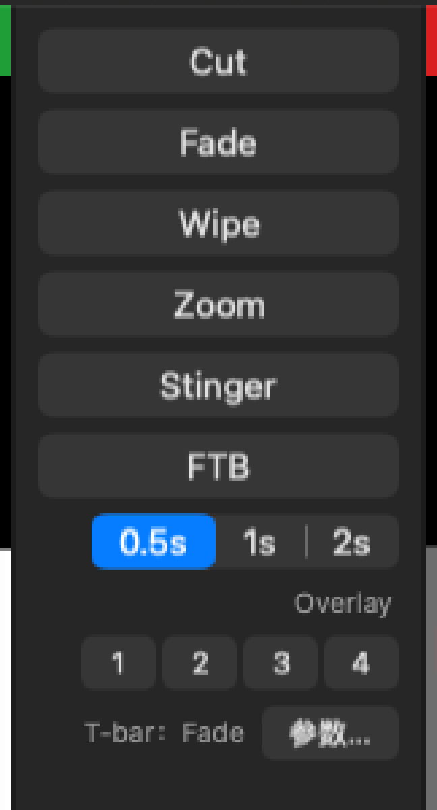
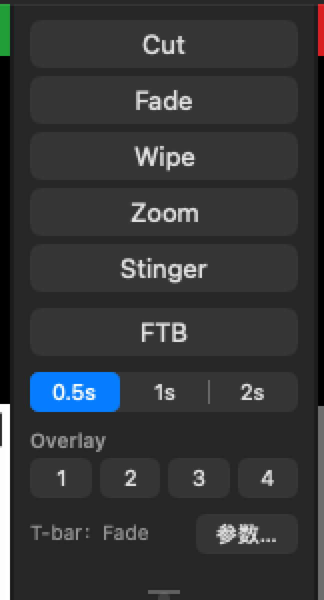
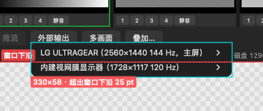
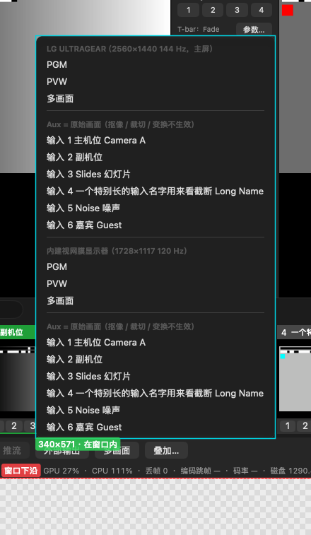

# 01 菜单逻辑：差在哪、按什么规则改

回答用户的第一个问题："现在很多菜单逻辑和参考软件不一样，先研究好、看看怎么改。"
本页讲规则和每一区的要点；逐条可开工的清单在 [01a 改动总表](01a-改动总表.md)（130 条，编号 A1…P4，下文括号里的编号都指它），要用户定的在 [04 待拍板](04-待拍板.md)（Qxx）。

## 0. 一句话结论

参考软件的菜单逻辑可以归成一套很一致的规则：**每个东西就近有齿轮（设置），按钮主体直接干活，右侧小箭头弹快捷菜单，底栏的菜单一律朝上开。**我们的 App 功能大多都有，但入口几乎全在 mac 菜单栏里，主窗口上缺齿轮、缺小箭头、缺工具条，转场按钮是"一个按钮 = 一种效果"而不是"四个可配置按钮"，底栏的菜单还往窗口外面弹。改法不是照抄，而是把这套规则搬过来，同时保留 mac 的菜单栏和快捷键习惯。

## 1. 总规则（下面各区的改法都从这 6 条推出来）

| # | 规则 | 参考依据 | 我们现在 | 对应条目 |
|---|---|---|---|---|
| 1 | **分体按钮三段**：⚙ = 打开这件事的设置；主体 = 执行 / 开关；▾ / ▴ = 快捷菜单（"全部开始 / 全部停止 + 每一路"、效果与时长、最近项） | 底栏 Record / External / Stream（图 001、111、119、124、133），转场按钮 ▾（图 064–067），Open / Save As / Fullscreen / Settings ▾（图 060–063、002） | 底栏七个都是普通按钮；只有"外部输出"一按弹菜单 | E2、K1、L1、L2、M1、G1、C2、A2、F2 |
| 2 | **就近齿轮**：监视器、输入格子、调音台条子、底栏每个输出都有自己的 ⚙，点了直达它自己的设置；右键 = 同一个菜单 | PVW / PGM 标题条齿轮（图 068）、卡片右下齿轮（图 069）、Master 条齿轮（图 104） | 监视器、格子都没有齿轮；设置靠右键、菜单栏或 ⇧⌘I | B1、B2、B3、D6、J2、J3 |
| 3 | **底栏的一级菜单和弹出层一律朝上开**，贴着按钮上沿、不出窗口；子菜单交给系统摆位 | 图 119、133、146（朝上）；图 123（子菜单会往下伸） | "外部输出"菜单、"叠加…"弹出层都往下，伸出窗口 25–318 pt（[03](03-目视检查.md) §2） | E1 |
| 4 | **状态写在按钮上**：当前用哪个转场、在推几路 / 哪路异常、录了多久，看按钮就知道 | 转场按钮上的字就是它的效果（图 001） | 推流按钮只看第一路、英文状态原样显示；看不出 T-bar 会推哪种转场 | C3、L4、L13、K11、E10 |
| 5 | **mac 菜单栏兜底**：主窗口里放了的每个动作，菜单栏里都还在，快捷键挂在菜单项上；sheet / popover / 独立窗口这些 mac 形式可以用，但不能挡住现场操作 | （参考是 Windows，没有菜单栏） | 菜单栏已有大部分入口；叠加面板是一点别处就关的浮层，总线效果是挡住主窗口的 sheet | O1–O4、I1、J2 |
| 6 | **借逻辑，不借文案**：入口位置、层级、触发方式照参考；文字、图标、默认快捷键表用我们自己的（铁律 6、设计方案 §1.1） | — | 界面里还出现了竞品的模块名"VMixCompat"（[03](03-目视检查.md) V-13） | P4、X62 |

有意**不**照参考做的，见第 6 节（PGM 红 / PVW 绿、ISO 与 PGM 同一拍起停、编号不挪位等）。

## 2. 为什么差这么多

- **W2-B 做主界面骨架时，把一批入口写成了"留给 W3-E"**：顶部工具条的 Pause Inputs / Basic / Settings、监视器和格子的齿轮、输入分类标签、多路录制齿轮、文件浏览记忆（reports/w2-app.md:112-130、:82）。**W3-E 的 prompt 没把它们列进去，所以一直没人做**（附录 R8 结论第 5 条，02 功能缺口 §0.4）。今天看到的"主窗口上缺齿轮、缺工具条"，大半是这次交接落空。
- **转场列按落地方案 §7 第 2 条落成了"一个按钮 = 一种效果"**：§7 定的是效果集合（Cut / Fade / Wipe / Zoom / Stinger，不做 Merge / Fly / Quick Play），W2-B 顺手把按钮模型也定成了固定类型。参考和界面稿的逻辑是"四个按钮各自带效果和时长"，这是入口模型的差别，不是效果集合的差别（Q01）。
- **mac 化时把入口收进了菜单栏**：这本身没错（规则 5），但主窗口里没留对应的就近入口，操作员在直播中得去菜单栏找。

## 3. 主窗口逐区对照

整窗对比：[改前 1440×900](img/主窗口-改前-1440x900.png)（参考见图 001；界面稿 docs/spec/ui-mock/vMix for Mac.dc.html）。

### 3.1 顶部工具条（A 区，6 条）

- **参考**：标题栏下一整行。左"Preset"组：New ｜ Open ▾（最近文件 + Clear）｜ Save ｜ Save As ▾（打包另存）｜ Last；中"Fullscreen ▾"（每块显示器 ▸ 选源）；右 Pause Inputs ｜ Basic ｜ Settings ▾（16 个设置页直达）｜ ?（图 001、060–063、002）。界面稿同样有这一行。
- **我们**：主窗口没有工具条，这些都在菜单栏"节目 / 输出 / PlusMix"里（`App/Sources/UI/MainWindowController.swift:127-136`；`App/Sources/AppDelegate.swift:78-88`）。
- **改成**：加 NSToolbar（一行，`.unified`）：左"节目"组 新建 ｜ 打开 ▾ ｜ 保存 ｜ 另存为；居中"全屏输出 ▾"（和底栏外部显示共用一份菜单，见 3.8 / 4.8）；右"设置 ▾"和"?"（A1、A2、F2、O3）。"暂停输入""精简模式"先不放——我们没有这两个功能，不放点了没反应的按钮（A5、A6，Q35、Q49）。
- **前置条件**：新建 / 打开现在会不问一声停掉正在跑的录制和推流、丢掉未保存的改动（A3，X03）。把这两个按钮摆到眼前之前，先加确认（Q67、Q68）。

### 3.2 监视器标题条（B 区，4 条）

- **参考**：PVW 标题条右端三个小图标（色彩 / 画框 / 齿轮）；PGM 只有齿轮，点开是小菜单"输入设置 ─ ✓ 输出"（图 001、068）。
- **我们**：标题条只有编号、名字、"PVW / PGM"字样；单击、双击、右键监视器都没有反应（`App/Sources/UI/MonitorView.swift`）。
- **改成**：PVW 加齿轮 = 打开 PVW 那一路的输入设置（B1，P1）；PGM 加齿轮 = 打开 PGM 那一路的输入设置（B2）；右键监视器弹"输入设置… / 全屏输出到 ▸"，单击不绑动作防误触（B3）；PGM 标题条右侧显示开着的叠加通道小徽标（B4）。色彩 / 画框两个图标对应的功能我们没有，不放（Q27）。

### 3.3 转场列（C 区，9 条，差别最大）

| 改前 | 只修排版的原型（[03](03-目视检查.md) §1） |
|---|---|
|  |  |

- **参考**：Quick Play ｜ Cut ｜ 四个分体转场按钮 ｜ FTB ｜ 叠加 1–4 ｜ 横向 T-bar ｜ 时钟（图 001）。每个转场按钮**自带效果和时长**，按钮上的字就是它的效果；▾ 弹出同一张菜单：22 种效果单选 + "Duration Milliseconds"输入框（截图时 Fade 500、其余 1000）（图 064–067）。
- **我们**：固定的 Cut / Fade / Wipe / Zoom / Stinger / FTB 六个按钮 + 一个五种转场共用的时长分段（0.5 / 1 / 2 s）+ "参数…"弹出层（`App/Sources/UI/TransitionPanelView.swift`）。三个后果：
  1. 想用 T-bar 推 Wipe，得先真做一次 Wipe——没有"只选不执行"的入口（V01）；
  2. 同一种效果只能有一个时长，"Fade 0.5 s"和"Fade 2 s"不能并存；只有一套 Stinger；
  3. 点 Fade 会悄悄把 T-bar 推的类型改成 Fade，Fade 按钮的提示还写着"回车"而回车走的是"当前类型"（C5）。
- **改成**（C1–C4，P0，要一份契约提案）：**"转场 1–4"四个可配置槽** + 固定的 Cut、FTB。出厂 = 今天的四个按钮（1 Fade 0.5 s、2 Wipe 1 s、3 Zoom 1 s、4 Stinger 1 s），老用户察觉不到变化。点主体 = 执行这个槽；点 ▾ 或右键 = 改配置、不执行：

```
效果
✓ Fade
  Zoom
  Wipe  左 → 右 / 右 → 左 / 上 → 下 / 下 → 上 / 对角     ← 五个方向平铺，一次点选
  Stinger：输入 4 片头.mov ▸                              ← 没选时写"Stinger（选输入…）"
────────────
时长
✓ 0.5 秒 / 1 秒 / 2 秒 / 自定义…                          ← 当前值不是预设时显示"✓ 自定义：0.75 秒"
────────────
参数…（软边、Stinger 换底拍）
用于 T-bar（不执行）                                      ← 打勾 = T-bar / 回车现在用这个槽
恢复出厂
```

  T-bar 上方那一行改成可点的弹出菜单，列四个槽，用来挑"当前槽"（C3，也就是附录 R8 的"只选不执行"入口）；快捷键 / MIDI / API / 兼容层加"执行转场 n""选中转场 n"两类动作（N6）。契约不批时的过渡做法：槽配置存 Show.layout，代价是外部控制够不着槽 2–4（Q01 选项 A′）。
- **其余**：叠加 1–4 按钮——通道没指定输入时用 PVW 那一路打开，而不是"按了变蓝却没画面"（C6）；FTB 时长能改（C8，要一条新命令）；按钮统一不抢焦点，保证空格 / 回车永远走快捷键（C9）；T-bar 横放还是竖放由用户定（C7、Q05，竖放是 W2-B 的选择，不在 §7 表里）；Quick Play 不放（§7 第 2 条，Q36）。
- **排版**："丑、没对齐"是另一件事，根因是 `TransitionPanelView.swift:98` 的 `stack.alignment = .width`（NSStackView 不支持），今天就能修，见 [03](03-目视检查.md) §1。

### 3.4 输入条与输入格子（D 区，11 条）

- **参考**：输入条左端是分类标签（彩色，可起名）+ 放大镜，右端"Audio Mixer"开关（图 001）；每张卡片两行按钮：Close ｜ Quick Play ｜ Cut ｜ Loop，1 2 3 4 ｜ Audio ｜ 显示器 ｜ ⚙（图 001、069）。
- **我们**：输入条只有"输入"标题 + 常驻搜索框；格子只有 Overlay 1–4 小按钮和"静音"。Cut 藏在 Shift + 点，删除、设置藏在右键，删除不确认（`App/Sources/UI/InputCellView.swift:183-233`）；没有调音台开关、没有"添加输入"占位格。
- **改成**：
  - 格子加一行看得见的按钮：转场（按当前槽把这一路送上 PGM）｜ Cut ｜ 删除 ×（在 PGM / PVW / 叠加 / 录制上时先确认）｜ 循环（只对文件）（D4、D9；D5 的播放 / 暂停要契约）；
  - 底行最右加 ⚙（D6）；"静音"对没有声音的输入灰掉（D7）；右键菜单补齐常用动作（D8）；
  - 输入条右端加"调音台"开关（D2）；末尾加虚线"＋ 添加输入"占位格，空节目时就是空状态提示（D10）；
  - 分类标签按颜色筛（D1，数据先放 Show.layout，Q14）。
- **不改**：PGM 红 / PVW 绿（参考是 PGM 绿 / PVW 橙；落地方案 §7 第 3 条）；搜索框保持常驻，加 ⌘F（D3）。
- 注意：转场进行中现在能改 PVW / PGM，会把正在切的画面换掉——格子上的"转场 / Cut"按钮要按 Q66 定的口径判断。

### 3.5 底栏与状态行（E 区，11 条）

| 参考（图 001 等，从左到右） | 我们对应的按钮（现在的顺序是 添加输入 · 录制 · ISO · 推流 · 外部输出 · 多画面 · 叠加，`App/Sources/UI/BottomBarView.swift:66`） | 改成 |
|---|---|---|
| Add Input ▴ | 添加输入… | 添加输入 ▴：▴ 里八种类型直达 + 最近添加的来源（G1） |
| ⚙ Record | 录制（全起全停，含 ISO） | ⚙ 录制 ▴：⚙ = 录制设置；主体仍一起起停（ISO 同拍）；▴ 里每路开关（K1、K3） |
| ⚙ MultiCorder（多路录制，自己起停） | ISO…（只打开 ISO 设置页，ISO 跟着录制起停） | 并进录制的 ⚙ / ▴，去掉单独按钮（K2，Q03 第 1 项） |
| ⚙ External | 外部输出（一按弹"显示器 × 源"菜单，往下弹） | ⚙ 外部显示：⚙ = 路由菜单（每块屏单选）；主体 = 全部外部显示一起开 / 关（M1、M2） |
| ⚙ Stream ▴（▴ 里"全部开始"） | 推流（全起全停；没目的地时变灰） | ⚙ 推流 ▴：⚙ = 推流设置；▴ = 全部开始 / 全部停止 + 每个目的地一项（L1、L2，P0） |
| ⚙ PlayList | — | 不放（后续方案 §2.5 落地再加） |
| — | 多画面 | 保留，同一模式：⚙ = 布局，主体 = 窗口开 / 关（E3） |
| 右组：Overlay ｜ ≡ 工具 ｜ 统计 ｜ 快捷按钮 ｜ 截图 ｜ 锁 | 叠加…（往下弹的浮层） | 叠加（独立窗，I1）｜ ≡ 工具菜单（E4）｜ 统计窗（E5）｜ 快捷按钮（E6）｜ 截图（E7）｜ 锁（E8） |

排好之后的顺序（E2）：左组 添加输入 ▴ ｜ ⚙ 录制 ▴ ｜ ⚙ 外部显示 ｜ ⚙ 推流 ▴ ｜ ⚙ 多画面；右组 叠加 ｜ ≡ ｜ 统计 ｜ 快捷按钮 ｜ 截图 ｜ 锁。

- **所有弹出物朝上开**（E1，P0）：用户点名的"菜单超出边框"就是这里，改法已实测（[03](03-目视检查.md) §2）。
- **停止前确认**（E11，P0）：录制 / 推流主体按下去会停掉所有路；参考默认要确认（图 005）。"开始"不确认，快捷键 / MIDI / API 不弹（Q41）。
- **状态行**独立成最底一行，格式写短"1080p59.94"（E9）；录制 / 推流显示时长（E10）。

 → 

## 4. 弹出的窗口与设置

### 4.1 设置体系（F 区，9 条）

- **参考**：一个"Settings"窗，左侧导航 16 页；右上 Settings ▾ 直达任一页（图 002–021）。
- **我们**：拆成四个互不相干的窗：偏好设置（一张长表单）、输出设置（左侧 7 页）、快捷键、MIDI 映射；快捷键 / MIDI 挂在"切换"菜单下；三种以上提交方式混用，关窗时没应用的改动静默丢（`App/Sources/Settings/*`）。
- **改成**：合成一个带侧栏的"设置"窗，侧栏分"本节目"（节目格式、输出各页、节目音频——随节目文件保存）和"本机"（常规、音频设备、远程控制、Tally、快捷键、MIDI、性能与电源、更新与诊断）两组（F1）；"设置 ▾"分体入口（F2）；快捷键 / MIDI 挪进设置（F3）；统一即时生效，要重起引擎的项集中到一个按钮并在录制推流中先确认（F4、F5）；加"高级"页放录制磁盘下限等（F7）。先做入口整理（S），合窗（L）排 0.1.x（Q04）。

### 4.2 添加输入（G 区，14 条）

- **参考**：Add Input 主体开"Input Select"窗，左列 21 种类型（大图标），默认停在第一项；▴ 快捷菜单（图 023–047）。
- **我们**：sheet，左列八种类型（文字），默认停在"合成测试源"，每次从零开始（`App/Sources/UI/AddInputSheet.swift`）。
- **改成**：分体按钮 + ▴（G1）；记住上次的类型和设备、第一次停在摄像头、测试源挪到最后（G2）；类型分组 + 图标（G3）；权限被拒 / 驱动没装时醒目横幅 + "打开系统设置…"（G6）；视频 / 图片最近文件（G11）；拖文件进来直接加（G13）；图片多选、改了 PNG 自动换上（G14，做字幕最常用）。类型本身的缺口（纯色 / 彩条、音频文件、网络流……）见 [02](02-功能缺口.md)。

### 4.3 输入设置（H 区，10 条）

- **参考**：每路一个窗，左侧 11 页（General / 调色 / 抠像 / 色彩校正 / 效果 / 位置 / 图层 / 触发器 / Tally / PTZ / 高级），大多数页下半是本路实时画面（图 069–103）。
- **我们**：左侧 6 节（基本 / 裁切变换 / 音频 / 抠像 / 效果链 / 来源），没有画面；"效果链"一节是**音频** EQ / 压缩，和参考同名的"效果"（视频）不是一回事（`App/Sources/Settings/InputSettingsPanel.swift`）。
- **改成**：入口见 B1、B2、D6、J3；"效果链"改名"音频效果"（H2）；嵌本路实时画面（复用多画面纹理，不动渲染器，H3）；抠像能在画面上点取色（H6）；按使用频率重排分节（H1）；几个设置窗别叠在一起（H9）。图层 / 调色 / 视频效果 / 触发器 / PTZ 是新功能，见 02 第 3、4 节。

### 4.4 叠加设置（I 区，3 条）

- **参考**：独立窗，一次编辑一个通道（Number：1–4 + Stinger 1–4），Type 全屏 / 画中画，19 种进出效果、时长、自动撤下、透明度、画中画拖框（图 141–145）。
- **我们**：底栏弹出的 transient 浮层，四个通道上下全列，点主窗口任何地方就关——边切边调做不到；而且内容被裁、往窗口外弹（`App/Sources/UI/OverlayPanel.swift`）。
- **改成**：独立的"叠加设置"窗，顶部选通道，即时生效；转场列叠加 k、格子叠加 k 的右键直达第 k 路（I1，Q40）；"整幅 / 画中画"二选一（I2）；新节目默认淡入 0.5 s（I3）。

### 4.5 音频（J 区，8 条）

- **参考**：Master 条上的齿轮开"音频设置"窗：General / Plugins / EQ（10 段图示）/ Compressor / Noise Gate，左侧常驻电平表（图 104–110）。
- **我们**：总线条上一个"效果 (n)"按钮，开的是挡住主窗口的 sheet；**效果链改了不出声**——引擎根本不读（X06、X07，S1）。
- **改成**：先止血：效果页和总线条标"尚未生效"、手册改（J1，P0）；再按 Q02 接线（总线先、每路后）。入口改成每条总线 / 输入条上的齿轮，开独立的"音频设置"窗（J2、J3、J4）；调音台 Master 常驻、总线 / 输入两组可收起（J6）；响度详情和耳机监听选总线（J7）；音频设备页能给每条总线选声道（J8，Bus A / B 现在没有出口）。

### 4.6 录制与 ISO（K 区，11 条）

- **参考**：Record ⚙ 开录制设置（两套配置，每套选 Output 1–4 为来源 + 格式）；多路录制是另一个按钮，自己的 Start（图 111–118、134）。
- **我们**：录制按钮一起起停 PGM + 全部 ISO（同一拍起步，这是我们有意的设计）；录制页只改第一个 PGM 录制；"容器 .mp4"选了没用；ISO 路创建时抄一次格式，之后不跟（X14、X26）。
- **改成**：⚙ 录制 ▴（K1、K3）；ISO 并入（K2）；"文件格式"单选取代"容器 + 转封装"（K5）；录制格式 / 目录对全部录制路生效（K10）；ISO 页改成通道表（K9）；状态文案本地化（K11）。

### 4.7 推流（L 区，13 条）

- **参考**：Stream ⚙ 开推流设置：每路一页（1–5）、目的地平台预设、质量摘要 + 齿轮进完整编码设置、Advanced（用户名 / 密码）、View Status 状态窗；▴ 里"全部开始"（图 124–133）。
- **我们**：底栏一个按钮全起全停；起不来的一路仍算"在跑"，再点会把正常的几路一起停掉（X02）；推流页没有起停、没有状态；地址里的用户名密码会被丢（X25）。
- **改成**：⚙ 推流 ▴ + 单路起停（L1、L2，P0）；推流页每个目的地加开关和状态行（L3）；按钮按最差状态汇总（L4）；起不来的路写明原因、改对地址后重试（L13）；服务预设和质量预设（L6、L7，平台名单用我们自己排的短表，Q31）；关键帧按秒显示、默认 2 s（L8）；推流状态面板（L11）；在推的路锁住关键字段（L12）；RTMP 鉴权（L10）。

### 4.8 外部显示 / 全屏输出（M 区，7 条）

- **参考**：顶部"Fullscreen ▾"：每块屏 ▸ 单选一个源，主体一键开关（图 062–063）；底栏 External ⚙ 管 Output 2–4 这类"输出通道"（图 119–123）。
- **我们**：底栏"外部输出"一按弹"显示器 × 源"菜单，每项独立打勾，同一块屏能叠开好几扇全屏窗；勾不看开没开，再点一次删掉整条配置；没有一键开关（`App/Sources/UI/ExternalOutputMenu.swift`）。
- **改成**：⚙ 外部显示：主体一键开 / 关、保留配置（M1）；每块屏单选 + "关闭"（M2）；菜单末尾加"外部显示设置… / NDI 发送设置…"（M3）；统一叫"外部显示"（M4）；工具条居中和底栏共用同一份菜单。"输出通道（Aux）"这一层 v1 不加（M6，Q15）。

### 4.9 快捷键 / MIDI 的动作选择（N 区，6 条）

- **参考**：选动作是一个小窗：左侧 16 个分类、右侧函数列表、顶部搜索，参数在宿主行里填（图 083–099）。能看清名字的 247 个函数，我们有 55、部分有 38、没有 154（大部分属于标题、回放、PTZ、数据源这类整块没做的功能）。
- **我们**：快捷键编辑器一个平铺下拉 12 种动作 + 一个整数参数，Fade 按拍填；MIDI 11 种；选"其他命令"保存后悄悄变成 Cut（X10）。
- **改成**：共用的"选动作"面板：分类 + 搜索 + 按命令目录自动生成的参数表单（N1、N3）；可绑动作补齐（N2）；"其他命令"先止血（N4）；搜索 / 复制行 / 启用勾（N5）；转场槽动作（N6）。默认快捷键表我们自己定，不照参考（Q29）。

## 5. 菜单栏（O 区，4 条）

菜单栏全部保留（规则 5），只重排和补项：

```
PlusMix   关于 PlusMix / 检查更新… / ─ / 设置… ⌘,  ▸ 各页 / ─ / 隐藏 / 退出
节目      新建 / 打开… / 打开最近 ▸ / 打开上次退出时的节目 / ─ / 保存 / 另存为…
编辑      （不变）
输入      添加输入… ⌘I / 按类型添加 ▸ / 输入 N「名字」设置… ⇧⌘I
切换      Cut 空格 / 执行当前转场（转场 2 · Wipe → 1 秒）回车 / ─ /
          转场 1–4（标题带效果和时长）/ ─ / FTB（✓ = 开着）/ Overlay ▸ 1–4（✓ = 开着）
输出      录制 ▸ / 推流 ▸ / 外部显示 ▸（和底栏同一份菜单）/ 多画面窗口 / 虚拟摄像头 ▸
窗口      最小化 / 缩放 / ─ / ✓ 调音台 / ✓ 多画面
帮助      PlusMix 使用手册 / 快捷键一览 / ─ / 导出诊断包… / 打开诊断文件夹
```

- "切换"菜单右侧的键是从当前快捷键表反查出来的，只显示、不另外绑定（O1）。
- "偏好设置…"改名"设置…"（O2，macOS 13 起的标准叫法）；快捷键 / MIDI 挪出"切换"菜单（F3）。
- 帮助菜单补手册和快捷键一览（O3）；"输入设置…"标题写出是哪一路（O4）。

## 6. 有意保留、不改的差异

完整 30 行见 [01a](01a-改动总表.md) 第 4 节，这里列最要紧的：

| 差异 | 为什么保留 |
|---|---|
| PGM 红 / PVW 绿（参考 PGM 绿 / PVW 橙） | 广播惯例，落地方案 §7 第 3 条 |
| 效果集合只有 Cut / Fade / Wipe / Zoom / Stinger，不做 Merge / Fly / Quick Play | 落地方案 §7 第 2 条；槽模型不加效果，只改入口 |
| ISO 与 PGM 录制同一拍起停，不给多路录制单独的"开始" | 测试标准 A4"多文件对齐"的前提 |
| 添加输入只选空号，已有输入不挪位 | 快捷键、MIDI、API、叠加都按编号绑定 |
| 保留 mac 菜单栏、sheet、⌘ 快捷键 | 平台习惯（规则 5） |
| 搜索框常驻（参考是放大镜点开） | 少点一下 |
| 音频效果链固定顺序（参考是可排序的插件列表） | 顺序固定更不容易调错；插件宿主是后续方案 §4.2 |

## 7. 先做哪些

P0 共 8 条，全部集中在"找不到 / 和习惯相反 / 界面说谎"：

| 条目 | 一句话 | 工作量 | 契约 |
|---|---|---|---|
| E1 | 底栏菜单和弹出层朝上开（用户点名） | S | 否 |
| E11 | 录制 / 推流停止前确认 | S | 否 |
| J1 | 效果链先标"尚未生效"，再接进引擎 | S → M–L | 否 |
| L1 | 推流按钮加 ⚙，没目的地时不灰 | S | 否 |
| L2 | 推流 ▴：全部开始 / 全部停止 + 单路起停 | M | 否 |
| C1 | 转场按钮改"转场 1–4"可配置槽 | L | 是（提案） |
| C2 | 每个槽"主体 + ▾"，▾ 只改配置不执行 | M | 同 C1 |
| C4 | 时长跟槽走，加"自定义…" | S | 同 C1 |

前 5 条不改契约、可以马上做；C1–C4 等 Q01 定了、提案批了再做。和转场列排版（"丑、没对齐"）一起的完整落地顺序见 [05 落地拆分](05-落地拆分.md)。
