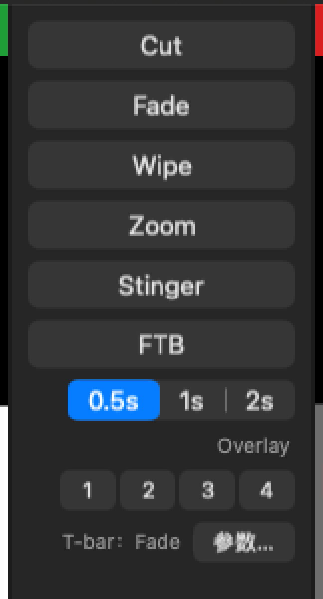
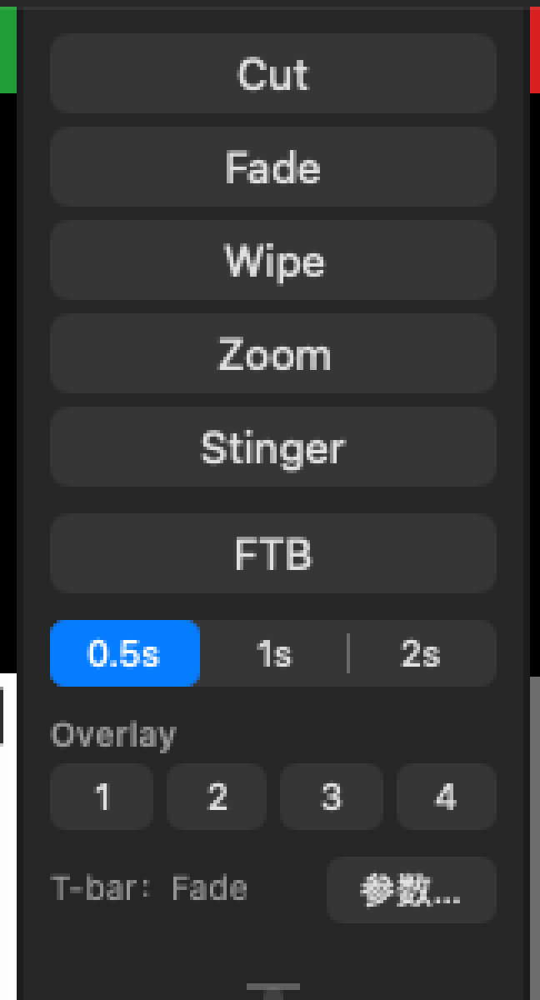
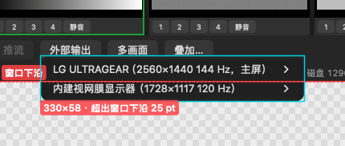
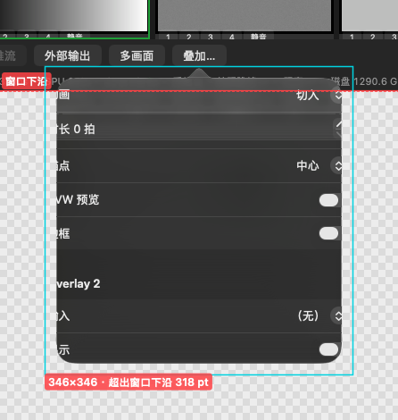

# 03 目视检查

把 App 真跑起来，逐个界面截图、量尺寸。用户事先点名了两处：**中间转场列"丑、没对齐"**，**底栏有个按钮的菜单超出边框**。两处都已找到根因、量化，并在临时拷贝里做了改法原型、实测通过。另外记下 32 条其它目视问题（S2 三条、其余 S3）。

- 原始记录（全部量化表、每张截图的文件名）：[附录/目视检查-原始记录.md](附录/目视检查-原始记录.md)
- 弹出菜单 / 弹出层的坐标实测：[附录/目视检查-弹出物几何.md](附录/目视检查-弹出物几何.md)
- 本页的截图在 [img/](img/)；其余 160 多张在调研草稿区，没入库。

## 0. 怎么测的

| 项 | 内容 |
|---|---|
| 提交 | c836cce（本分支起点，工作区干净） |
| 机器 | M5 Max，macOS 27.0；LG 2560×1440 @1×（主屏，截图都在这块屏上）+ 内建 1728×1117 @2× |
| 外观 | 深色，界面 zh-Hans |
| 构建 | `git archive` 出一份拷贝到草稿区，只在拷贝里加巡检脚本（`App/Sources/UITour.swift`，环境变量触发）、把几个 `private` 放开；bundle id 改成 `com.plusmix.switcher.uitour`，不碰用户的设置域 |
| 运行 | `XCTestConfigurationFilePath=/dev/null` 让 App 进测试宿主模式：独立 defaults、空节目、不恢复上次节目、退出不自动保存；加 6 路合成测试源当内容；结束用 `exit(0)` |
| 截图 | 只截本 App 的窗口（`screencapture -l <窗口号>`）；弹出物按窗口服务器给的边界拼到主窗口图上（窗口外画棋盘格，红框 = 主窗口，红虚线 = 窗口下沿，青框 = 弹出物） |
| 尺寸 | 1440×900（默认）、1100×700（最小）、铺满 LG、按内建屏铺满的尺寸，共四种；再加"窗口贴屏幕上沿"一种位置 |
| 量法 | 递归导出每个视图的窗口坐标 frame、alignmentRect、控件档、字号；再按像素扫描实际绘制的左右边 |

副作用（已告知用户）：打开"添加输入 › NDI"页时 NDI 源发现触发了一次 macOS 防火墙询问（对象是草稿区的临时构建，应点"拒绝"）；系统里多了 `~/Library/Preferences/com.plusmix.switcher.uitour.plist`（窗口位置，可删）。

## 1. 已知问题 (a)：中间转场列"丑、没对齐"

| 改前（c836cce） | 原型（只在临时拷贝里） |
|---|---|
|  |  |

整窗对比：[改前 1440×900](img/主窗口-改前-1440x900.png) · [原型 1440×900](img/主窗口-原型-1440x900.png)；FTB 开着时：[改前](img/转场列-FTB开-改前.png) · [原型](img/转场列-FTB开-原型.png)。

### 1.1 量出来的不齐（1440×900，x 从列左沿量）

| 控件 | 实际绘制的左…右边 | 控件档 / 字号 | 问题 |
|---|---|---|---|
| Cut / Fade / Wipe / Zoom / Stinger / FTB | 8…141 | regular 24 pt / 13 pt | 基准 |
| 时长分段 0.5s / 1s / 2s | 28…141 | small 20 pt / **13 pt** | 左边缩进 20 pt；small 控件配 regular 字号，字挤 |
| "Overlay" 标签 | 文字 103…138 | 10 pt | 设了居中，但标签只包住文字 → 贴右；左半边空出 25 pt 的洞 |
| Overlay 1–4 | 24…141 | small / 13 pt | 左边缩进 16 pt |
| "T-bar：Fade" 标签 | 文字 27…84 | 10 pt | 位置随字长漂：换成 Stinger 时左移 12 pt |
| T-bar 把手 | 14…135 | — | 比按钮窄 12 pt |
| 时钟 | 8…141 | 22 / 12 pt | 2 pt 纯白框是整列最"响"的东西；12 小时制显示成"12:13 上午" |

纵向 12 行一律间距 6 pt，没有分组；列的最小高度 483 pt，比最小窗口 1100×700 时能分到的 476 还高，T-bar 那一行被压到 13 pt（[1100×700 改前](img/主窗口-改前-1100x700.png)）。

### 1.2 根因（全在 App）

- **`App/Sources/UI/TransitionPanelView.swift:98` 的 `stack.alignment = .width`**：NSStackView 不支持这个值（读回来是 0），等于没做横向对齐。只有 6 个转场按钮自己设了宽度约束（`:74-76`），其余控件按自身宽度贴右——这是"没对齐"的主因。
- `:61`、`:65`、`:72` 只改了 `controlSize = .small`，没配 small 字号。
- `:67`、`:88` 标签的 `.center` 对齐无效（标签宽 = 文字宽）。
- `:84`、`:94`、`:99` 行内间距 2、4 和全列 6 三套间距互不相干，没有分组。
- `:109-110` T-bar ≥ 120 + 时钟 64 → 列最小高 483。
- `App/Sources/UI/TBarView.swift:49` 把手左右各缩 6；`App/Sources/UI/ClockView.swift:16`（"hh:mm a"）、`:24-26`（2 pt 白框）。
- FTB 开着时标题是黑字压红底，对比 3.0:1（白字是 6.8:1）：`App/Sources/UI/Theme.swift:61-64` 的 `contentTintColor` 管不到推按钮的标题。

### 1.3 改法（原型已实测：所有可见边都落在 8…141，列最小高 409 pt）

1. `stack.alignment = .leading`，每一行加 `widthAnchor == stack.width − 16`。
2. 控件只用两档：主操作 regular（24 pt 高、13 pt 字），次要控件 small（20 pt 高、`systemFontSize(for: .small)` = 11 pt 字）。时长分段 `segmentDistribution = .fillEqually`，Overlay 行 fillEqually、间距 4。
3. 组标题（"Overlay"、"T-bar · Fade"）左对齐在 x = 8；T-bar 行标签靠左、"参数…"靠右。
4. 间距用 `setCustomSpacing`：组内 4、组间 8、组标题到控件 2。
5. T-bar 把手与按钮同宽；T-bar 最小高 60。
6. 时钟 56 高、1 pt `Theme.divider` 边框、圆角 6、字号 20 / 11；12 小时制用 `setLocalizedDateFormatFromTemplate("hmma")`。
7. 高亮态标题一律白字（FTB、录制、静音这几处红底都受影响）。

改后布局（x 一律 8…142）：

| 行 | y | 高 | 与上一行 |
|---|---|---|---|
| Cut / Fade / Wipe / Zoom / Stinger | 8、36、64、92、120 | 24 | 4 |
| FTB | 152 | 24 | 8 |
| 时长分段 | 184 | 20 | 8 |
| "Overlay" 组标题 | 212 | 13 | 8 |
| Overlay 1–4 | 227 | 20 | 2 |
| "T-bar · Fade" + 参数… | 255 | 20 | 8 |
| T-bar | 279 | 弹性（≥ 60） | 4 |
| 时钟 | 列高 − 64 | 56 | 下边距 8 |

这是**只修排版**的改法，和 [01 菜单逻辑](01-菜单逻辑.md) §C 的"转场 1–4 四个槽"改版是两件事：先修排版（S，今天就能做），槽模型定了再整列重排。可选：转场按钮排成 2×3 网格，列最小高还能再省约 84 pt，同时缓解监视器黑边（V-01）。

## 2. 已知问题 (b)：底栏按钮的菜单超出边框

有两个，都是"往下弹"：

| 弹出物 | 改前 | 超出多少 |
|---|---|---|
| **"外部输出"菜单**（最可能就是用户说的那个） |  | 四种窗口位置下每次都伸出窗口下沿 **25 pt**，盖住状态行；它的显示器子菜单伸出 **228 pt**（[截图](img/外部输出子菜单-改前.png)） |
| **"叠加…"弹出层** |  | 窗口下方屏幕放得下时（1100×700），整块弹到窗口外，伸出 **318 pt**；放不下时翻到上方，但内容只有 320×320、装的是 400×640 的表单，**每行标签头一两个字被裁掉**（"动画"→"画"、"Overlay 2"→"verlay 2"，[截图](img/叠加弹出层-改前-1440x900-被裁.png)） |

窗口铺满、下沿贴屏幕下沿时，系统会把菜单往上推，菜单留在窗口内，但会盖住"外部输出"按钮本身。参考软件底栏的菜单都朝上开，贴着按钮上沿（图 119、133、146）；它的子菜单交给系统摆位，也会往下伸（图 123）。

### 2.1 根因

- 外部输出：`App/Sources/UI/MainWindowController.swift:297` 的 `menu.popUp(positioning: nil, at: NSPoint(x: 0, y: anchor.bounds.height), in: anchor)`。NSButton 是翻转坐标（`isFlipped == true`，已写探针确认），`y = bounds.height` 就是**按钮下沿**：菜单顶在按钮下沿，往下挂 58 pt；按钮下沿离窗口下沿只有 28 pt，必然伸出 25 pt。子菜单来自 `App/Sources/UI/ExternalOutputMenu.swift:53-73`，首项和父项顶对齐往下长。
- 叠加…：同一个文件 `:281` 的 `preferredEdge: .maxY`，在翻转坐标的按钮上 `.maxY` 也是**下沿**，所以首选往下弹。内容被裁是因为 `App/Sources/UI/OverlayPanel.swift:208-212` 用 NSHostingView 装表单、没设 `preferredContentSize`（实测内容区 320×320），而表单在 `:168` 固定 `.frame(400, 640)`。对照：转场"参数…"弹出层用 NSHostingController + `preferredContentSize`，尺寸正确。

### 2.2 改法（原型已实测）

| 改法 | 结果 | 原型截图 |
|---|---|---|
| 菜单往上开：`at: NSPoint(x: 0, y: -menu.size.height + 1)` | 一级菜单底边落在按钮上沿之上 4 pt，整块在窗口内（离下沿 56 pt）；但子菜单仍往下伸出 147 pt | [朝上](img/外部输出菜单-原型-朝上.png) |
| 再把"显示器 ▸"子菜单拍平成段标题（每块屏一个小标题，下面列来源） | 2 台屏 × 6 路输入 = 25 项、340×571，整块在窗口内，上方还剩 305 pt | [朝上 + 拍平](img/外部输出菜单-原型-朝上拍平.png) |
| 叠加面板：`preferredContentSize = 400 × min(640, 窗口内容高 − 120)`，`preferredEdge = .minY`（翻转坐标里是上沿），表单高度可伸缩 | 1440×900 时 426×666 完整显示、在窗口内；1100×700 用 520 高也在窗口内 | [原型](img/叠加弹出层-原型.png) |

落地时抽一个"底栏弹出"的小工具函数，底栏以后加的 ▴ 菜单（录制、推流、添加输入，见 [01](01-菜单逻辑.md) §E）都走它；叠加面板长期改成独立窗口（01 §I）。其它弹出物实测都在窗口内：转场"参数…"弹出层（在按钮右侧）、格子右键菜单、添加输入 sheet、重命名对话框。

## 3. 其它目视问题（32 条）

编号沿用原始记录（V-xx）。S2 = 有绕过办法的功能问题，S3 = 外观 / 文案（测试标准 §6 的级别）。

### 3.1 S2（3 条）

| 编号 | 现象 | 根因 | 建议 |
|---|---|---|---|
| V-02 | 窗口缩小时分栏按比例缩放：1100×700 下输入条只剩 133 pt（声明 ≥ 190），头行和格子按钮被切；调音台宽 216 / 282（声明最小 340）；日志里 14 条约束冲突 | `App/Sources/UI/MainWindowController.swift:108-125`、`:137-138`：子视图是 frame 管理，holding priority 不生效 | 改用 NSSplitViewController，或 delegate `shouldAdjustSizeOfSubview` 对输入条 / 调音台返回 false。原型实测输入条 197、调音台 339（[原型 1100×700](img/主窗口-原型-1100x700.png)） |
| V-13 | 偏好设置里出现竞品的模块名"VMixCompat"（中英两份都有），违反铁律 6（lint 只放行代码里的模块名） | `App/Resources/*.lproj/Localizable.strings:648` | 标题去掉模块名，写"第三方 API 兼容层"；lint 规则顺带扫 `.strings` 里的这个 token（[截图](img/偏好设置-底部.png)） |
| V-28 | 格子右键菜单里"删除"和其它项没有分隔，也不确认；撤销是灰的 | `App/Sources/UI/InputCellView.swift:184-190` | 加分隔线；删 PGM / PVW / 叠加上的输入先确认（[04](04-待拍板.md) Q06） |

### 3.2 S3：主窗口布局

| 编号 | 现象 | 根因 | 建议 |
|---|---|---|---|
| V-01 | PVW / PGM 大半是黑边：1440×900 时显示区 501×631，画面只有 501×282（黑 55%） | `MainWindowController.swift:142`，监视器没按 16:9 约束 | 上半区高 = 标题条 26 + 宽 × 9/16，和转场列最小高取大 |
| V-03 | 调音台内容垂直居中，上下各空约 250 pt（[截图](img/调音台-内容居中.png)） | `App/Sources/UI/MixerPanelView.swift:231-257` | `.frame(maxHeight: .infinity, alignment: .top)`（原型已验证） |
| V-04 | 调音台表头"监听"折成两行；宽 216 时"调音台"也折行、"AFV"消失 | `MixerPanelView.swift:262-276` | 分段控件 labelsHidden，标签 fixedSize |
| V-23 | 输入格子缩略图上下各约 10 pt 黑边 | `InputCellView.swift:101`、`InputStripView.swift:135-145` | 显示框按裁切后的比例算 |
| V-32 | 1100×700 时转场列 T-bar 行被压到 13 pt | `TransitionPanelView.swift:109-110` | 用 §1.3 的新布局 |

### 3.3 S3：对比度与字

| 编号 | 现象 | 根因 | 建议 |
|---|---|---|---|
| V-05 | FTB 开着时黑字压红底，对比 3.0:1；录制 / 静音的红底推测同样 | `Theme.swift:61-64` | 高亮时用白字 attributedTitle |
| V-06 | PVW 标题条白字压绿底，对比 3.5:1 | `Theme.swift:16` | 绿调暗，或改黑字 |
| V-07 | 10–11 pt 暗灰字在 1× 屏上有效对比约 2:1；提示蓝字 4.18:1 | `Theme.swift:11`；`TransitionPanelView.swift:24`、`:87`；`BottomBarView.swift:26-27` | 字号 ≥ 11 pt，暗灰提到 0.68 |
| V-08 | 时钟显示"12:13 上午" | `ClockView.swift:16` | 模板 `hmma` |

### 3.4 S3：文案与用词

| 编号 | 现象 | 根因 | 建议 |
|---|---|---|---|
| V-14 | 开发术语和规格号进了界面：测试标准 §2.1、设计方案 §0 / §9.3、BLOCKED-签名、AVCaptureDevice、ParametricEQ、`--api-listen`、AppleLanguages、环形缓冲、时钟从属、scheme 等 | `Localizable.strings` 约 15 处（行号见原始记录）；`AddInputSheet.swift:673` | 改成操作员能懂的话，实现口径挪进手册 |
| V-16 | 添加输入 › 音频设备的说明行过长贴边，还带"bltn" | `AddInputSheet.swift:673` | 拆两行，传输类型翻成中文 |
| V-18 | 用词不一：外部输出 / 外部显示；叠加… / Overlay；"输出"菜单里"外部输出…"与"外部输出 ▸"、"虚拟摄像头…"与"虚拟摄像头 ▸"并存 | `AppDelegate.swift:118-141` | 统一叫"外部显示"（§1.1）；设置类菜单项带"设置"二字 |
| V-19 | "切换"菜单缺 Wipe / Zoom / Stinger，也不显示快捷键 | `AppDelegate.swift:105-112` | 见 [01](01-菜单逻辑.md) §O 的重排 |
| V-22 | 状态行中英混用；上下留白 6 / 24 / 10 / 14 / 4 不对称，左沿差 2 pt；偶尔显示"GPU 0%" | `BottomBarView.swift:77-87`、`StatusLineFormatter.swift` | 统一语言、对称留白；状态行独立成最底一行（01 §E） |

### 3.5 S3：空状态与控件细节

| 编号 | 现象 | 根因 | 建议 |
|---|---|---|---|
| V-09 | 空节目时输入条一片空白，没有"添加输入"占位 | `InputStripView.swift` | 虚线占位卡，写 ⌘I（01 §D） |
| V-10 | MIDI 映射没有设备时只有"MIDI 源 0 个："，表格空白 | `MIDIMappingPanel.swift:189`；`Localizable.strings:417` | 写空状态说明 |
| V-11 | 快捷键编辑器没有列头；组合键显示成"shift+1" | `HotkeyEditorPanel.swift:163` | 加表头，用 ⇧⌘ 符号 |
| V-12 | 偏好设置里分辨率显示成"1,920×1,080"，端口"8,098" | `PreferencesPanel.swift:178`、`:189`、`:219` | `Text(verbatim:)`、`.grouping(.never)` |
| V-15 | 输出设置 › 录制的长路径被按钮压住，没有省略号 | `OutputSettingsPanel.swift:447` | 中间截断，完整路径放提示 |
| V-17 | 添加输入 › 文件 / 图片：路径为空时路径框看不见 | `AddInputSheet.swift:619`、`:633` | "未选择文件"占位 |
| V-20 | 底栏"外部输出"没有 ▾，看不出点了是菜单 | `BottomBarView.swift:43` | 随底栏三段式改（01 §E） |
| V-21 | 弹出层是半透明玻璃，压在视频上字难读 | `TransitionPanelView.swift:186`、`OverlayPanel.swift:208` | 内容加不透明背景 |
| V-24 | "打开最近"里同名文件分不出来 | `AppDelegate.swift:170-185` | 同名时加上级目录名 |
| V-25 | 偏好设置的"应用"按钮在长滚动表单最底下 | `PreferencesPanel.swift:244-245` | 按钮固定在窗口底部 |
| V-26 | 多画面标签截断没有省略号 | SwitcherRender 的名字条绘制 | 画"…" |
| V-27 | 声像滑块从左填充，居中时显示半条蓝 | `MixerPanelView.swift:302` | 中点刻度、不填充 |
| V-29 | 合成测试源表单把测试专用参数全露出来；灰度滑块和数值分两行 | `AddInputSheet.swift:498-527` | 测试参数折叠进"高级" |
| V-30 | 抠像页"键色"标签没和色块垂直居中 | `InputSettingsPanel.swift:267` | 调行对齐 |
| V-31 | 窗口菜单里"调音台 / 多画面"是开关，但没有 ✓ | `AppDelegate.swift:148-149` | 按可见性设 state |

另记一条非目视的旁注：巡检期间约每秒 2 次 cache_delete 查询，推测是磁盘余量用了会触发 CacheDelete 的 API（没核代码），交录制磁盘保护那一路的会话看。

## 4. 没截到的界面

总线效果 sheet（SwiftUI 状态驱动，程序拿不到入口）；NDI 页真实发现结果（为免再弹防火墙询问，后几轮关掉了自动发现）；摄像头 / 屏幕的授权后状态；录制 / 推流 / 外部显示 / 虚拟摄像头的运行态（按约定不开）；打开 / 保存面板、关于、导出诊断包；所有 2× 截图（内建屏那块的当前空间被别的 App 占着，窗口实际不可见）。

## 5. 复测与防回归

- 巡检脚本没入库（它要放开 `private` 并改 bundle id，只适合临时拷贝）。建议落地会话在 App 测试里加两条几何断言：转场列里所有可见控件左右边一致；底栏每个弹出物的 frame 在主窗口 frame 内。都走 `cacheDisplay` / 窗口坐标，不依赖屏幕录制权限。测试 ID 建议见 [05 落地拆分](05-落地拆分.md)。
- 原型代码在草稿区（`tour-src/`，挂在 `PLUSMIX_UI_TOUR_FIX` 环境变量后面），只作参考，正式实现由 App 会话按上面的改法重写。
