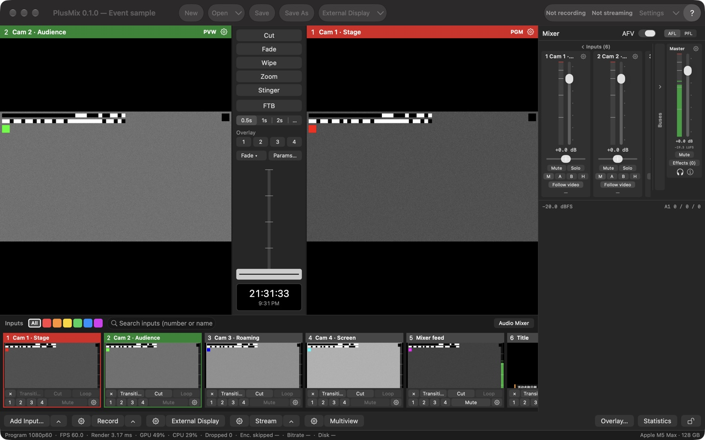

# Concepts

One vocabulary is used everywhere: interface, show files, API and this manual ([design spec §1.1](../../spec/导播台设计方案.md#11-统一用词)).

| Term | Meaning |
|---|---|
| **Input** | A numbered signal source: camera / capture device, DeckLink, screen, video file, image, NDI®, audio-only device, synthetic test source. Numbers start at 1; 0 means "black" |
| **Program / PGM** | What the audience sees (the large monitor on the right, red title bar) |
| **Preview / PVW** | What goes on air next (the large monitor on the left, green title bar) |
| **Transition** | How PVW becomes PGM: Cut, Fade, Wipe, Zoom, Stinger |
| **T-bar** | Manual transition lever; pushing it to the end commits and it snaps back |
| **FTB** | Fade to black; while on, PGM outputs black and audio fades to silence |
| **Overlay 1–4** | Four independently switchable layers on top of PGM: lower thirds, picture-in-picture, logos |
| **Bus** | The four audio buses: Master, Bus A, Bus B, Headphones |
| **Output** | Recording, streaming, NDI® output, external display, virtual camera, multiview |
| **Tally** | Per input: on PGM / on PVW / neither. Cell title bars, multiview borders, Stream Deck colours and external tally lights all read it |
| **Show** | A JSON file (`*.switcher.json`) holding inputs, switching, audio, outputs and window layout |
| **Tick** | One beat of the program clock = one frame; 30 ticks at 1080p60 is 0.5 s |

## The main window

The smallest window is 1100×720 (including the toolbar row). The areas:

| Area | What it does |
|---|---|
| **Toolbar** | Left: New / Open▾ / Save / Save As — the same actions as the Show menu (New and Open ask first, see [Show files](#show-files)); Open▾ = Open Show from Last Quit + the 10 most recent shows + Clear Menu. Centre: External Display▾ — the button turns all external displays on / off, ▾ chooses what each display shows (same as ⚙ External Display in the bottom bar). Right: recording / streaming status (display only, the same text as the bottom-bar buttons; "Not recording / Not streaming" when off), Settings▾ (the button opens Settings on the page you used last; ▾ lists every settings page) and "?" (= the Help menu) |
| **Monitors** | PVW on the left, PGM on the right; the title bar shows number and name. The gear at the right end of a title bar opens the input settings of the input on that monitor (greyed out when it is black). Right-click a monitor for "Input Settings… / Show Fullscreen On ▸": one item per display, ticked = that display is showing this monitor full screen; choose an unticked one to show it there, a ticked one to turn that display off (its settings are kept). The PGM title bar lists the visible overlays ("channel · input name"); while FTB is on it reads "PGM · FTB" and blinks slowly. Clicking or double-clicking a monitor does nothing |
| **Transition column** | See [Transitions](#transitions) |
| **Mixer** | On the right, see [Audio](#audio); Window › Audio Mixer or the "Audio Mixer" switch at the right end of the input strip hides and shows it |
| **Input strip** | One cell per input: thumbnail + two rows of buttons; category tags and a search field above; a "＋ Add Input" cell at the end, and you can drop video / image files on it. Details in [Inputs › Input strip and cells](inputs.md#input-strip-and-cells) |
| **Bottom bar** | Two rows: buttons on top, the status line below. The buttons are listed below |
| **Status line** | The bottom row of the window, full width. On the left, once a second: program format, frame rate, render time, GPU / CPU, dropped frames, encoder skips, bitrate, free disk. These numbers are **the same data** the API and `stats.jsonl` report ([test standard §7](../../testing/测试标准.md#71-统计字段-statsjsonl)); the UI does not compute its own. On the right: machine information ("Apple M5 Max · 128 GB") normally, notices when there are any (they disappear after 4 s), and an amber reminder bar when a reminder is active |

Click a thumbnail to put it on PVW; Shift-click cuts it straight to PGM.

### Bottom-bar buttons

Most buttons have three parts: **⚙ opens the settings of that kind, the main button does the work, ▴ opens a menu upwards**. Missing parts are simply not shown.

| Button | ⚙ | Main button | ▴ |
|---|---|---|---|
| Add Input… | — | The Add Input panel, on the type you used last (same as ⌘I) | Jump straight to one of the eight types; "Recently Added" (up to 5) adds another input of that source without the panel (lowest free number, automatic name); = Input › Add by Type ▸ |
| Record | Menu: Recording Settings… / ISO Recording… | Nothing recording → every route that **takes part in recording** starts on the same tick; something recording → stop all (asks first). No record output in the show yet → it adds a default one (recording into `~/Movies/PlusMix`) and starts | One line per record output "name · state" (✓ = recording); click a recording line to stop just that route (asks first); routes that are off are greyed out (a single route can't be started mid-recording); "Stop All" at the end; = Output › Record ▸ |
| External Display | Menu: one single-choice section per display (PGM / PVW / Multiview / Input n; once a display has been set up the first line is "Off", and an output that is off is marked "(off)"), remove a route / Turn Off All External Displays, External Display Settings… / NDI® Output Settings…; = Output › External Display ▸ | Some are on → turn them all off; all off → turn them all back on as configured; none configured → show PGM full screen on the first non-main display; no second display → open the ⚙ menu | — |
| Stream | Settings › Streaming | Nothing on → start all; some couldn't start → retry only those (healthy ones are not stopped and nothing is asked); all live → stop all (asks first). No destination in the show yet → opens the Streaming page with the cursor in the "Add destination" URL field | Start All / Stop All; one item per destination ("name · state · bitrate"; click = start just that one if off, stop just that one if live, retry just that one if it couldn't start); Streaming Settings… / Stream Status…; = Output › Stream ▸ |
| Multiview | Settings › Multiview Layout | The separate multiview window on / off (highlighted while open) | — |
| Overlay… (right group) | — | Opens the Overlay Settings window on the channel you edited last (see [Overlay channels](#overlay-channels)) | — |
| Statistics (right group) | — | The statistics window (below) | — |
| 🔒 (far right) | — | Interface lock on / off (below) | — |

The Record / Stream buttons show **the worst route**: "● Recording (3)", "● Streaming 2/3" (live destinations / all destinations); when a route is reconnecting or couldn't start the button turns orange "Stream · 1 in trouble" (dark red when it couldn't start);
the tooltip lists "name: state" for every route, with the reason for routes that couldn't start. A first connection reads "Connecting"; only after a destination has been live does a drop read "Reconnecting (attempt n)". Details in [Outputs › Streaming](outputs.md#2-streaming).

**Stopping asks first**: the bottom-bar Record / Stream button, stopping one route from ▴, and "Stop all" on the Streaming page all show "Stop recording (n)?" with every route's state; Return does not land on "Stop", Esc cancels.
Hotkeys, MIDI and the API never ask. Settings › General › Confirmations turns the stop question off (the bottom bar, the ▴ menus and the Streaming page all follow it); the question shown on New / Open / format change / Quit while recording or streaming cannot be turned off.

### Reminders, statistics window, interface lock

- **Reminders**: an amber bar at the right of the status line, several joined with "·": the engine has run n minutes with neither recording nor streaming (off by default, n = 5), FTB has been on for 10 seconds (the PGM title bar blinks too),
  the Master level has stayed below −50 dBFS for 30 seconds (only judged when some input with sound feeds the Master unmuted). Settings › General › Reminders turns each off separately; changes apply immediately.
- **Statistics window**: the Statistics button in the bottom bar or Window › Statistics, read-only. Five sections: Inputs (fps / repeated / dropped / latency), Rendering (render time / missed / jitter / GPU / CPU / memory),
  Outputs (each output matched by number to its name, type, source, state, frames, encoder skips, dropped, bitrate, reconnects), Displays (monitor, multiview window, external displays, virtual camera) and Audio (dropouts / underruns / discontinuities, Master peak, short-term loudness).
  It reads the same statistics line as the status line and the API. "Reset" only restarts the counts inside this window; `stats.jsonl`, the API and the status line keep counting.
- **Interface lock**: the lock at the far right of the bottom bar, or Window › Lock Interface (ticked while locked). While locked, mouse clicks in the main window (toolbar, cells, T-bar, mixer, bottom bar) do nothing and the status line says
  "Interface locked: click the lock at the right end of the bottom bar to unlock; shortcuts still work"; **hotkeys, MIDI, the API and the menu bar keep working**, and separate windows such as Settings and Statistics are not locked. The button reads "Locked" while locked.
  **The interface lock has no default shortcut** (so it can't be hit by accident): use the lock button or the menu.

### Menu bar

| Menu | Contents |
|---|---|
| PlusMix | About PlusMix, Check for Updates…, Settings… (⌘,), Shortcuts…, MIDI Mapping…, All Settings Pages ▸, Hide, Quit |
| Show | New (⌘N), Open… (⌘O), Open Recent ▸, Open Show from Last Quit, Save (⌘S), Save As… (⇧⌘S) |
| Input | Add Input… (⌘I), Add by Type ▸, Input N "name" Settings… (⇧⌘I, the input on PVW; greyed out while PVW is black), Find Input (⌘F) |
| Transition | Cut, Run Current Transition (type · duration), the five types under "T-bar and Return use (select only, doesn't run)", FTB, Overlay ▸ 1–4 and Overlay Settings…. The grey text on the right is the key bound in the current shortcut table (display only; keys are handled by the shortcut table) |
| Output | Record ▸, Stream ▸, External Display ▸ (the same menus as the bottom bar), Turn On / Turn Off All External Displays, Multiview Window, Virtual Camera ▸, then the output settings pages (Output Overview…, Recording Settings…, ISO Recording…, Streaming Settings…, External Display Settings…, NDI® Output Settings…, Virtual Camera…, Multiview Layout…) |
| Window | Minimize, Zoom, Audio Mixer, Multiview Window, Input Thumbnails ▸ (Small / Medium / Large), Statistics, Lock Interface |
| Help | PlusMix User Guide (this manual, installed with the app as web pages), Keyboard Shortcuts (a page generated from the current shortcut table, opened in your browser), Export Diagnostics…, Show Diagnostics Folder |

The pages of the Settings window (⌘,) are described in [Settings](settings.md).

## How a switch happens

Every control — button, shortcut, MIDI, API, script — only **sends a command** to the state machine. The state machine applies it,
publishes a new immutable snapshot, and the render thread reads the latest snapshot once per tick. Consequences:

- Switches always land on a tick boundary; a Cut has no intermediate frame (a hard requirement of the [test standard](../../testing/en/README.md), V6).
- The UI and the API always see one state; two operators cannot overwrite each other, commands queue in arrival order.
- A command the state machine ignores by rule is not an error; the receipt says `applied = false`: Fade while a transition is running, **changing PVW / PGM while a transition is running** (both preview and cut-to-program are refused, and a half-pulled T-bar counts as running), FTB already at the target.
  The Transition / Cut buttons on the cells are greyed out during a transition, clicking or Shift-clicking a thumbnail does nothing, and the status line says "Transition in progress: PVW / PGM can change after it finishes".

The full command list is the [API reference](../../api.md) (Chinese); the shortcut table binds the same commands.

## Transitions

| Type | Effect | Parameters |
|---|---|---|
| Cut | Atomic swap of PGM and PVW | none |
| Fade | Cross-fade | duration |
| Wipe | New picture wipes in | direction (left → right, right → left, top → bottom, bottom → top, diagonal), softness (0–1) |
| Zoom | New picture grows from the centre | duration |
| Stinger | An image / file with alpha on top; the picture underneath swaps at tick n | stinger input number, cut tick |

The transition column, top to bottom:

- **Cut**: puts PVW on PGM at once. Cut during a running transition completes it immediately.
- **Fade / Wipe / Zoom / Stinger**: a click runs it — selects that type and immediately runs one auto transition (at the duration selected below); the T-bar and Return use that type from then on.
- **FTB**: fade to black / back from black.
- **Duration**: 0.5s / 1s / 2s / … ("…" = custom, 0.1–10 seconds; when the duration is not a preset, this segment shows the actual value). All five transitions share this duration.
- **Overlay 1–4**: overlay channel on / off (see [Overlay channels](#overlay-channels)); a channel without an input uses the input on PVW. Right-click = Overlay Settings…
- **"Fade ▾"**: which transition the T-bar and Return use — choosing here **only sets it, it doesn't run**; the current type is ticked, and it can't change during a transition. The row flashes when the type changes.
- **Params…**: Wipe direction / softness, Stinger input / cut tick. Changes made during a transition (including a half-pulled T-bar) apply when it finishes.
- **T-bar**: uses the type chosen in "Fade ▾". 25 % is a 25 % mix or wipe position; pushing to the end swaps and returns to 0; releasing midway holds.
- **Clock**: local time.

Every button's tooltip shows the key bound in the current shortcut table (it follows changes to the table). In the Transition menu the five types are, like "Fade ▾", **select only**; "Run Current Transition" runs it.

FTB has its own duration (defaults to the transition duration, both 30 ticks); tally does not change while black. In this version the FTB duration cannot be changed from the UI, only in the show file (`ftb.durationTicks`) or through the API's `loadShow`.

## Overlay channels

Each channel has one input, a rectangle in 0–1 program coordinates, an in / out animation (cut / fade / slide / zoom with a duration),
an optional border (for picture-in-picture) and an anchor (zoom animates around it).

Showing and hiding: Overlay 1–4 in the transition column, the small 1–4 buttons on a cell (click = put this input on that channel and show it; if it is already showing there = hide), Transition › Overlay ▸, and the hotkeys ⌃1–⌃4.

The **Overlay Settings window** is a normal window (it doesn't block the main window; you can keep clicking cells and pressing hotkeys). Open it from Overlay… in the bottom bar (on the channel you edited last), from "Overlay Settings…" in the right-click menu of Overlay k in the transition column or of a cell's small k button (straight to channel k), or from Transition › Overlay ▸ › Overlay Settings….

| Section | Contents |
|---|---|
| Top | Overlay 1–4 segments; only the current channel is shown; every change applies immediately |
| Source | Input, On (switch), Preview in PVW |
| Full screen / picture in picture | One or the other. Full screen covers the picture (position, anchor and border are hidden, their settings kept); picture in picture = position preset (lower third, bottom right quarter, bottom left, top left, top right, custom) + X / Y / W / H, border (colour, width), anchor. Switching from full screen starts at the bottom right quarter |
| In / out animation | Cut / Fade / Slide (from which edge) / Zoom; duration in seconds (0.5 / 1 / 2 s shortcuts; the tooltip says "= n frames") |

- In a show created in the app all four channels fade in over 0.5 s by default (that is only the app's default for new shows; shows built through the API or the headless engine default to cut).
- Transparent parts of an image / video show PGM through. A full 1920×1080 PNG with alpha plus "Full screen" is the simplest way to do titles (the [sample shows](../../../Samples/README.md) do exactly that).
- While a channel is visible (including its out animation) its input counts as on PGM: red tally.
- PVW does not draw overlays by default; tick "Preview in PVW" per channel, or turn all on in Settings › General › Preview all overlays in PVW.
- Channels stack 1 to 4; 4 is on top.

## Audio

- **Per input**: gain (−96…+24 dB), mute, solo, pan, audio delay compensation (0–500 ms; delays the sound only, for a capture device's own A/V offset), bus routing, follow video.
  They can be changed on the input's mixer strip and in Input Settings › Audio (both are the same settings).
- **Four buses**, each with gain / mute / an effect chain. Master feeds recording / streaming / NDI®; Bus A / B are secondary mixes (foldback etc.); Headphones is the monitor bus (solo / PFL / AFL live there).
  Which two channels of the output device each bus goes to is chosen in Settings › Audio Devices (needs a multichannel device; see [Settings › Audio Devices](settings.md#audio-devices)).
- **Bus effect chains now affect the sound**: parametric EQ (up to 16 bands per slot, the UI offers 3), compressor and peak limiter, processed in chain order; a slot that is turned off is bypassed (its parameters kept); at most 3 slots per bus.
  A compressor or limiter adds 5–35 ms of processing delay to that bus — **recording / streaming / NDI® stay in sync** (it is compensated), but live monitoring on speakers / headphones is late by that much.
  The compressor has no fixed ratio: it holds the part above the threshold under "threshold + amount"; the limiter's ceiling is fixed at 0 dBFS and its attack is the look-ahead (which is the bus's extra delay).
- **Per-input effect chains** can be edited but **do not affect the sound yet** in this version (Input Settings › Audio effects and the audio settings window say "Effects don't affect the sound yet (this version)").
- **AFV (audio follows video)**: with the global switch in the mixer header on, inputs whose "Follow video" is on are only audible on PGM and cross-fade with the transition (same start tick, same length).
  For a presenter microphone or a mixer feed that must always be heard, turn that input's "Follow video" off (on its mixer strip, or Input Settings › Audio › Follow video (AFV)).
- **Headphone monitoring**: AFL (after fader) / PFL (pre fader); the monitor point can sit before the alignment delay (low latency) or after it (aligned with picture), in Settings › Show Audio.

### The mixer

- Header: the AFV switch and AFL / PFL. Inputs on the left (scroll horizontally), Bus A / B / Headphones in the middle, the Master strip pinned on the right; the input group and the bus group each collapse into a narrow bar (by default inputs are expanded and buses collapsed).
- Each strip: name and gear (= that strip's audio settings window), fader and meter, mute / solo, send to M / A / B / H, follow video. Under the Master strip: short-term loudness (LUFS), "Effects (n)" (opens the EQ page),
  the headphones icon (the Listen menu) and "i" (loudness details: momentary / short-term / integrated / loudness range LRA / true peak, updated every second; integrated loudness counts from engine start and can't be reset in this version).
- The Listen menu: in this version the headphones carry the headphone bus only; "listen to Master / Bus A / Bus B" are listed but greyed out (they need audio engine support).
- Meters: each strip shows peak and RMS, the Master strip also short-term loudness; true peak, momentary / integrated loudness and LRA are in the loudness details, the API and `stats.jsonl`. Recording and streaming loudness use these meters.

### Audio settings window

The gear on a mixer strip opens "Audio Settings — Master / Input n" (one window per strip; clicking the same gear again brings it to the front). The left column is that strip's post-fader meter; pages on the right:

| Page | Contents |
|---|---|
| General | Format (48 kHz · stereo), fader reading, mute; for inputs also "Input Settings… (gain / pan / delay / sends)". There is no input trim or automatic gain in this version |
| EQ | Enabled + up to 3 bands (centre frequency, gain, Q), Reset |
| Compressor | Enabled + threshold, amount, output gain; attack / release / expansion ratio under "Advanced"; Reset |
| Limiter (buses only) | Enabled + pre-gain, attack, decay; Reset. The page says how many milliseconds late the bus runs |

Turning "Enabled" off bypasses the effect and keeps its parameters; "Reset" sets the parameters back to defaults without touching the switch. Hotkeys keep switching the program while an audio settings window is in front.

## Show files

The Show menu: New / Open… / Open Recent / Open Show from Last Quit / Save / Save As… (the four buttons at the left of the toolbar are the same actions).
The file is readable JSON with the same fields as the API's `state` ([CONTRACTS.md §2.8](../../CONTRACTS.md), Chinese) and can be generated by scripts ([example](../../../Samples/tools/make-shows.py)).

- An input's **runtime state** (signal or not) and an output's **runtime numbers** (frames, bitrate) are not in the file; only configuration is.
- Recording / streaming outputs are always stopped when a file is opened; only a button, shortcut or API call starts them.
- With **unsaved changes** the window's close button shows a dot. Show content counts as a change: inputs, outputs and their settings, transition type / duration / parameters, overlay positions and animations, audio settings (faders too), the program format.
  Live operation does not: which input is on PVW / PGM, transition progress, FTB, which overlays are showing, whether recording / streaming runs, window arrangement.
- **New, Open, Open Recent, double-clicking a show in Finder, Quit** (⌘Q, or closing the main window — closing the main window quits): while recording / streaming runs it first asks "Creating a new show will stop 1 recording(s), 1 stream(s)";
  with unsaved changes it then asks "Save changes to 'name'?" (Save / Don't Save / Cancel; "Save…" for a show that has never been saved). Cancelling at any step changes nothing.
- Quitting **never silently rewrites** the show file you opened: "Don't Save" leaves the file byte-for-byte unchanged. The current state is still kept in `~/Library/Application Support/PlusMix/LastSession.switcher.json` (for crash recovery).
- Next launch: if a file was open last time → that file is opened (as it is on disk); if it was a never-saved show → it is restored from LastSession (marked unsaved).
  To get back changes you didn't save when quitting: Show › Open Show from Last Quit (it is not a file; saving asks where to save it).
- The program format and show audio need an engine restart ("Apply and Restart Engine" in Settings); you are asked first while recording / streaming runs, and the Settings window stays open.
- The shortcut table and MIDI map are **not** in the show file; they live next to it as `hotkeys.json` / `midi.json` ([Shortcuts](shortcuts.md)); this Mac's settings (the "This Mac" group in Settings) are not in the show file either.
