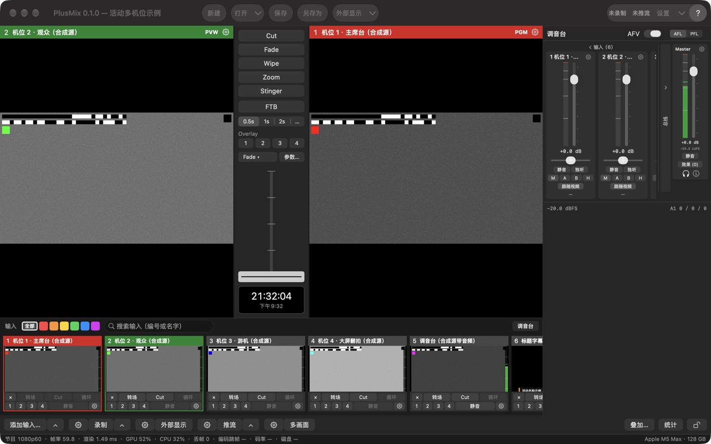

# 概念

导播台的用词只有一套（[设计方案 §1.1](../spec/导播台设计方案.md#11-统一用词)），界面、节目文件、API、本手册都用它。

| 词 | 意思 |
|---|---|
| **Input（输入）** | 编号的信号源：摄像头 / 采集卡、DeckLink、屏幕、视频文件、图片、NDI®、纯音频设备、合成测试源。编号 1–16（一个节目最多 16 路），0 保留给"黑场" |
| **Program / PGM** | 观众看到的画面（右边那个大监视器，红色标题条） |
| **Preview / PVW** | 下一个要切上去的画面（左边那个大监视器，绿色标题条） |
| **Transition（转场）** | PVW 变成 PGM 的方式：Cut、Fade、Wipe、Zoom、Stinger。节目里有四个**转场槽**（转场 1–4），每个槽存一种效果、时长和参数 |
| **T-bar** | 手动控制转场进度的推杆（横放，左 0 右 1）；推过 97% 松手提交并回弹 |
| **FTB** | 渐黑（Fade to Black）；开着时 PGM 输出黑场，声音跟着落到静音 |
| **Overlay 1–4（叠加通道）** | 叠在 PGM 上、可独立开关的四层：下三分之一字幕、画中画、台标 |
| **Bus（音频总线）** | Master、Bus A、Bus B、耳机（Headphones）四条 |
| **Output（输出）** | 录制、推流、NDI® 发送、外部显示、虚拟摄像头、多画面 |
| **Tally** | 每个输入"在 PGM / 在 PVW / 都不在"的状态：格子标题条、多画面边框、Stream Deck 按钮颜色、外部 tally 灯都用它 |
| **Show（节目文件）** | 一个 JSON 文件（`*.switcher.json`），保存输入、切换、音频、输出配置和窗口布局 |
| **Tick（拍）** | 节目时钟的一拍 = 一帧的时间；1080p60 下 30 拍 = 0.5 s |

## 主窗口

最小窗口 1100×720（含工具条那一行；缩略图选"大"时会再高一点）。各区域：

| 区域 | 做什么 |
|---|---|
| **工具条** | 左："新建 / 打开▾ / 保存 / 另存为"，和"节目"菜单同一套动作（新建、打开同样先问，见[节目文件](#节目文件)）；"打开▾"= 打开上次退出时的节目 + 最近 10 个 + 清除列表。正中"外部显示▾"：主体 = 全部外部显示开 / 关，▾ = 每块屏送什么（同底栏 ⚙ 外部显示）。右：录制 / 推流状态（只显示，文字和底栏按钮同一份，在录 / 在推时带时长，没开写"未录制 / 未推流"）、"设置▾"（主体 = 打开设置窗、回到上次那一页；▾ = 所有设置页）、"?"（= 帮助菜单） |
| **监视器** | 左 PVW、右 PGM；标题条写编号和名字。标题条右端的齿轮 = 这一路的输入设置（PVW 的齿轮开 PVW 上那一路，PGM 的开 PGM 上那一路；黑场时灰着）。右键监视器 = "输入设置… / 全屏输出到 ▸"：每块屏一项，打勾 = 这块屏正在全屏显示这个监视器的画面，点没勾的 = 这块屏改成显示它，点有勾的 = 关掉这块屏（配置留着）。PGM 标题条上会列出开着的叠加（"通道号 · 输入名"）；FTB 开着时写"PGM · FTB"并慢闪。单击、双击监视器不做任何事 |
| **转场列** | 见下面的[转场](#转场) |
| **调音台** | 右侧，见[音频](#音频)；窗口 › 调音台，或输入条右端的"调音台"开关收起 / 拉出 |
| **输入条** | 每路输入一个格子：缩略图 + 两行按钮；头一行有分类标签、搜索框；末尾"＋ 添加输入"占位格，可以把视频 / 图片文件拖进来。详见 [输入 › 输入条与格子](输入.md#输入条与格子) |
| **底栏** | 两行：上面是按钮，下面是状态行。按钮见下表 |
| **状态行** | 窗口最底一行、全宽。左边每秒刷新：节目格式、帧率、渲染耗时、GPU / CPU、丢帧、编码滞后跳帧、录制码率、推流码率、磁盘剩余（见下）——这些数字和 API、stats.jsonl 里的是**同一份**（[测试标准 §7](../testing/测试标准.md#71-统计字段-statsjsonl)），不是界面自己另算的。右边平时是本机信息（"Apple M5 Max · 128 GB"），有提示时显示提示（4 s 后消失），有提醒时出现琥珀色的提醒条 |

状态行里和输出有关的三项写成"编码滞后跳帧 n · 录制 x Mb/s · 推流 y Mb/s"：

- **编码滞后跳帧**：编码器跟不上、在编码之前跳过的帧（这一路这次开始录 / 推以来累计），取在录 / 在推的路里最多的那一路；录制、推流都没在跑时取 NDI® 发送的。
- **录制 / 推流**：分开写码率，几路同时在跑时各写**码率最低**的那一路（正在退避重连的推流码率是 0，就显示 0 b/s；起不来、失败的推流不算在跑）；没在录 / 没在推写"—"。NDI® 发送的原始码率（约 2 Gb/s）不算在里面。

点缩略图 = 选到 PVW；按住 Shift 点 = 直切 PGM。

### 底栏按钮

大多数按钮分成三段：**⚙ 打开这一类的设置，主体直接干活，▴ 弹一个朝上的快捷菜单**。没有的段不显示。

| 按钮 | ⚙ | 主体 | ▴ |
|---|---|---|---|
| 添加输入… | — | 添加输入面板，停在上次添加用的类型（⌘I 同一个入口） | 八种类型直达；"最近添加"（最多 5 个）点一下不弹面板、直接再加一路（编号取空号、名字自动取）；= 菜单"输入 › 按类型添加 ▸" |
| 录制 | 菜单：录制设置… / ISO 分路录制… | 都没在录 → 所有**参与录制**的路同一拍一起开始；有在录的 → 全部停止（先确认）。节目里还没有录制输出 → 先加一路默认的（录到 `~/Movies/PlusMix`）再开始 | 每个录制输出一行"名字 · 状态"（✓ = 在录；在录的那一行带时长："名字 · 录制中 · 01:02:05"），点在录的那一行 = 只停这一路（先确认），没开的路灰着（不能中途单独开始）；"全部停止"；末尾"录制状态…"（打开[推流 / 录制状态窗](输出.md#推流--录制状态窗)的录制页）；= 菜单"输出 › 录制 ▸" |
| 外部显示 | 菜单：每块屏一段单选（PGM / PVW / 多画面 / 输入 n；这块屏已经配过时第一行是"关闭"，关着的那一路标"（已关）"）、删除某一路 / 关闭全部外部显示、外部显示设置… / NDI® 发送设置…；= 菜单"输出 › 外部显示 ▸" | 有开着的 → 全部关；都关着 → 按原来的配置全部开；一路都没配 → 在第一块非主屏上全屏显示 PGM；没有第二块屏 → 弹 ⚙ 那个菜单 | — |
| 推流 | 设置 › 推流页 | 都没开 → 全部开始；有起不来 / 失败的路 → 只重试那几路（正常的路不停、不问）；都在推 → 全部停止（先确认）。节目里还没有目的地 → 打开推流页，光标放在"添加目的地"的地址框 | 全部开始 / 全部停止；每个目的地一项（"名字 · 状态 · 码率"，点 = 没开的只开它、在推的只停它、起不来 / 失败的只重试它）；推流设置…（推流页）/ 推流状态…（推流 / 录制状态窗的推流页）；= 菜单"输出 › 推流 ▸" |
| 多画面 | 设置 › 多画面布局页 | 多画面独立窗口开 / 关（开着高亮） | — |
| 叠加…（右组） | — | 打开叠加设置窗，停在上次编辑的那一路（见[叠加通道](#叠加通道)） | — |
| 统计（右组） | — | 统计窗（见下） | — |
| 🔒（最右） | — | 界面锁开 / 关（见下） | — |

录制 / 推流按钮的字反映**最差的那一路**，在录 / 在推时带**时长**："● 录制 01:02:05"、几路一起录时"● 录制 00:14:22（3 路）"；"● 推流 00:10:00"（节目里只有一个目的地）、"● 推流 00:10:00（2/3）"（在推的路数 / 目的地总数）。
时长读统计（与 API 同一份），多路取最长的那一路，推流的时长从开始推算起、重连期间也算；没有新一行统计时字不变（App 不自己计时）。
有路在重连、起不来或失败（服务器拒绝鉴权后停下）时变成橙色"推流 · 1 路异常"（起不来 / 失败的是深红），只开了一路时直接写它的状态（"推流 · 重连中（第 2 次）"、"推流 · 失败"）；
悬停提示逐路列"名字：状态"，起不来 / 失败的写原因。推流首次连接写"连接中"，连上过之后断线才写"重连中（第 n 次）"。工具条右边的状态是同一份文字。详见 [输出 › 推流](输出.md#2-推流)。

**停之前先确认**：点底栏的录制 / 推流主体、▴ 里停某一路、推流页的"全部停止"，都会先弹"确定停止录制（n 路）？"并列出要停的路（底栏这一问还写每路的状态）；回车不会落在"停止"上，Esc = 取消。
快捷键、MIDI、API 停止时一律不问。设置 › 常规 › 操作确认 可以关掉"停止前确认"（底栏、▴ 菜单、推流页的停止都跟着它）；新建 / 打开 / 换格式 / 退出时还在录、在推的那一问不能关。

### 提醒、统计窗、界面锁

- **提醒**：状态行右侧的琥珀色提醒条，几条用"·"连起来：引擎跑了 n 分钟还没在录也没在推（默认关，n 默认 5）、FTB 开着满 10 秒（同时 PGM 标题条慢闪）、
  Master 电平持续 30 秒低于 −50 dBFS（只在有一路带声音的输入送进 Master 且没静音时判）。设置 › 常规 › 提醒 里每条可以单独关，改了立刻生效。
- **统计窗**：底栏"统计"或 窗口 › 统计，只读。五节：输入（帧率 / 重复帧 / 丢帧 / 延迟）、渲染（渲染耗时 / 丢帧 / 抖动 / GPU / CPU / 内存）、
  输出（每个输出按编号对上名字、类型、来源、状态、帧数、编码跳帧、丢帧、码率、重连）、显示（监视器、多画面窗口、外部显示、虚拟摄像头）、音频（回调超时 / 欠载 / 不连续、Master 峰值、短期响度；下面一张"效果链延迟"表：四条总线（没装效果写 0.0 ms）和装了均衡 / 压缩的每一路输入，各写处理延迟（一位小数）与压缩器实测（两位，没装自写压缩器写"—"），是采样那一刻的瞬时值，"重置"不动它）。
  读的是和状态行、API 同一行统计。"重置"只在这个窗里从 0 算起，stats.jsonl、API、状态行照旧累计。
- **界面锁**：底栏最右的锁，或 窗口 › 锁定界面（锁着时打勾）。锁着时主窗口里的鼠标点击（含工具条、格子、T-bar、调音台、底栏）都不生效，点了状态行提示
  "界面已锁定：点底栏最右的锁解锁；快捷键照常"；**快捷键、MIDI、API、菜单栏照常**，设置窗、统计窗等独立窗口不锁。按钮锁着时写"已锁定"。
  **界面锁没有默认快捷键**（防止误按），只能点底栏的锁或用菜单。

### 菜单栏

| 菜单 | 有什么 |
|---|---|
| PlusMix | 关于 PlusMix、检查更新…、设置…（⌘,）、快捷键…、MIDI 映射…、所有设置页 ▸、隐藏 PlusMix、退出 PlusMix（⌘Q） |
| 节目 | 新建（⌘N）、打开…（⌘O）、打开最近 ▸、打开上次退出时的节目、保存（⌘S）、另存为…（⇧⌘S） |
| 编辑 | 撤销、重做、剪切、复制、粘贴、全选——给输入框用的；节目里的改动（加删输入、改设置）没有撤销 |
| 输入 | 添加输入…（⌘I）、按类型添加 ▸、输入 N「名字」设置…（⇧⌘I，PVW 上那一路；PVW 是黑场时灰着）、搜索输入（⌘F） |
| 切换 | Cut ／ 执行当前转场（转场 1 · Fade 0.5 秒）／ 转场 1–4（标题带效果与时长，当前槽打勾；**点了就做**，与转场列的主体同一条路，转场进行中灰着）／ FTB ／ Overlay ▸ 1–4 与"叠加设置…"。右边灰字写的是当前快捷键表里对应的键（只显示，按键由快捷键表处理；默认 空格 / 回车 / ⌥1–⌥4 / F / ⌃1–⌃4） |
| 输出 | 录制 ▸、推流 ▸、外部显示 ▸（同底栏的菜单，录制 ▸ / 推流 ▸ 末尾有"录制状态… / 推流状态…"）、打开全部外部显示 / 关闭全部外部显示（一路都没配而有第二块屏时写"在副屏上显示 PGM"，没有第二块屏时灰着）、多画面窗口、虚拟摄像头 ▸，下面是输出各设置页（输出总览…、录制设置…、ISO 分路录制…、推流设置…、外部显示设置…、NDI® 发送设置…、虚拟摄像头…、多画面布局…） |
| 窗口 | 最小化、缩放、调音台、多画面窗口、输入缩略图 ▸（小 / 中 / 大）、统计、锁定界面 |
| 帮助 | PlusMix 使用手册（就是本手册，随 App 一起装的网页版）、快捷键一览（按当前快捷键表生成一页，用浏览器打开）、导出诊断包…、打开诊断文件夹 |

设置窗（⌘,）的各页见 [设置](设置.md)。

## 切换是怎么发生的

所有操作——按钮、快捷键、MIDI、API、脚本——都只是**发一条命令**给状态机；状态机把命令应用到当前状态、发布一个新快照；渲染线程每拍读一次最新快照。
所以：

- 切换永远落在拍点边界上，Cut 没有中间帧（[测试标准](../testing/测试标准.md) V6 硬性要求）。
- 界面和 API 看到的永远是同一个状态；两个人同时操作不会互相覆盖，命令按到达顺序排队。
- 被状态机按规则忽略的命令不算错，回执里 `applied = false`：转场进行中再按 Fade、**转场进行中改 PVW / PGM**（选 PVW、直切 PGM 都会被拒，T-bar 推到一半也算转场进行中）、FTB 已经是目标状态。
  格子上的"转场 / Cut"按钮在转场进行中是灰的，点缩略图、Shift 点也不生效，状态行提示"转场进行中：等这次转场做完再改 PVW / PGM"。

命令的完整列表在 [API 参考](../api.md)；快捷键表里能绑的也是它们。

## 转场

| 类型 | 做什么 | 参数 |
|---|---|---|
| Cut | PGM / PVW 原子对调 | 无 |
| Fade | 交叉淡变 | 时长 |
| Wipe | 新画面按方向擦入 | 方向（左 → 右 / 右 → 左 / 上 → 下 / 下 → 上 / 对角）、软边（界面 0–0.3；API 收 0–1） |
| Zoom | 新画面从中心放大到满幅 | 时长 |
| Stinger | 一张带 alpha 的图 / 文件叠在最上层，在第 n 拍换底 | 作 stinger 的输入编号、换底拍 |

### 转场槽

转场不是每次临时挑类型，而是放在节目里的四个**转场槽**（转场 1–4）里：每个槽存一种效果、一个时长和它的参数（Wipe 方向 / 软边、Stinger 输入 / 换底拍），随节目保存。出厂四槽：

| 槽 | 出厂设置 | 按钮上写 |
|---|---|---|
| 转场 1 | Fade 0.5 秒 | Fade 0.5s |
| 转场 2 | Wipe 左 → 右 1 秒 | Wipe → 1s |
| 转场 3 | Zoom 1 秒 | Zoom 1s |
| 转场 4 | Stinger 1 秒，还没选输入 | Stinger 未设 |

- **当前槽**：T-bar、回车、菜单"执行当前转场"、格子上的"转场"按钮用的那一个（新节目是转场 1）。转场列里当前槽的按钮左边有一条常亮的蓝色竖条（这个槽正在执行时按钮蓝底、竖条变白）。
  执行哪个槽，哪个就成为当前槽；只想换当前槽、不执行，用槽 ▾ 里的"用于 T-bar（不执行）"。
- 改槽（效果 / 时长 / 参数）只改设置、不执行，转场进行中也能改：正在进行的那一次照开始时的设置走完，改的若是当前槽，做完那一拍起按新设置——T-bar 推到一半时改了、又把 T-bar 拉回 0（取消）也一样，拉回 0 那一拍起就是新设置。
- 秒数按节目的标称帧率换成拍（59.94 按 60 算：1 秒 = 60 拍）；节目文件里存的是拍。
- 旧节目文件（还没有转场槽的）打开时补上出厂四槽，原来那组转场放进转场 1、当前槽是 1；原来是 Cut 的不放（转场 1 仍是 Fade 0.5 秒），这时当前那组对不上任何槽（见下面转场列一节的末尾）。

### 转场列

从上到下：Cut ｜ 转场 1–4 ｜ FTB ｜ Overlay 1–4 ｜ "T-bar"一组 ｜ 时钟。

- **Cut**：立刻把 PVW 切上 PGM。转场进行中按 Cut = 立即完成这次转场（声音跟着在同一拍收口，见[音频 › AFV](#音频)）。
- **转场 1–4**：每个是"主体 + ▾"。
  - **点主体 = 执行这个槽**：一拍内选中并开始（之后 T-bar 和回车也用它）。按钮上的字是槽的效果与时长（Wipe 带方向箭头 → ← ↓ ↑ ↘），执行中蓝底。转场进行中点别的槽什么都不发生（状态机忽略，按钮不灰）。
  - **Stinger 槽还没选输入**（按钮写"Stinger 未设"）**执行不了**：状态机不收"执行"这种槽——不然画面在换底拍那一拍就硬切（出厂换底拍 0 = 第 1 拍；没有 Stinger 画面可叠），状态机却要等满时长（出厂 1 秒）才对调 PGM / PVW。
    点主体、菜单栏"切换 › 转场 n"、T-bar 那一行的菜单：先弹出这个槽的输入选择（标题"转场 4 · Stinger：先选一路输入，选好后再点一次才执行"），选一路只改这个槽，再点才执行；
    格子上的"转场"（和右键"按当前转场送上 PGM"，当前槽是它时）：同样在格子按钮下面弹这个槽的输入选择，**一条命令都不发**（PVW 不换），悬停写"转场 4 是 Stinger、还没选输入：点一下先选输入（不换 PVW、不执行）"；
    ⌥4、回车、"执行当前转场"、MIDI：不执行，状态行提示"转场 4 是 Stinger、还没选输入——在转场列 ▾ 里选一路"；兼容层 `Transition4` 回 409，Stream Deck 按钮闪一下警告，API 回 400。只选中（"用于 T-bar"）照常。
    当前槽是这种槽时 **T-bar 灰掉、推不动**，下面一行橙字"转场 4 是 Stinger、还没选输入"（悬停写为什么：推下去会是一次硬切）；选了输入或换了当前槽就恢复。MIDI 推杆和 API 的 `tbar` 不经过界面，照样能推——推过换底拍的位置画面就换（出厂一推就换），推到顶对调，等于一次硬切。
  - **▾ 或右键主体**：这个槽的菜单，只改设置、不执行，当前的那项打勾：
    - 效果：Cut（无过渡：T-bar 推到顶才切）／ Fade ／ Zoom ／ Wipe 五个方向（左 → 右、右 → 左、上 → 下、下 → 上、对角）／ Stinger ▸ 选输入；
    - 时长：0.5 / 1 / 2 秒 / 自定义…（0.1–10 秒；不是预设值时多一行"✓ 自定义：0.75 秒"）；
    - 参数…（软边、Stinger 换底拍）：在这个槽右边弹出一个小面板，改的是这个槽的 Wipe 方向 / 软边（0–0.3）与 Stinger 输入 / 换底拍；
    - 用于 T-bar（不执行）：只把它设成当前槽，T-bar 和回车改用它（转场进行中灰着）；
    - 恢复出厂：这个槽回到上表的出厂设置（已经是出厂设置时灰着）。
- **FTB**：也是"主体 + ▾"。主体 = 淡出到黑 / 从黑淡回（开着时红底）；▾ 或右键 = FTB 自己的时长：0.5 / 1 / 2 秒 / 自定义…，不跟随转场时长，悬停提示写着现在是几秒。FTB 开着时 tally 不变。
  正在淡（出或回）的时候改时长：从改的那一拍起按新时长、从当前的亮度接着淡，声音跟画面一起换。
- **Overlay 1–4**：叠加通道开关（见[叠加通道](#叠加通道)）；通道还没指定输入时，按下用 PVW 上那一路打开。右键 = 叠加设置…
- **"T-bar"一组**：
  - 第一行是当前槽，写成"转场 2 · Wipe → 1 秒 ▾"（没选输入的 Stinger 只写"转场 4 · Stinger ▾"）。点开列出四个槽（当前的打勾），**点一个就执行它**（之后 T-bar 和回车也用它）；转场进行中四项灰着。只选不执行在各槽的 ▾ 里（菜单底下有这句提示）。当前槽被换掉（执行别的槽、"用于 T-bar"、⌥n、API）或当前槽的效果 / 时长改了时，这一行高亮 1.5 秒。
  - 时长分段 0.5s / 1s / 2s / …：改的是**当前槽**的时长，别的槽不动（"…" = 自定义；时长不是预设值时这一格写实际值）。
  - **T-bar**（横放）：推的是当前槽。左 0、右 1，拖到 25% 就是 25% 的混合 / 擦边位置；**过 97% 松手 = 提交**（PGM / PVW 对调），然后回弹到最左；没过 97% 松手就停在原位，下次从那里接着推。自动转场时能看到它自己往右走。MIDI 推子不经过它，照旧推到两端就提交并换向。
    当前槽是没选输入的 Stinger 时它是灰的（见上面"转场 1–4"）。
- **时钟**：本机时间。

每个按钮的悬停提示写着当前快捷键表里对应的键（改了表跟着变）：默认 ⌥1–⌥4 = 执行转场 1–4，回车 = 执行当前槽，空格 = Cut，F = FTB（[快捷键](快捷键.md)）。
节目里的当前那组转场如果是 API / 节目文件直接设的、对不上任何一个槽，T-bar 那一行只写效果与时长（不写槽号），四个槽都不亮，时长分段改的是那一组（转场进行中改不了）。

## 叠加通道

每个通道一路输入 + 一个位置尺寸（0–1 的比例矩形）+ 一种进出动画（切入 / 淡入 / 滑入 / 缩放 + 时长）+ 可选的边框（画中画用）和锚点（缩放动画绕它缩）。

开关叠加：转场列的 Overlay 1–4、格子上的 1–4 小按钮（点 = 把这一路放到这个通道并打开；它已经开在这个通道上时 = 关）、菜单 切换 › Overlay ▸、快捷键 ⌃1–⌃4。
转场列、菜单和快捷键 ⌃1–⌃4 遇到还没指定输入的通道，都用 PVW 上那一路打开；PVW 也是黑场时不开，状态行提示"Overlay n 还没指定输入，PVW 也是黑场……"。

**叠加设置窗**（独立窗口，开着也不挡主窗口，照样可以点格子、按快捷键）的入口：底栏"叠加…"（停在上次编辑的那一路）、转场列 Overlay k 或格子上 k 号小按钮的右键"叠加设置…"（直接到第 k 路）、菜单 切换 › Overlay ▸ › 叠加设置…。

| 一节 | 内容 |
|---|---|
| 顶部 | Overlay 1–4 分段，只显示当前这一路；每一项改了立刻生效 |
| 来源 | 输入（选"（无）"= 清掉这个通道的输入：开着的通道画面立刻没有、没有退出动画，想淡出先关"显示"、等退出动画走完再清；"（无）"不动"显示"开关，清空后它仍开着，再选一路输入画面直接出现、不走进入动画）、显示（开关）、PVW 预览 |
| 整幅 / 画中画 | 二选一。整幅 = 盖满画面（位置、锚点、边框几行收起，设置留着）；画中画 = 位置预设（下三分之一、右下 1/4、左下、左上、右上、自定义）+ X / Y / 宽 / 高、边框（颜色、宽度）、锚点。从整幅切到画中画时先放在右下 1/4 |
| 进出动画 | 切入 / 淡入 / 滑入（从哪条边滑入）/ 缩放；时长按秒（0.5 / 1 / 2 秒快捷值，悬停写"= n 拍"；填超大的数按上限 864 000 拍算，60 fps 下 14 400 秒）。正在进 / 出的时候改时长，从当前进度按新时长接着走（不往回跳） |

- 新建的节目四个通道默认淡入 0.5 秒（只是 App 新建节目时的默认值；用 API / 无界面引擎建的节目默认切入）。
- 图片 / 视频带 alpha 的部分透出 PGM：整幅 1920×1080 的 PNG 配"整幅"，就是最省事的字幕做法（[示例节目](../../Samples/README.md)里的字幕就是这样）。
- 通道开着（或退出动画还没走完）时它用的那路输入算"在 PGM"，tally 亮红。
- 默认 PVW 不画叠加；某通道勾"PVW 预览"后它也出现在 PVW 上，设置 › 常规 › PVW 预览全部叠加 可以全开。
- 四个通道从 1 到 4 依次叠，4 在最上。

## 音频

- **每路输入**：增益（−96…+24 dB）、静音、独听、声像、音频延迟补偿（0–500 ms，只推迟声音，修采集卡 / 摄像头自己的音画不同步）、送哪几条总线、是否跟随视频。
  调音台这一路的条子上能改推子（−60…+12 dB）、静音、独听、声像、送哪几条总线、跟随视频；完整的增益范围和音频延迟补偿在 输入设置 › 音频（两边改的是同一份设置）。
- **四条总线**各有增益 / 静音 / 效果链。Master 进录制 / 推流 / NDI®；Bus A / B 是返送之类的第二路混音；耳机总线：有独听时只放独听（PFL / AFL）的那几路，没有独听时放各路"送 H"的声音。
  每条总线送到输出设备的哪两个声道在 设置 › 音频设备 里选（要多声道设备；见[设置 › 音频设备](设置.md#音频设备)）。
- **效果链已经作用到声音，总线和每路输入都是**；关掉的格旁路（参数留着）：
  - **总线**：参量均衡（一格最多 16 段，界面给 3 段）、压缩、峰值限制器，按链的顺序处理；每条总线最多 3 格。
  - **每路输入**：均衡（最多 16 段，界面给 3 段）+ 一个动态格（压缩），顺序固定先均衡后压缩（与链里写的先后无关）；**每路不装限幅器**（界面上没有这一节；API 写进来的限幅格列在 输入设置 › 音频效果 的"其他效果（原样保留）"里，不起作用）。
    效果在这一路的对齐延迟线之前，处理延迟从这一路自己的对齐延迟里扣，节目的时间线不变；PGM、ISO 音轨、耳机、电平表拿到的都是效果后的声音。
  - **压缩器有两种**，占同一格、二选一（音频设置窗 › 压缩 页顶上的"类型"，输入设置 › 音频效果 里"用压缩"下面同样二选一；新开默认是第一种）：
    - **压缩器（阈值 + 比例）**：自写压缩器 `compressor`——阈值 −60…0 dBFS、比例 1…20 : 1、补偿 0…24 dB，"高级"里拐点 0…24 dB、起音 0.1–200 ms、释放 10 ms–3 s。
      不用前瞻、不给这条加延迟（音频设置窗页上"延迟自测：0 帧（0.00 ms）"是引擎装上和改参数时实测的，量到的照样补进对齐）；起音 / 释放是线性域峰值包络的一阶时间常数，不是 dB 域里增益走到 63% 的时间（两者差多少看信号超过阈值多少，超 20 dB 时后者约为前者的一半）。
    - **动态处理器（阈值 + 压缩量）**：苹果的 `dynamicsProcessor`，没有固定比例——它把超过阈值的部分压到"阈值 + 压缩量"以内（输入设置里这一项叫 Headroom），固定多 5.3 ms 延迟。
  - 限幅器（只有总线）：起音就是前瞻（也就是这条总线多出来的延迟）；限幅页上的"天花板"（−20…0 dBFS）是限幅之后输出的最高电平，0 = 0 dBFS（API / 节目文件里是 `ceilingDb`）。
- **监听同步**：Master 开了压缩 / 限幅会多出处理延迟（最多约 35 ms：动态处理器 5.3 ms，限幅 = 起音 1–30 ms，自写压缩器 0），PlusMix 把**画面同样延后这么多**——PGM / PVW 监视器、外部显示、多画面窗口和录制 / 推流 / NDI® 都按同一条延后的时间线走，
  扬声器 / 耳机里的声音和画面对得上；延后了多少写在[推流 / 录制状态窗](输出.md#推流--录制状态窗)底部（"视频延后 n ms"，即统计里的 `video_delay_ms`）；录制文件从这条时间线的 0 起，开头没有黑帧。
  画面只按 **Master** 的延迟延后：Bus A / B 自己开了压缩 / 限幅时，送到设备声道的那两路会比画面晚它们的延迟与 Master 延迟之差。
- **AFV（音频跟随视频）**：调音台头部的总开关开着时，"跟随视频"开着的输入只有在 PGM 上才出声，转场时交叉淡变（和画面同一拍开始、同样长）。
  用 T-bar 推时声音跟着推杆的位置走；**提交**（T-bar 过 97% 松手、MIDI 推杆推到头）和**转场中途按 Cut** 时，声音在画面对调的那一拍用约 5 ms 的短淡收口，不再接着走原来那条长淡变（Cut 本身也是这条约 5 ms 的短淡）。
  主持人话筒、调音台送来的总线这类"一直要出声"的路，把那一路的"跟随视频"关掉即可（调音台条子上，或 输入设置 › 音频 › 跟随视频（AFV））。
- **耳机出口**（设备上给耳机分了一对声道时）：平时放"监听来源"，在 Master 条耳机图标的**监听菜单**里选：Master（新节目默认）/ Bus A / Bus B / 耳机总线（只听每路"送 H"的那些）——同一条命令 `setMonitorSource`，API、快捷键也能换，菜单的勾跟着走；调音台里有独听时放耳机总线（只有独听的那几路，AFL 推子后 / PFL 推子前）。
  所以监听来源不是"耳机总线"时，各路的"送 H"在耳机里听不到（只进耳机总线本身，API / 统计里有它的电平）。独听的监听点可选对齐延迟线之前（低延迟，默认）或之后（与画面对齐），在 设置 › 节目音频——
  "与画面对齐"只在 Master 没开压缩 / 限幅时成立：Master 有效果时画面延后了，独听的路不经过 Master 的效果，仍比画面早那么多。
- **2 声道设备**（内置扬声器、普通 USB 耳机）上耳机没有自己的声道：在 设置 › 音频设备 打开"监听时临时占用 Master 声道"，独听时扬声器 / 耳机里只放独听的那几路，取消独听回到 Master；
  录制 / 推流 / NDI® 拿的 Master 不受影响，开关当场生效（[设置 › 音频设备](设置.md#音频设备)）。

### 调音台

- 头部：AFV 总开关、AFL / PFL。左边是输入组（横向滚动），中间 Bus A / B / 耳机一组，最右是常驻的 Master 条；输入组和总线组都能收成一条竖条（默认输入展开、总线收起）。
- 输入条：名字和齿轮（= 这一路的音频设置窗；右键另有"输入设置…"）、推子和电平表、声像、静音 / 独听、送 M / A / B / H、跟随视频，下面一行是 AFV 门控的读数。
- 总线条（Bus A / B / 耳机 / Master）：名字和齿轮、推子和电平表、短期响度（LUFS）、静音、"效果 (n)"（直接打开这一条的均衡页）。Master 条另有耳机图标（监听菜单）和
  "i"（响度详情：瞬时 / 短期 / 积分 / 响度范围 LRA / 真峰值，每秒更新，积分从引擎启动算起，这一版不能复位）。
- 监听菜单（Master 条的耳机图标）：Master / Bus A / Bus B / 耳机总线 四项单选，当前那项打勾（API / 快捷键换了也跟着变），选了马上换；独听 / PFL / AFL 时耳机里总是独听的那几路（见上面"耳机出口"）。
- 表：调音台每条画峰值与 RMS，Master 条另写短期响度；真峰值、瞬时 / 积分响度、LRA 在响度详情、API 和 stats.jsonl 里。录制与推流的响度按这套表。

### 音频设置窗

调音台每条上的齿轮打开"音频设置 — Master / 输入 n"（每条一个窗，再点同一个齿轮 = 把它叫到前面）。左边一列是这一条推子后的电平表，右边分页：

| 页 | 内容 |
|---|---|
| 常规 | 格式（48 kHz · 立体声）、推子读数、静音、"效果链延迟"（这条链打开的格的延迟之和，读统计里的 `audio.effects`，每秒更新；一路输入没装效果写"0 ms（没装效果）"）；输入的这一页另有"输入设置…（增益 / 声像 / 延迟 / 送出）"。这一版没有前级增益和自动增益 |
| 均衡 | 启用 + 最多 3 段（中心频率、增益、Q），复位 |
| 压缩 | 启用 + 类型二选一：压缩器（阈值 + 比例）——阈值、比例、补偿，"高级"里拐点 / 起音 / 释放，下面一行"延迟自测"；动态处理器（阈值 + 压缩量）——阈值、压缩量、输出增益，"高级"里起音 / 释放 / 扩展比；复位 |
| 限幅（只有总线） | 启用 + 预增益、起音、衰减、天花板（−20…0 dBFS）；复位。起音就是这条总线多出来的延迟：Master 的这一页写"画面跟着一起延后对齐（状态窗写着“视频延后 n ms”）"，Bus A / B 的写"耳机 / 扬声器监听会晚这么多"（见上面的监听同步） |

输入的音频设置窗只有 常规 / 均衡 / 压缩 三页，均衡与压缩都作用到这一路的声音（与 输入设置 › 音频效果 是同一份设置）。
"启用"关掉 = 旁路，参数留着；"复位"只把参数改回默认，开关不动。音频设置窗开着时按快捷键照样切画面。

## 节目文件

菜单"节目"：新建 / 打开… / 打开最近 / 打开上次退出时的节目 / 保存 / 另存为…（工具条左边四个按钮是同一套动作）。
文件是可读的 JSON，字段名与 API 的 `state` 一致（节目格式、PGM / PVW、转场、FTB、叠加放在 `mixer` 下，另有 `schemaVersion`、`name`、`layout`；[CONTRACTS.md §2.8](../CONTRACTS.md)），可以用脚本生成（[示例](../../Samples/tools/make-shows.py)）。

- 输入的**运行状态**（有没有信号）和输出的**运行数字**（帧数、码率）不在文件里，文件只存配置。
- 打开文件时录制 / 推流一律是停着的，只有你按按钮、快捷键或 API 才起。
- **有没保存的改动**时窗口关闭按钮上有个点。算改动的是节目内容：输入、输出及其设置、转场槽（效果 / 时长 / 参数）和当前用哪个槽、FTB 时长、叠加的位置和动画、音频设置（推子也算）、节目格式、文件输入的"切上 PGM 时从头播"。
  所以执行另一个转场槽（⌥2 之类，当前槽换了）也会让这个点出来。现场操作不算：选了哪路进 PVW / PGM、转场进度、FTB 开没开、叠加开没开、文件输入的暂停 / 回到开头、录制 / 推流在不在跑、窗口摆放。
- **新建、打开、打开最近、在 Finder 里双击节目文件、退出**（⌘Q，或关主窗口——关主窗口 = 退出）：录制 / 推流在跑时先问"新建节目会停止 1 路录制、1 路推流"；
  有没保存的改动时再问"要保存对'名字'的改动吗？"（保存 / 不保存 / 取消；没存过的节目是"保存…"）。任何一步取消都什么都不动。
- 新建、打开、打开上次退出时的节目、换节目格式 / 节目音频、重起引擎**排队、一次只做一个**：连着点两次打开，后一个等前一个开完再开，之后保存写的永远是当前跑着的那一份；打不开的文件什么都不改（跑着的节目、保存位置照旧）。
- 退出时**不会悄悄改写**你打开的节目文件："不保存"= 文件一个字节都不变。正常退出时当前状态另存一份到 `~/Library/Application Support/PlusMix/LastSession.switcher.json`（只在正常退出时写，崩溃时来不及写）。
- 下次启动：打开最近一次打开或保存过的那个节目文件（磁盘上的样子，没保存的改动不在里面）；从没打开 / 保存过文件、或那个文件已经不在了，才从 LastSession 恢复（算未保存）。哪一份在却读不出来（JSON 坏了、有这一版不收的值），先弹一句为什么，再退到下一份（都不行就是空节目）。
  所以"新建"之后没保存就退出，下次启动打开的仍是之前那个文件。想找回退出时没保存的那些改动：节目 › 打开上次退出时的节目（它不是一个文件，保存时会让你另存）。
  节目里用相对路径的图片 / 视频文件，从 LastSession 恢复时仍按原节目文件所在的目录找（LastSession 里存的是换算好的绝对路径；节目文件里照旧是相对路径）。
- 节目格式、节目音频要换引擎才生效（设置里点"应用并重起引擎"）；录制 / 推流在跑时先问，换完设置窗不关。
- 快捷键表和 MIDI 映射**不在**节目文件里，在同一个目录下的 `hotkeys.json` / `midi.json`（[快捷键](快捷键.md)）；本机设置（设置窗"本机"那一组）也不在节目文件里。
