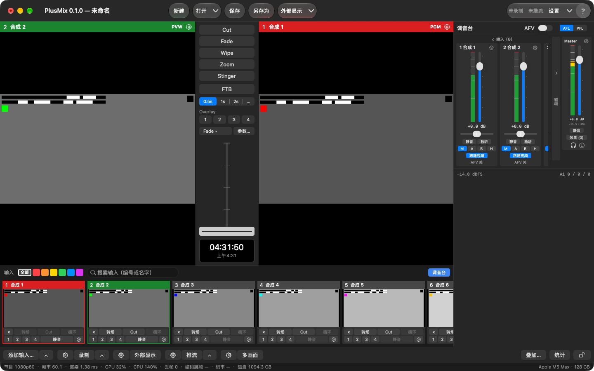

# 概念

导播台的用词只有一套（[设计方案 §1.1](../spec/导播台设计方案.md#11-统一用词)），界面、节目文件、API、本手册都用它。

| 词 | 意思 |
|---|---|
| **Input（输入）** | 编号的信号源：摄像头 / 采集卡、DeckLink、屏幕、视频文件、图片、NDI®、纯音频设备、合成测试源。编号从 1 起，0 保留给"黑场" |
| **Program / PGM** | 观众看到的画面（右边那个大监视器，红色标题条） |
| **Preview / PVW** | 下一个要切上去的画面（左边那个大监视器，绿色标题条） |
| **Transition（转场）** | PVW 变成 PGM 的方式：Cut、Fade、Wipe、Zoom、Stinger |
| **T-bar** | 手动控制转场进度的推杆；推到头提交并回弹 |
| **FTB** | 渐黑（Fade to Black）；开着时 PGM 输出黑场，声音跟着落到静音 |
| **Overlay 1–4（叠加通道）** | 叠在 PGM 上、可独立开关的四层：下三分之一字幕、画中画、台标 |
| **Bus（音频总线）** | Master、Bus A、Bus B、耳机（Headphones）四条 |
| **Output（输出）** | 录制、推流、NDI® 发送、外部显示、虚拟摄像头、多画面 |
| **Tally** | 每个输入"在 PGM / 在 PVW / 都不在"的状态：格子标题条、多画面边框、Stream Deck 按钮颜色、外部 tally 灯都用它 |
| **Show（节目文件）** | 一个 JSON 文件（`*.switcher.json`），保存输入、切换、音频、输出配置和窗口布局 |
| **Tick（拍）** | 节目时钟的一拍 = 一帧的时间；1080p60 下 30 拍 = 0.5 s |

## 主窗口

最小窗口 1100×720（含工具条那一行）。各区域：

| 区域 | 做什么 |
|---|---|
| **工具条** | 左："新建 / 打开▾ / 保存 / 另存为"，和"节目"菜单同一套动作（新建、打开同样先问，见[节目文件](#节目文件)）；"打开▾"= 打开上次退出时的节目 + 最近 10 个 + 清除列表。正中"外部显示▾"：主体 = 全部外部显示开 / 关，▾ = 每块屏送什么（同底栏 ⚙ 外部显示）。右：录制 / 推流状态（只显示，文字和底栏按钮同一份，没开写"未录制 / 未推流"）、"设置▾"（主体 = 打开设置窗、回到上次那一页；▾ = 所有设置页）、"?"（= 帮助菜单） |
| **监视器** | 左 PVW、右 PGM；标题条写编号和名字。标题条右端的齿轮 = 这一路的输入设置（PVW 的齿轮开 PVW 上那一路，PGM 的开 PGM 上那一路；黑场时灰着）。右键监视器 = "输入设置… / 全屏输出到 ▸"：每块屏一项，打勾 = 这块屏正在全屏显示这个监视器的画面，点没勾的 = 这块屏改成显示它，点有勾的 = 关掉这块屏（配置留着）。PGM 标题条上会列出开着的叠加（"通道号 · 输入名"）；FTB 开着时写"PGM · FTB"并慢闪。单击、双击监视器不做任何事 |
| **转场列** | 见下面的[转场](#转场) |
| **调音台** | 右侧，见[音频](#音频)；窗口 › 调音台，或输入条右端的"调音台"开关收起 / 拉出 |
| **输入条** | 每路输入一个格子：缩略图 + 两行按钮；头一行有分类标签、搜索框；末尾"＋ 添加输入"占位格，可以把视频 / 图片文件拖进来。详见 [输入 › 输入条与格子](输入.md#输入条与格子) |
| **底栏** | 两行：上面是按钮，下面是状态行。按钮见下表 |
| **状态行** | 窗口最底一行、全宽。左边每秒刷新：节目格式、帧率、渲染耗时、GPU / CPU、丢帧、编码跳帧、码率、磁盘剩余——这些数字和 API、stats.jsonl 里的是**同一份**（[测试标准 §7](../testing/测试标准.md#71-统计字段-statsjsonl)），不是界面自己另算的。右边平时是本机信息（"Apple M5 Max · 128 GB"），有提示时显示提示（4 s 后消失），有提醒时出现琥珀色的提醒条 |

点缩略图 = 选到 PVW；按住 Shift 点 = 直切 PGM。

### 底栏按钮

大多数按钮分成三段：**⚙ 打开这一类的设置，主体直接干活，▴ 弹一个朝上的快捷菜单**。没有的段不显示。

| 按钮 | ⚙ | 主体 | ▴ |
|---|---|---|---|
| 添加输入… | — | 添加输入面板，停在上次添加用的类型（⌘I 同一个入口） | 八种类型直达；"最近添加"（最多 5 个）点一下不弹面板、直接再加一路（编号取空号、名字自动取）；= 菜单"输入 › 按类型添加 ▸" |
| 录制 | 菜单：录制设置… / ISO 分路录制… | 都没在录 → 所有**参与录制**的路同一拍一起开始；有在录的 → 全部停止（先确认）。节目里还没有录制输出 → 先加一路默认的（录到 `~/Movies/PlusMix`）再开始 | 每个录制输出一行"名字 · 状态"（✓ = 在录），点在录的那一行 = 只停这一路（先确认），没开的路灰着（不能中途单独开始）；末尾"全部停止"；= 菜单"输出 › 录制 ▸" |
| 外部显示 | 菜单：每块屏一段单选（PGM / PVW / 多画面 / 输入 n；这块屏已经配过时第一行是"关闭"，关着的那一路标"（已关）"）、删除某一路 / 关闭全部外部显示、外部显示设置… / NDI® 发送设置…；= 菜单"输出 › 外部显示 ▸" | 有开着的 → 全部关；都关着 → 按原来的配置全部开；一路都没配 → 在第一块非主屏上全屏显示 PGM；没有第二块屏 → 弹 ⚙ 那个菜单 | — |
| 推流 | 设置 › 推流页 | 都没开 → 全部开始；有起不来的路 → 只重试那几路（正常的路不停、不问）；都在推 → 全部停止（先确认）。节目里还没有目的地 → 打开推流页，光标放在"添加目的地"的地址框 | 全部开始 / 全部停止；每个目的地一项（"名字 · 状态 · 码率"，点 = 没开的只开它、在推的只停它、起不来的只重试它）；推流设置… / 推流状态…；= 菜单"输出 › 推流 ▸" |
| 多画面 | 设置 › 多画面布局页 | 多画面独立窗口开 / 关（开着高亮） | — |
| 叠加…（右组） | — | 打开叠加设置窗，停在上次编辑的那一路（见[叠加通道](#叠加通道)） | — |
| 统计（右组） | — | 统计窗（见下） | — |
| 🔒（最右） | — | 界面锁开 / 关（见下） | — |

录制 / 推流按钮的字反映**最差的那一路**："● 录制中（3 路）"、"● 推流中 2/3"（在推的路数 / 目的地总数）；有路在重连或起不来时变成橙色"推流 · 1 路异常"（起不来的是深红）；
悬停提示逐路列"名字：状态"，起不来的写原因。推流首次连接写"连接中"，连上过之后断线才写"重连中（第 n 次）"。详见 [输出 › 推流](输出.md#2-推流)。

**停之前先确认**：点底栏的录制 / 推流主体、▴ 里停某一路、推流页的"全部停止"，都会先弹"确定停止录制（n 路）？"并逐路列出状态；回车不会落在"停止"上，Esc = 取消。
快捷键、MIDI、API 停止时一律不问。设置 › 常规 › 操作确认 可以关掉"停止前确认"（底栏、▴ 菜单、推流页的停止都跟着它）；新建 / 打开 / 换格式 / 退出时还在录、在推的那一问不能关。

### 提醒、统计窗、界面锁

- **提醒**：状态行右侧的琥珀色提醒条，几条用"·"连起来：引擎跑了 n 分钟还没在录也没在推（默认关，n 默认 5）、FTB 开着满 10 秒（同时 PGM 标题条慢闪）、
  Master 电平持续 30 秒低于 −50 dBFS（只在有一路带声音的输入送进 Master 且没静音时判）。设置 › 常规 › 提醒 里每条可以单独关，改了立刻生效。
- **统计窗**：底栏"统计"或 窗口 › 统计，只读。五节：输入（帧率 / 重复帧 / 丢帧 / 延迟）、渲染（渲染耗时 / 丢帧 / 抖动 / GPU / CPU / 内存）、
  输出（每个输出按编号对上名字、类型、来源、状态、帧数、编码跳帧、丢帧、码率、重连）、显示（监视器、多画面窗口、外部显示、虚拟摄像头）、音频（回调超时 / 欠载 / 不连续、Master 峰值、短期响度）。
  读的是和状态行、API 同一行统计。"重置"只在这个窗里从 0 算起，stats.jsonl、API、状态行照旧累计。
- **界面锁**：底栏最右的锁，或 窗口 › 锁定界面（锁着时打勾）。锁着时主窗口里的鼠标点击（含工具条、格子、T-bar、调音台、底栏）都不生效，点了状态行提示
  "界面已锁定：点底栏最右的锁解锁；快捷键照常"；**快捷键、MIDI、API、菜单栏照常**，设置窗、统计窗等独立窗口不锁。按钮锁着时写"已锁定"。
  **界面锁没有默认快捷键**（防止误按），只能点底栏的锁或用菜单。

### 菜单栏

| 菜单 | 有什么 |
|---|---|
| PlusMix | 关于 PlusMix、检查更新…、设置…（⌘,）、快捷键…、MIDI 映射…、所有设置页 ▸、隐藏、退出 |
| 节目 | 新建（⌘N）、打开…（⌘O）、打开最近 ▸、打开上次退出时的节目、保存（⌘S）、另存为…（⇧⌘S） |
| 输入 | 添加输入…（⌘I）、按类型添加 ▸、输入 N「名字」设置…（⇧⌘I，PVW 上那一路；PVW 是黑场时灰着）、搜索输入（⌘F） |
| 切换 | Cut、执行当前转场（类型 · 时长）、"T-bar 和回车用（只选，不执行）"的五种类型、FTB、Overlay ▸ 1–4 与"叠加设置…"。右边灰字写的是当前快捷键表里对应的键（只显示，按键由快捷键表处理） |
| 输出 | 录制 ▸、推流 ▸、外部显示 ▸（同底栏的菜单）、打开 / 关闭全部外部显示、多画面窗口、虚拟摄像头 ▸，下面是输出各设置页（输出总览…、录制设置…、ISO 分路录制…、推流设置…、外部显示设置…、NDI® 发送设置…、虚拟摄像头…、多画面布局…） |
| 窗口 | 最小化、缩放、调音台、多画面窗口、输入缩略图 ▸（小 / 中 / 大）、统计、锁定界面 |
| 帮助 | PlusMix 使用手册（就是本手册，随 App 一起装的网页版）、快捷键一览（按当前快捷键表生成一页，用浏览器打开）、导出诊断包…、打开诊断文件夹 |

设置窗（⌘,）的各页见 [设置](设置.md)。

## 切换是怎么发生的

所有操作——按钮、快捷键、MIDI、API、脚本——都只是**发一条命令**给状态机；状态机把命令应用到当前状态、发布一个新快照；渲染线程每拍读一次最新快照。
所以：

- 切换永远落在拍点边界上，Cut 没有中间帧（[测试标准](../testing/测试标准.md) V6 硬性要求）。
- 界面和 API 看到的永远是同一个状态；两个人同时操作不会互相覆盖，命令按到达顺序排队。
- 被状态机按规则忽略的命令不算错，回执里 `applied = false`：转场进行中再按 Fade、**转场进行中改 PVW / PGM**（选 PVW、直切 PGM 都会被拒，T-bar 推到一半也算转场进行中）、FTB 已经是目标状态。
  格子上的"转场 / Cut"按钮在转场进行中是灰的，点缩略图、Shift 点也不生效，状态行提示"转场进行中：等这次转场做完再改 PVW / PGM"。

命令的完整列表在 [API 参考](../api.md)；快捷键表里能绑的也是它们。

## 转场

| 类型 | 做什么 | 参数 |
|---|---|---|
| Cut | PGM / PVW 原子对调 | 无 |
| Fade | 交叉淡变 | 时长 |
| Wipe | 新画面按方向擦入 | 方向（左 → 右 / 右 → 左 / 上 → 下 / 下 → 上 / 对角）、软边宽（0–1） |
| Zoom | 新画面从中心放大到满幅 | 时长 |
| Stinger | 一张带 alpha 的图 / 文件叠在最上层，在第 n 拍换底 | 作 stinger 的输入编号、换底拍 |

转场列从上到下：

- **Cut**：立刻把 PVW 切上 PGM。转场进行中按 Cut = 立即完成这次转场。
- **Fade / Wipe / Zoom / Stinger**：点了就做——选这个类型并立刻执行一次自动转场（时长用下面选中的时长），T-bar 和回车之后也改用这个类型。
- **FTB**：淡出到黑 / 从黑淡回。
- **时长**：0.5s / 1s / 2s / …（"…" = 自定义，0.1–10 秒；时长不是预设值时这一格写实际值）。五种转场共用这一个时长。
- **Overlay 1–4**：叠加通道开关（见[叠加通道](#叠加通道)）；通道还没指定输入时，按下用 PVW 上那一路打开。右键 = 叠加设置…
- **"Fade ▾"**：T-bar 和回车用哪种转场——在这里选**只改设置、不执行**，当前那种打勾，转场进行中不能改。类型变了这一行会高亮一下。
- **参数…**：Wipe 方向 / 软边、Stinger 输入 / 换底拍。转场进行中（含 T-bar 推到一半）改的参数等这次转场结束再生效。
- **T-bar**：用"Fade ▾"选的类型。拖到 25% 就是 25% 的混合 / 擦边位置，推到头对调并回到 0，中途松手停在原位。
- **时钟**：本机时间。

每个按钮的悬停提示写着当前快捷键表里对应的键（改了表跟着变）。菜单"切换"里的五种类型和"Fade ▾"一样是**只选不执行**，"执行当前转场"才执行。

FTB 有自己的时长（默认与转场相同，都是 30 拍），开着时 tally 不变。这一版界面上改不了 FTB 时长，只能改节目文件（`ftb.durationTicks`）或用 API 的 `loadShow`。

## 叠加通道

每个通道一路输入 + 一个位置尺寸（0–1 的比例矩形）+ 一种进出动画（切入 / 淡入 / 滑入 / 缩放 + 时长）+ 可选的边框（画中画用）和锚点（缩放动画绕它缩）。

开关叠加：转场列的 Overlay 1–4、格子上的 1–4 小按钮（点 = 把这一路放到这个通道并打开；它已经开在这个通道上时 = 关）、菜单 切换 › Overlay ▸、快捷键 ⌃1–⌃4。

**叠加设置窗**（独立窗口，开着也不挡主窗口，照样可以点格子、按快捷键）的入口：底栏"叠加…"（停在上次编辑的那一路）、转场列 Overlay k 或格子上 k 号小按钮的右键"叠加设置…"（直接到第 k 路）、菜单 切换 › Overlay ▸ › 叠加设置…。

| 一节 | 内容 |
|---|---|
| 顶部 | Overlay 1–4 分段，只显示当前这一路；每一项改了立刻生效 |
| 来源 | 输入、显示（开关）、PVW 预览 |
| 整幅 / 画中画 | 二选一。整幅 = 盖满画面（位置、锚点、边框几行收起，设置留着）；画中画 = 位置预设（下三分之一、右下 1/4、左下、左上、右上、自定义）+ X / Y / 宽 / 高、边框（颜色、宽度）、锚点。从整幅切到画中画时先放在右下 1/4 |
| 进出动画 | 切入 / 淡入 / 滑入（从哪条边滑入）/ 缩放；时长按秒（0.5 / 1 / 2 秒快捷值，悬停写"= n 拍"） |

- 新建的节目四个通道默认淡入 0.5 秒（只是 App 新建节目时的默认值；用 API / 无界面引擎建的节目默认切入）。
- 图片 / 视频带 alpha 的部分透出 PGM：整幅 1920×1080 的 PNG 配"整幅"，就是最省事的字幕做法（[示例节目](../../Samples/README.md)里的字幕就是这样）。
- 通道开着（或退出动画还没走完）时它用的那路输入算"在 PGM"，tally 亮红。
- 默认 PVW 不画叠加；某通道勾"PVW 预览"后它也出现在 PVW 上，设置 › 常规 › PVW 预览全部叠加 可以全开。
- 四个通道从 1 到 4 依次叠，4 在最上。

## 音频

- **每路输入**：增益（−96…+24 dB）、静音、独听、声像、音频延迟补偿（0–500 ms，只推迟声音，修采集卡 / 摄像头自己的音画不同步）、送哪几条总线、是否跟随视频。
  这些在调音台这一路的条子上和 输入设置 › 音频 里都能改（两边是同一份）。
- **四条总线**各有增益 / 静音 / 效果链。Master 进录制 / 推流 / NDI®；Bus A / B 是返送之类的第二路混音；耳机是监听总线（独听 / PFL / AFL 都在它上面）。
  每条总线送到输出设备的哪两个声道在 设置 › 音频设备 里选（要多声道设备；见[设置 › 音频设备](设置.md#音频设备)）。
- **总线效果链已经作用到声音**：参量均衡（一格最多 16 段，界面给 3 段）、压缩、峰值限制器，按链的顺序处理，关掉的格旁路（参数留着）；每条总线最多 3 格。
  开了压缩 / 限制器，这条总线会多 5–35 ms 处理延迟——**录制 / 推流 / NDI® 的音画对齐已经补上**，扬声器 / 耳机里的实时监听会晚这么多。
  压缩器没有固定比例：它把超过阈值的部分压到"阈值 + 压缩量"以内；限幅器的天花板固定 0 dBFS，起音就是前瞻（也就是这条总线多出来的延迟）。
- **每路输入的效果链**这一版只能编辑、**还没有作用到声音**（输入设置 › 音频效果 与音频设置窗里写着"效果尚未作用到声音（本版本）"）。
- **AFV（音频跟随视频）**：调音台头部的总开关开着时，"跟随视频"开着的输入只有在 PGM 上才出声，转场时交叉淡变（和画面同一拍开始、同样长）。
  主持人话筒、调音台送来的总线这类"一直要出声"的路，把那一路的"跟随视频"关掉即可（调音台条子上，或 输入设置 › 音频 › 跟随视频（AFV））。
- **耳机监听**：AFL（推子后）/ PFL（推子前）；监听点可选对齐延迟线之前（低延迟）或之后（与画面对齐），在 设置 › 节目音频。

### 调音台

- 头部：AFV 总开关、AFL / PFL。左边是输入组（横向滚动），中间 Bus A / B / 耳机一组，最右是常驻的 Master 条；输入组和总线组都能收成一条竖条（默认输入展开、总线收起）。
- 每条：名字和齿轮（= 这一条的音频设置窗）、推子和电平表、静音 / 独听、送 M / A / B / H、跟随视频；Master 条下面是短期响度（LUFS）、"效果 (n)"（直接打开均衡页）、
  耳机图标（监听菜单）、"i"（响度详情：瞬时 / 短期 / 积分 / 响度范围 LRA / 真峰值，每秒更新，积分从引擎启动算起，这一版不能复位）。
- 监听菜单：这一版耳机里只能听耳机总线；"听 Master / Bus A / Bus B"列在那里但灰着（要音频引擎支持）。
- 表：调音台每条画峰值与 RMS，Master 条另写短期响度；真峰值、瞬时 / 积分响度、LRA 在响度详情、API 和 stats.jsonl 里。录制与推流的响度按这套表。

### 音频设置窗

调音台每条上的齿轮打开"音频设置 — Master / 输入 n"（每条一个窗，再点同一个齿轮 = 把它叫到前面）。左边一列是这一条推子后的电平表，右边分页：

| 页 | 内容 |
|---|---|
| 常规 | 格式（48 kHz · 立体声）、推子读数、静音；输入的这一页另有"输入设置…（增益 / 声像 / 延迟 / 送出）"。这一版没有前级增益和自动增益 |
| 均衡 | 启用 + 最多 3 段（中心频率、增益、Q），复位 |
| 压缩 | 启用 + 阈值、压缩量、输出增益；起音 / 释放 / 扩展比在"高级"里；复位 |
| 限幅（只有总线） | 启用 + 预增益、起音、衰减；复位。页上写着这一条会晚多少毫秒 |

"启用"关掉 = 旁路，参数留着；"复位"只把参数改回默认，开关不动。音频设置窗开着时按快捷键照样切画面。

## 节目文件

菜单"节目"：新建 / 打开… / 打开最近 / 打开上次退出时的节目 / 保存 / 另存为…（工具条左边四个按钮是同一套动作）。
文件是可读的 JSON，字段与 API 的 `state` 一样（[CONTRACTS.md §2.8](../CONTRACTS.md)），可以用脚本生成（[示例](../../Samples/tools/make-shows.py)）。

- 输入的**运行状态**（有没有信号）和输出的**运行数字**（帧数、码率）不在文件里，文件只存配置。
- 打开文件时录制 / 推流一律是停着的，只有你按按钮、快捷键或 API 才起。
- **有没保存的改动**时窗口关闭按钮上有个点。算改动的是节目内容：输入、输出及其设置、转场类型 / 时长 / 参数、叠加的位置和动画、音频设置（推子也算）、节目格式。
  现场操作不算：选了哪路进 PVW / PGM、转场进度、FTB 开没开、叠加开没开、录制 / 推流在不在跑、窗口摆放。
- **新建、打开、打开最近、在 Finder 里双击节目文件、退出**（⌘Q，或关主窗口——关主窗口 = 退出）：录制 / 推流在跑时先问"新建节目会停止 1 路录制、1 路推流"；
  有没保存的改动时再问"要保存对'名字'的改动吗？"（保存 / 不保存 / 取消；没存过的节目是"保存…"）。任何一步取消都什么都不动。
- 退出时**不会悄悄改写**你打开的节目文件："不保存"= 文件一个字节都不变。当前状态照样存一份到 `~/Library/Application Support/PlusMix/LastSession.switcher.json`（崩溃恢复用）。
- 下次启动：上次打开的是文件 → 打开那个文件（磁盘上的样子）；上次是没存过的新节目 → 从 LastSession 恢复（算未保存）。
  想找回退出时没保存的那些改动：节目 › 打开上次退出时的节目（它不是一个文件，保存时会让你另存）。
- 节目格式、节目音频要换引擎才生效（设置里点"应用并重起引擎"）；录制 / 推流在跑时先问，换完设置窗不关。
- 快捷键表和 MIDI 映射**不在**节目文件里，在同一个目录下的 `hotkeys.json` / `midi.json`（[快捷键](快捷键.md)）；本机设置（设置窗"本机"那一组）也不在节目文件里。
